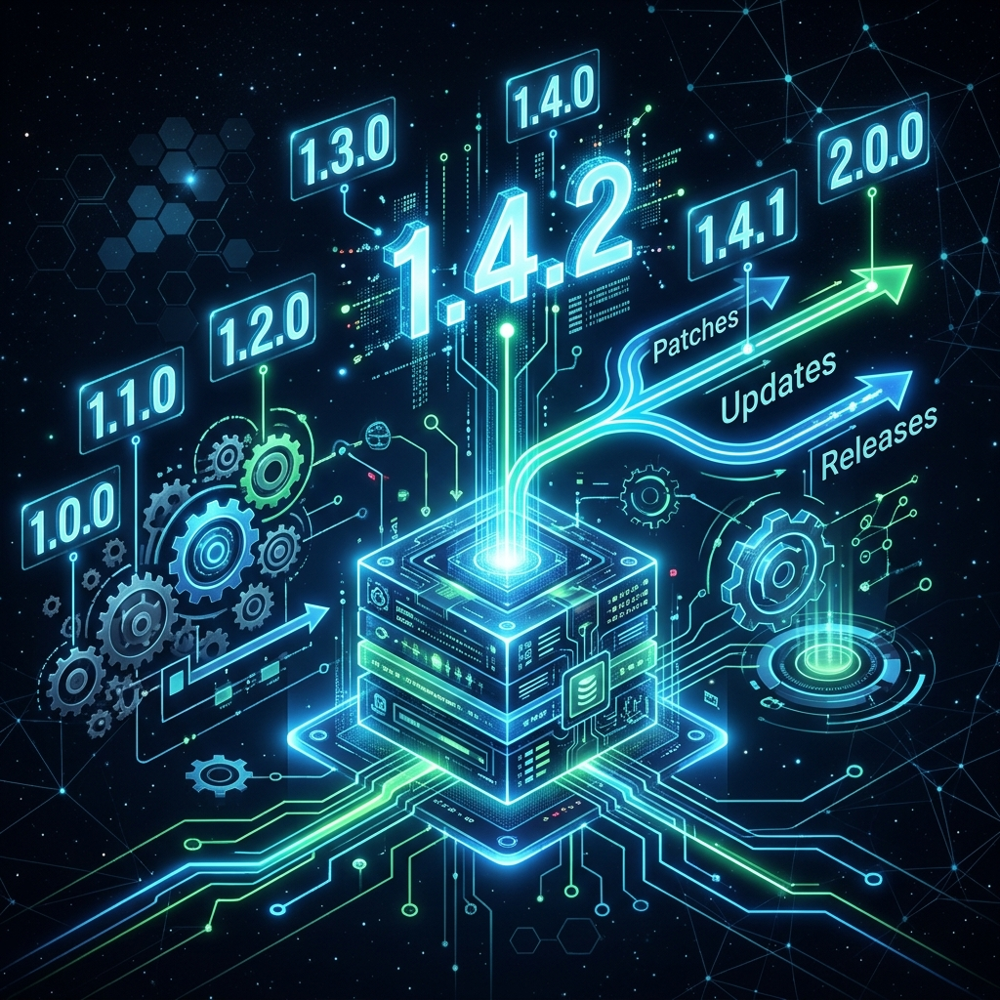
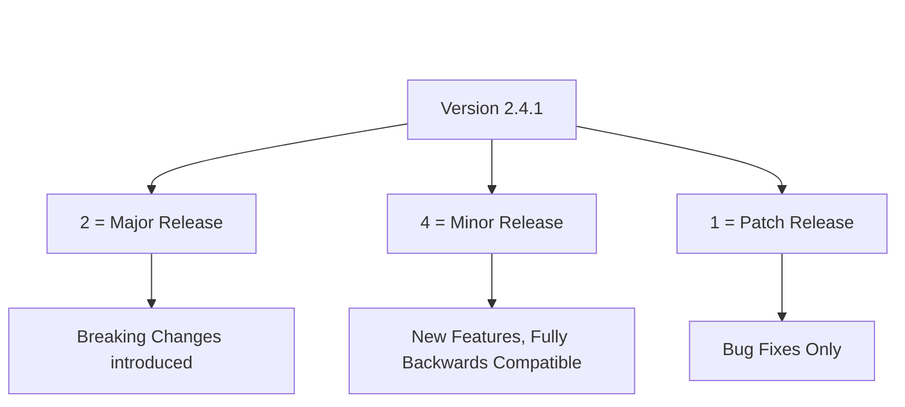
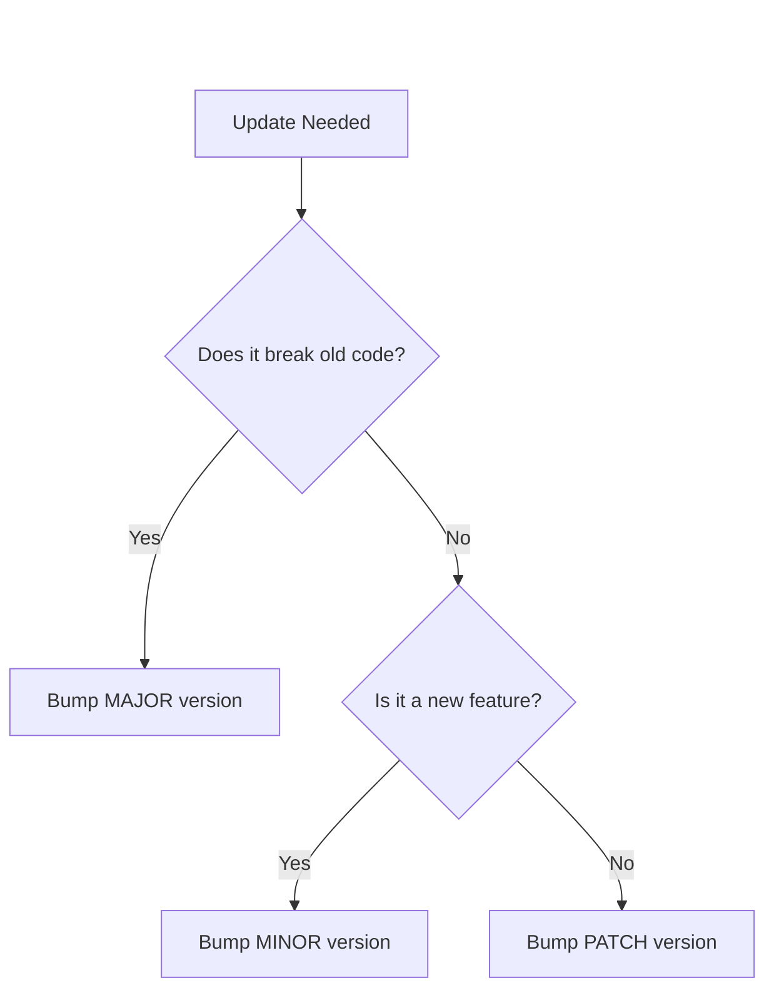
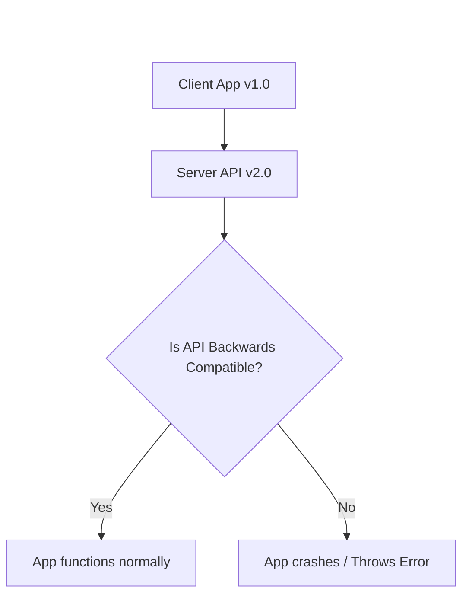
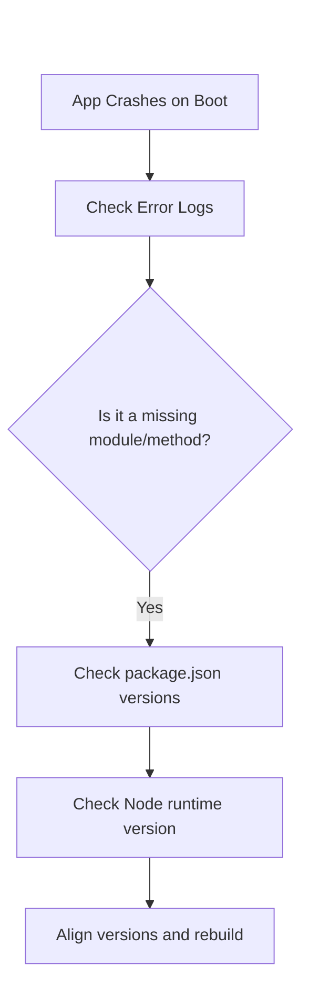
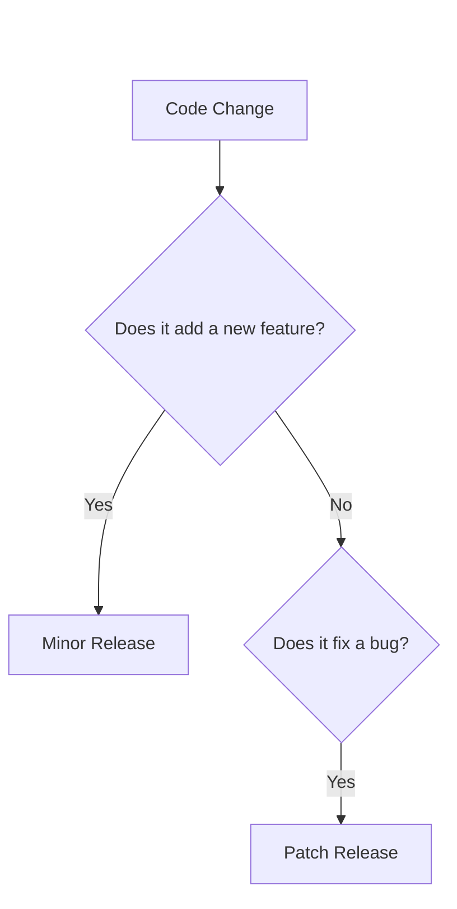
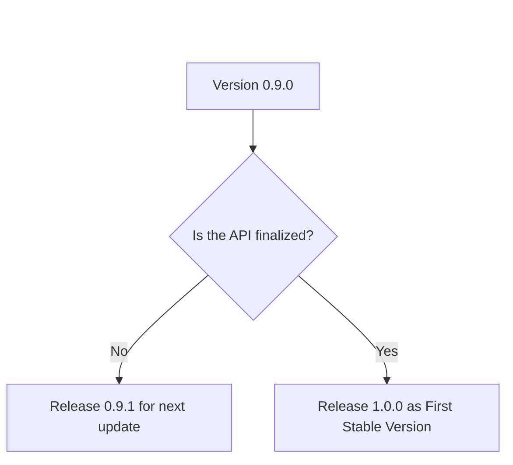

# 07 - Software Versions



## 1. Jargon Translation

- **Version Number**:
  - *Official Definition*: A unique identifier assigned to a specific state or release of a software product.
  - *Under the Hood*: A nametag that tells you exactly how old the software is, what new features it has, and what bugs were recently squashed.
- **Semantic Versioning (SemVer)**:
  - *Official Definition*: A universal standard for assigning version numbers, typically formatted as `MAJOR.MINOR.PATCH` (e.g., `1.4.2`).
  - *Under the Hood*: A strict set of rules that developers follow so computers (and other developers) know exactly how risky an update is before they install it.
- **Patch**:
  - *Official Definition*: A software update comprised of code inserted into the executable of a program to fix a bug or security vulnerability.
  - *Under the Hood*: A digital band-aid applied to fix something that was broken, without adding any shiny new features.
- **Backwards Compatibility**:
  - *Official Definition*: A property of a system that allows for interoperability with an older legacy system.
  - *Under the Hood*: Upgrading your PlayStation 5 but still being able to put a PlayStation 4 disc in it and play the game perfectly.

## 2. Topics Introduced in Lecture Transcript

1. The Purpose of Software Versioning
2. Version Number Formats and Conventions
3. The Semantic Numbering System (SemVer)
4. Identifying Your Current Software Version
5. Backwards Compatibility and Troubleshooting

## 3. Exhaustive Deep Dive & Structured Notes

### The Purpose of Software Versioning
Without versioning, the software development ecosystem would collapse into chaos. Versioning provides a historical ledger for code.
- **For Users**: It determines if they have the latest features or are vulnerable to security bugs.
- **For Developers**: It tracks what code is running in production, helping them pinpoint exactly when a specific bug was introduced.

### Version Number Formats
Not all version numbers look the same. They vary in length (often 2, 3, or 4 sets of numbers divided by a period).
- **The "1.0" Milestone**: The first official, stable release of an application usually receives a `1.0` version number to indicate it is ready for production.
- **Beta / Pre-Release Versions**: If a software is still in testing and is highly unstable, it will have a version number starting with `0` (e.g., `0.9` or `0.1.5`).
- **Date-Based Versioning**: Some software uses the release date rather than feature counts. For example, Ubuntu Linux `18.04.2` means it was originally released in the year **2018**, in the **04**th month (April), and this is the **.2** (second) update to that specific release.

### The Semantic Numbering System (SemVer)
SemVer is the undisputed king of backend and web development versioning. It typically relies on a 3-part or 4-part system.
- **Part 1 (Major)**: Indicates massive, sweeping changes. A major version bump means the software is likely **not** backwards compatible. If you upgrade from version 1 to version 2, your old code might break.
- **Part 2 (Minor)**: Indicates new features were added, but they are fully backwards compatible. Nothing old will break.
- **Part 3 (Patch)**: Indicates a bug fix or security patch. No new features, just repairing existing code.
- **Part 4 (Build)**: (Optional) Indicates a highly specific internal build number or date, representing negligible, non-functional changes.



In practice, developers rarely type exact version numbers — `package.json` uses prefix symbols to tell npm exactly how much auto-updating is allowed:

| Prefix | Example | Auto-Updates | Risk Level |
| :--- | :--- | :--- | :--- |
| **Caret `^`** | `^4.18.2` | Minor & Patch, never Major | Low-Medium |
| **Tilde `~`** | `~6.0.1` | Patch only, never Minor/Major | Low |
| **None (Exact)** | `4.17.21` | Nothing — fully locked | None |
| **Wildcard `*`** | `*` | Everything, including Major | Very High |

### Backwards Compatibility and Troubleshooting
The most common problem in software engineering is a **lack of compatibility** between different versions of software.
- **The Problem**: You write code using a brand-new feature from Database Version `3.0`. You deploy your code to a server that is only running Database Version `2.5`. The server crashes because it doesn't understand your code.
- **The Solution**: Checking software versions is the absolute first step in troubleshooting. Often, simply updating a legacy system to a newer version resolves mysterious errors.
- **The Gold Standard**: Good software strives to be backwards compatible, meaning a newer version of the software can seamlessly read and execute files created by an older version.

## 4. Step-by-Step Breakdown: Troubleshooting a Version Mismatch

1. **Identify the Error**: Your backend application throws a mysterious `SyntaxError` or `Method Not Found` error when calling an external library.
2. **Check Your Code's Expectation**: Look at your own documentation (or `package.json`) to see what version of the library your code expects to be interacting with.
3. **Identify the Running Version**: Use the CLI or the "About/Help" menu to check the *actual* version of the software running on the server.
4. **Compare**: If the server is running version `1.5.0` but your code requires a feature introduced in `1.8.0`, you have found the mismatch.
5. **Resolve**: Update the server software to `1.8.0+` to restore compatibility.

## 5. Concrete Examples

In the Node.js ecosystem, Semantic Versioning is the law. Imagine you install the popular `express` framework, and your version is `4.18.2`.
- `4` (Major): The massive rewrite of Express. If they upgrade to Express `5.0.0`, your current server code might completely break and require rewriting.
- `18` (Minor): The Express team added a new routing feature, but all your old routes still work perfectly.
- `2` (Patch): Someone found a security vulnerability in how Express handles headers. They patched it without changing how any of the code functions.

## 6. Code Blocks

```javascript
// The package.json file uses SemVer prefixes to control auto-updates

{
  "dependencies": {
    "express": "^4.18.2",  // The Caret (^) means: Auto-update MINOR and PATCH versions, but NEVER MAJOR.
    "mongoose": "~6.0.1",  // The Tilde (~) means: Auto-update PATCH versions only. NEVER MINOR or MAJOR.
    "lodash": "4.17.21"    // No prefix means: NEVER auto-update anything. Lock it exactly to this version.
  }
}

// WHAT HAPPENS IF... a developer carelessly uses the "*" wildcard?
// "express": "*"
// If a developer does this, the next time the app is installed, it will automatically pull the newest version.
// If Express releases version 5.0.0 (a Major breaking change), the app will pull it, completely break 
// production, and the developer will spend hours trying to figure out why code that worked yesterday is crashing today.
```

## 7. Related Concepts

1. **package-lock.json**: A file in Node.js that freezes the exact version of every single dependency down to the patch number, ensuring absolute consistency across all developer machines.
2. **Deprecation**: When a developer releases a new major version, they will mark the old version as "deprecated", warning users that it will no longer receive security patches and they must upgrade.
3. **Breaking Change**: Any update to software (a Major version bump) that alters the way it functions, causing older integrated systems to fail.
4. **Git Tags**: Developers use Git to "tag" specific commits in their repository with version numbers (e.g., `v1.4.2`), freezing that exact snapshot of code in time.
5. **Dependency Hell**: A nightmare scenario where App A requires Library X (Version 1.0), and App B requires Library X (Version 2.0), making it impossible to run both apps on the same server.

## 8. Key Takeaways (Flashcard-Ready)

- **Q: What is Semantic Versioning (SemVer)?**
  - A: A 3-part numbering system (Major.Minor.Patch) used to indicate the scale and risk of software updates.
- **Q: What does a change in the first number (Major) of a SemVer indicate?**
  - A: It indicates massive, breaking changes that are likely not backwards compatible.
- **Q: What does a change in the third number (Patch) of a SemVer indicate?**
  - A: It indicates minor bug fixes or security updates with no new features.
- **Q: Why might a version number start with a zero (e.g., 0.9.5)?**
  - A: It indicates the software is still in Beta or pre-release testing and is not guaranteed to be stable.
- **Q: What does it mean if software is backwards compatible?**
  - A: It means the new version of the software can still flawlessly execute files, code, or systems designed for an older version.

## 9. 💡 The Secret Engineering Trick

**The Danger of Careless SemVer Carets (`^`)**
By default, when you install a package in Node.js via `npm install`, it adds a caret (`^`) in front of the version number in your `package.json` (e.g., `"^1.4.2"`). This tells NPM it is safe to automatically upgrade the minor version to `1.5.0` or `1.9.0`. While SemVer *promises* that Minor versions won't break your code, developers are humans and make mistakes. Secretly breaking changes accidentally slip into Minor updates all the time. Senior engineers often rely strictly on `package-lock.json` or remove the caret entirely to ensure their production builds are 100% deterministic and immune to accidental third-party update explosions.

## 10. Interview Questions Section

### 1. What is Semantic Versioning (SemVer)?

* **Simple Definition**: It's a three-part numbering code that tells you exactly how dangerous it is to hit the "Update" button on your software.
* **Official Definition**: Semantic Versioning is a formal convention for specifying compatibility using a three-part number format: MAJOR.MINOR.PATCH.
* **Primary Responsibilities / Core Details**:
  * MAJOR version changes indicate incompatible API breaking changes.
  * MINOR version changes add functionality in a backwards-compatible manner.
  * PATCH version changes make backwards-compatible bug fixes.
  * Standardizes communication between developers regarding code stability.
  * Solves the issue of "Dependency Hell" by making compatibility predictable.
* **Real-World Example**: You are using a weather API at version `2.4.1`. The developers upgrade it to `2.5.0`. Because the Major number (`2`) didn't change, you know your app won't break if you update.
* **Best Coding/Development Practices**:
  * **Never mutate a released version**: Once a version is released (e.g., `1.0.1`), the code behind that exact version number must never be modified. Any change requires a new version number (`1.0.2`).
    * *Example Code (Git Tagging for Immutable Releases)*:
      ```bash
      # Tagging a commit permanently prevents the code for v1.0.1 from ever changing
      git tag -a v1.0.1 -m "Release version 1.0.1"
      git push origin v1.0.1
      ```
  * **Start at 0.1.0 for initial development**: Do not use `1.0.0` until the public API is completely stable.
    * *Example Code (Beta Versioning in package.json)*:
      ```json
      {
        "name": "my-beta-app",
        "version": "0.1.0"
      }
      ```
* **Visual Aid (Mermaid Flowchart)**:

* **Core Focus Areas**: Predictability | Compatibility | Dependency Management

### 2. What is backwards compatibility?

* **Simple Definition**: Upgrading your operating system, but all your old apps still work perfectly without needing to be rewritten.
* **Official Definition**: Backwards compatibility is a property of a system, product, or technology that allows for interoperability with an older legacy system, or with input designed for such a system.
* **Primary Responsibilities / Core Details**:
  * Ensures users are not punished for upgrading.
  * Reduces the cost of maintenance for enterprise systems.
  * Often requires maintaining legacy code paths inside modern applications.
  * Dictates that APIs must not remove fields, only add them.
* **Real-World Example**: A web browser like Google Chrome updating to version 120, but still perfectly rendering a simple HTML file written in the year 1999.
* **Best Coding/Development Practices**:
  * **Additive API Changes**: When updating an API, you can add new JSON keys, but you must never delete or rename old keys.
    * *Example Code (Additive Backwards Compatibility)*:
      ```javascript
      // Version 1.0 Response
      res.json({ name: "John Doe" });
      
      // Version 1.1 Response (Backwards Compatible - old apps can still read 'name')
      res.json({ name: "John Doe", email: "john@example.com" });
      ```
  * **Deprecation Warnings**: If you must break compatibility in the future, issue warnings in the current version long before you actually remove the feature.
    * *Example Code (Issuing a Deprecation Warning)*:
      ```javascript
      function oldLegacyMethod() {
          console.warn("DEPRECATED: oldLegacyMethod will be removed in version 2.0. Use newMethod instead.");
          // execute legacy logic
      }
      ```
* **Visual Aid (Mermaid Flowchart)**:

* **Core Focus Areas**: Legacy Support | Interoperability | Seamless Upgrades

### 3. How do you troubleshoot a compatibility issue in a Node.js project?

* **Simple Definition**: Finding out if the Lego bricks you bought today are fundamentally designed to snap into the Lego baseplate you bought 5 years ago.
* **Official Definition**: The process of identifying, isolating, and resolving errors caused by mismatched dependencies, differing runtime environments, or deprecated library functions.
* **Primary Responsibilities / Core Details**:
  * Auditing `package.json` for version mismatches.
  * Checking the Node.js runtime environment version (`node -v`).
  * Reading changelogs to identify breaking changes in Major updates.
  * Downgrading or upgrading specific packages to align with requirements.
* **Real-World Example**: You pull a React project from GitHub that hasn't been updated in 4 years. When you run `npm start`, it crashes with 50 errors. You check the required Node version in the documentation, realize you are running Node v20 instead of Node v14, downgrade your Node version, and it boots up perfectly.
* **Best Coding/Development Practices**:
  * **Specify Engine Requirements**: Explicitly tell the server which version of Node.js is required to run your code to prevent mismatch errors on deployment.
    * *Example Code (Enforcing Node Version)*:
      ```json
      {
        "engines": {
          "node": ">=18.0.0"
        }
      }
      ```
  * **Use NPM Audit**: Automatically scan your dependency tree to find deprecated or vulnerable package versions that might cause issues.
    * *Example Code (Running a Security/Version Audit)*:
      ```bash
      # Identifies outdated or conflicting packages
      npm audit
      # Automatically attempts to fix compatible version issues
      npm audit fix
      ```
* **Visual Aid (Mermaid Flowchart)**:

* **Core Focus Areas**: Environment Auditing | Dependency Resolution | Log Analysis

### 4. What is the difference between a minor update and a patch?

* **Simple Definition**: A minor update adds a new sunroof to your car. A patch fixes the flat tire.
* **Official Definition**: In Semantic Versioning, a minor update introduces new, backwards-compatible functionality to the public API. A patch update strictly contains backwards-compatible bug fixes that resolve incorrect behavior.
* **Primary Responsibilities / Core Details**:
  * Minor: Increases the second digit (`1.1.0` -> `1.2.0`).
  * Minor: Implies active development and added value for the user.
  * Patch: Increases the third digit (`1.1.1` -> `1.1.2`).
  * Patch: Implies maintenance, security fixes, and stabilization without adding features.
* **Real-World Example**: A video game receives a Patch to stop a glitch where players fall through the floor. Two months later, it receives a Minor update that adds a brand-new multiplayer map. 
* **Best Coding/Development Practices**:
  * **Strict Separation of Concerns in Commits**: Never mix bug fixes and new features into the same release cycle if you want to adhere strictly to SemVer.
    * *Example Code (Branching Strategy)*:
      ```bash
      # Create a specific branch just for the patch
      git checkout -b hotfix/fix-login-crash
      
      # Create a separate branch for the minor feature
      git checkout -b feature/add-oauth-support
      ```
  * **Automate Version Bumping**: Use tools to automatically bump the correct number based on your commit history.
    * *Example Code (NPM Versioning)*:
      ```bash
      # Automatically increases the patch number in package.json
      npm version patch
      
      # Automatically increases the minor number in package.json
      npm version minor
      ```
* **Visual Aid (Mermaid Flowchart)**:

* **Core Focus Areas**: Feature Addition vs Stabilization | Precision Versioning | Release Management

### 5. Why might a version number start with a zero (e.g., 0.9.1)?

* **Simple Definition**: The software is currently a rough draft. Use it at your own risk.
* **Official Definition**: According to SemVer, major version zero (`0.y.z`) is for initial development. Anything MAY change at any time. The public API should not be considered stable.
* **Primary Responsibilities / Core Details**:
  * Signifies the software is in Alpha or Beta testing.
  * Warns developers not to use this in a mission-critical production environment.
  * Allows the creators to break the API constantly without bumping the Major version number to 2, 3, or 4 within the first week.
  * The release of `1.0.0` signifies the end of this unstable phase.
* **Real-World Example**: An open-source database is released on GitHub as version `0.8.0`. A bank decides to use it. The next week, the database updates to `0.9.0`, the developers completely change how tables are queried, and the bank's entire system crashes because they relied on unstable software.
* **Best Coding/Development Practices**:
  * **Lock Versions for Beta Software**: If you absolutely must use `0.x.x` software, you must lock the version to the exact patch so it cannot auto-update and break your system.
    * *Example Code (Locking a Beta Version)*:
      ```json
      {
        "dependencies": {
           // Notice there is NO caret (^) or tilde (~). It is locked exactly to 0.9.1.
          "unstable-beta-library": "0.9.1"
        }
      }
      ```
  * **Clear Documentation Warnings**: If you are the one writing the `0.x.x` software, put a massive warning in your Readme file.
    * *Example Code (Markdown Warning)*:
      ```markdown
      > [!WARNING]
      > This package is currently in v0.x.x. The API is highly unstable and subject to breaking changes without notice. Do not use in production!
      ```
* **Visual Aid (Mermaid Flowchart)**:

* **Core Focus Areas**: Pre-Release Instability | API Fluidity | Risk Management
