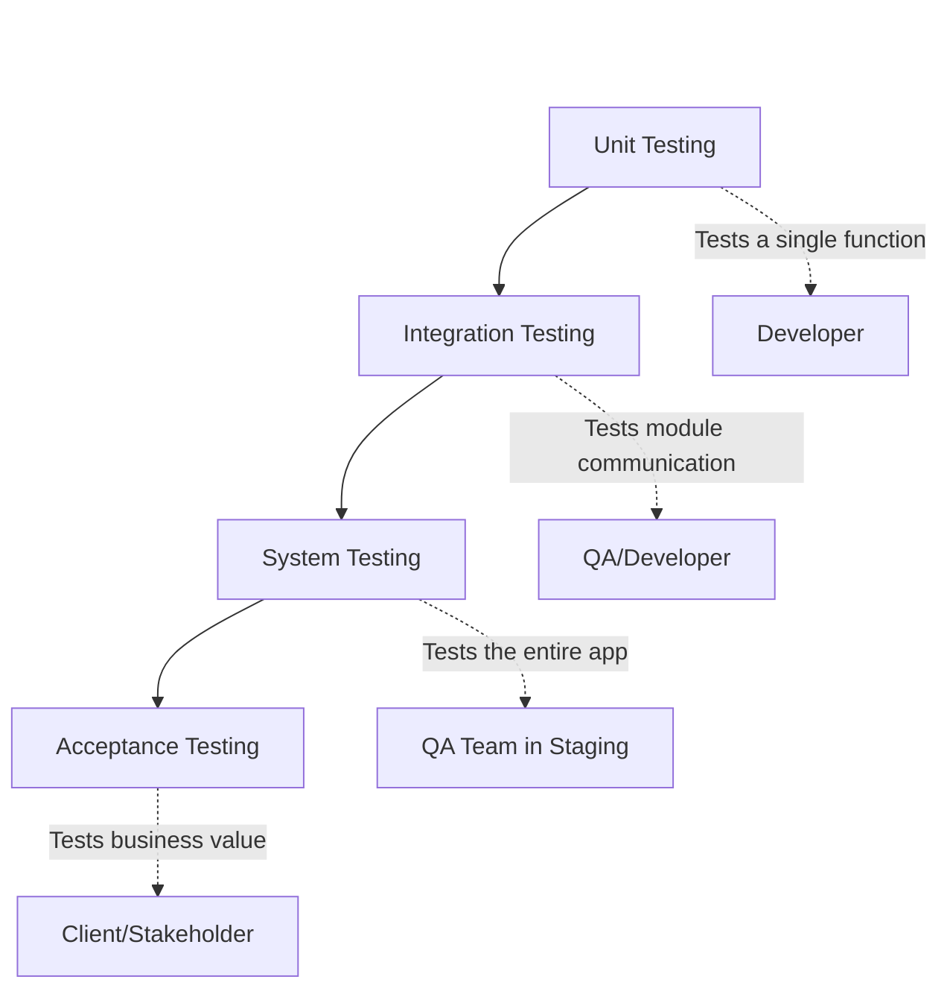
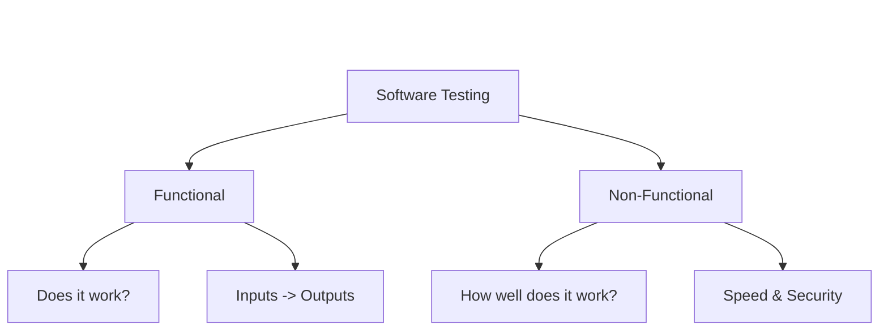
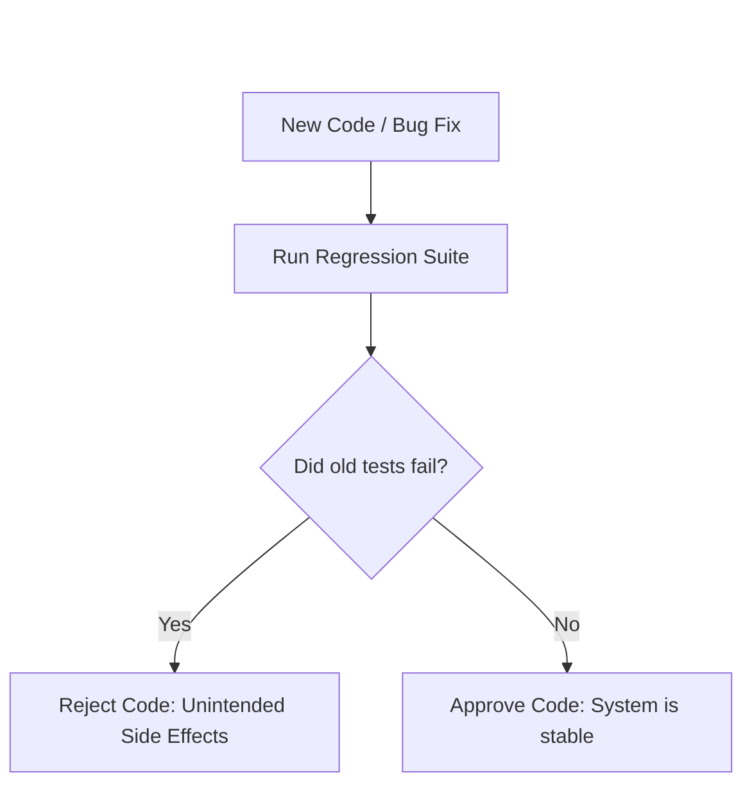
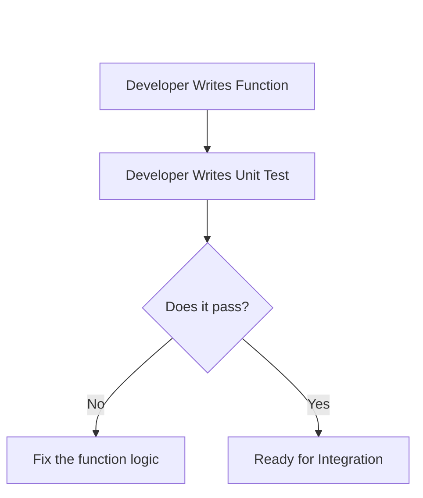
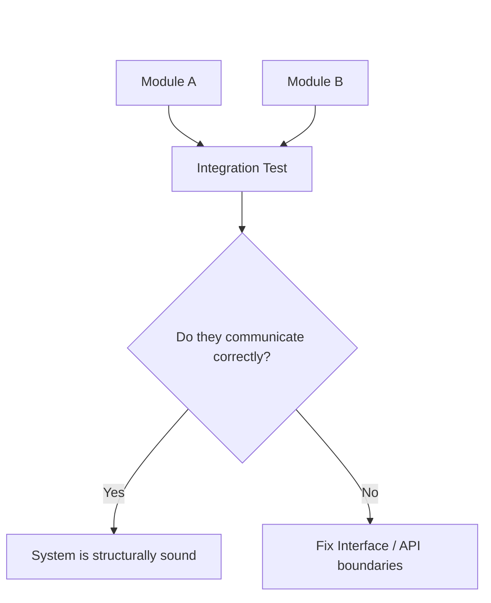
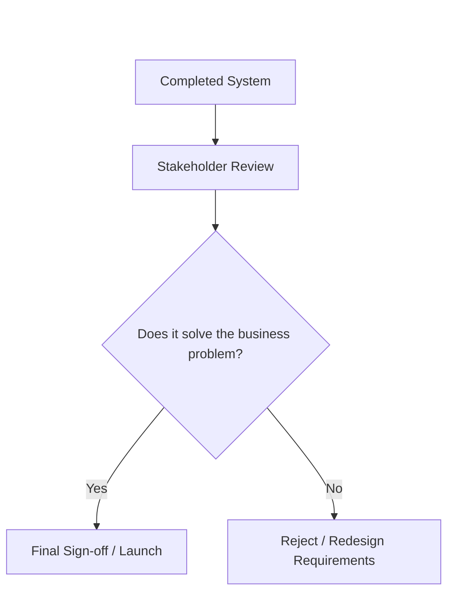

# 08 - Software Testing


## 1. Jargon Translation

- **Test Case**:
  - *Official Definition*: A set of conditions or variables under which a tester will determine whether a system under test satisfies requirements or works correctly.
  - *Under the Hood*: A strict recipe of steps to follow (e.g., "Click button A, type 'Hello'") to prove the software doesn't explode.
- **SUT (System Under Test)**:
  - *Official Definition*: A term that denotes a system that is being tested for correct operation.
  - *Under the Hood*: The specific piece of code or app you are trying to break right now.
- **Black Box Testing**:
  - *Official Definition*: A method of software testing that examines the functionality of an application without peering into its internal structures or workings.
  - *Under the Hood*: Testing a car by driving it. You don't care how the engine works, you just care that when you press the gas, it goes forward.
- **Regression Testing**:
  - *Official Definition*: Re-running functional and non-functional tests to ensure that previously developed and tested software still performs after a change.
  - *Under the Hood*: Making sure that fixing the roof didn't accidentally break the plumbing.

## 2. Topics Introduced in Lecture Transcript

1. The Purpose and Anatomy of a Test Case
2. The Three Broad Categories of Testing (Functional, Non-Functional, Regression)
3. The Four Levels of Testing (Unit, Integration, System, Acceptance)

## 3. Exhaustive Deep Dive & Structured Notes

### The Anatomy of a Test Case
A test case is written *after* requirements are finalized but *before* or *during* coding. It must contain four rigid elements:
1. **Steps**: The exact sequence of actions to take.
2. **Inputs**: The data injected into the system (e.g., a username).
3. **Data**: The state of the system or database during the test.
4. **Expected Output**: Exactly what the system *should* do if the code is correct.

### The Three Categories of Testing
All software testing falls into one of three buckets:

1. **Functional Testing** (Does it work?):
   - Heavily relies on **Black Box Testing**.
   - Tests if the SUT meets the functional requirements.
   - Tests input edge cases and ensures error messages display seamlessly when users make mistakes.
2. **Non-Functional Testing** (How well does it work?):
   - Tests performance, security, scalability, and availability.
   - Answers questions like: *What happens when 10,000 users log in at once? How does it handle a server crash? Is it secure?*
3. **Regression Testing** (Did we break old stuff?):
   - Also called maintenance testing.
   - You run this after changing requirements or fixing a defect to ensure you didn't accidentally destroy existing functionality.
   - Because running *every* test can take hours, testers prioritize regression tests for areas with frequent defects, complex logic, or recent changes.

### The Four Levels of Testing
To prevent overlap and save time, testing occurs in four distinct, chronological levels:

1. **Unit Testing**:
   - Done by **Developers** during the coding phase.
   - Verifies the smallest, most specific section of code (usually a single function).
   - Aims to eliminate construction errors *before* the code is combined with other modules.
2. **Integration Testing**:
   - A type of black-box testing.
   - Occurs when two or more independent, unit-tested modules are combined.
   - Uncovers bugs in communication, database connections, differing programming logic, and poor exception handling between modules.
3. **System Testing**:
   - Conducted on the *complete, integrated system* to evaluate compliance with requirements.
   - Tests both functional and non-functional requirements.
   - Done in a **Staging Environment** that exactly mimics the Production environment.
4. **Acceptance Testing**:
   - Formal testing usually done by the **customer or stakeholders** during the maintenance stage.
   - Verifies that the software actually satisfies the business processes and user needs.

| Level | Performed By | Scope | Typical Environment |
| :--- | :--- | :--- | :--- |
| **Unit** | Developer | Single function/component | Local machine |
| **Integration** | Developer / QA | Multiple combined modules | Local / CI pipeline |
| **System** | QA Team | The entire, complete application | Staging (mirrors production) |
| **Acceptance** | Customer / Stakeholder | Business needs & processes | UAT / Production-like |



## 4. Step-by-Step Breakdown: The Testing Hierarchy

1. **Write the Function**: A developer writes a `calculateTax()` function.
2. **Unit Test**: The developer writes a test passing `$100` into the function to ensure it returns `$105`.
3. **Integrate**: The developer connects the tax function to the `ShoppingCart` module.
4. **Integration Test**: A test is run to ensure the `ShoppingCart` can successfully send data to `calculateTax()` and read the response without crashing.
5. **System Test**: The QA team puts the app on a staging server and tests the entire checkout flow from a browser to ensure it's fast (non-functional) and correct (functional).
6. **Acceptance Test**: The CEO of the company clicks through the checkout flow and confirms, "Yes, this is exactly what I asked you to build."

## 5. Concrete Examples

Let's look at an e-commerce backend:
- **Unit Test**: Testing if the `passwordHasher()` function correctly encrypts a string.
- **Integration Test**: Testing if the `UserAuth` service can successfully open a connection to the `PostgreSQL` database to save the hashed password.
- **System Test**: Running an automated script that simulates a user logging in, adding an item to the cart, and checking out, ensuring the whole process takes under 2 seconds.
- **Regression Test**: You fix a bug in the "Forgot Password" feature. You then run the "Login" regression tests to make sure your fix didn't accidentally break the normal login process.

## 6. Code Blocks

```javascript
// Comparing a Unit Test and an Integration Test using Jest syntax

const db = require('./database');
const { calculateDiscount } = require('./billingService');

// --- UNIT TEST ---
// Testing a single, isolated function. No databases, no external networks.
test('Unit: should calculate a 10% discount correctly', () => {
    const total = 100;
    const discountedTotal = calculateDiscount(total, 0.10);
    expect(discountedTotal).toBe(90);
});

// --- INTEGRATION TEST ---
// Testing two modules working together: The API route and the Database.
test('Integration: should successfully save a user to the database', async () => {
    const mockUser = { name: "Alice", email: "alice@test.com" };
    // We are testing if our Node.js app communicates properly with the external DB module
    const result = await db.saveUser(mockUser); 
    expect(result.id).toBeDefined();
    expect(result.email).toBe("alice@test.com");
});

// WHAT HAPPENS IF... we don't write regression tests?
// Developer A fixes a bug in the `calculateDiscount` function.
// Developer A doesn't realize that the `applyCouponCode` function was secretly relying on the old, buggy logic.
// Without automated regression tests to catch the ripple effect, Developer A pushes the code, 
// and the entire coupon system breaks in production, costing the company millions.
```

## 7. Related Concepts

1. **TDD (Test-Driven Development)**: A coding philosophy where the developer writes the failing unit tests *before* writing the actual functional code.
2. **Mocking / Stubbing**: Faking a piece of the system during a test. (e.g., Faking a database response during a Unit Test so you don't have to connect to a real database).
3. **CI/CD**: The automated pipeline that runs all of your unit, integration, and regression tests every time you commit code, blocking the deployment if any test fails.
4. **Code Coverage**: A metric (usually a percentage) that tells you how many lines of your source code are actually executed during your automated tests.
5. **White Box Testing**: The opposite of Black Box Testing. Testing the software by explicitly looking at the internal source code and logic branches, usually done during Unit Testing.

## 8. Key Takeaways (Flashcard-Ready)

- **Q: What is the main difference between Functional and Non-Functional testing?**
  - A: Functional testing verifies *what* the system does (inputs and outputs), while non-functional testing verifies *how well* the system does it (speed, security, scalability).
- **Q: What is the purpose of Regression testing?**
  - A: To confirm that a recent code change or bug fix didn't accidentally break already existing, working functionality.
- **Q: What does Unit Testing verify, and who performs it?**
  - A: It verifies the smallest specific section of code (a function) and is performed by the developer during the coding phase.
- **Q: What does Integration Testing expose?**
  - A: It exposes bugs in communication and logic that occur when two or more independent, unit-tested modules interact with each other or external databases.
- **Q: When and where does System Testing occur?**
  - A: It occurs after integration testing, is conducted on the fully completed software product, and takes place in a Staging Environment that mimics production.

## 9. 💡 The Secret Engineering Trick

**The "Flaky Test" Anti-Pattern**
A "flaky test" is an automated test that passes 90% of the time but fails 10% of the time without any code changing (often due to network latency in integration tests or relying on exact timestamps). 
**The Trick**: If a test is flaky, developers will start ignoring the CI/CD pipeline warnings, assuming "Oh, that test just fails sometimes." This destroys the entire purpose of a testing suite. If a test is flaky, you must either fix it immediately or delete it entirely. A test suite must be 100% deterministic to be trusted.

## 10. Interview Questions Section

### 1. What is the difference between Functional and Non-Functional testing?

* **Simple Definition**: Functional testing makes sure the car's steering wheel turns the wheels. Non-functional testing makes sure the steering wheel doesn't snap off when you drive 100mph.
* **Official Definition**: Functional testing verifies that the software meets specified functional requirements based on inputs and expected outputs. Non-functional testing evaluates attributes like performance, scalability, security, and usability.
* **Primary Responsibilities / Core Details**:
  * Functional testing is usually Black Box testing.
  * Functional testing cares about user actions (logging in, adding to cart, error messages).
  * Non-functional testing cares about system constraints (loading in under 2 seconds).
  * Non-functional testing answers questions about disaster recovery and stress handling.
* **Real-World Example**: Testing if a user can successfully submit a payment form is a Functional Test. Testing if the payment server crashes when 50,000 users submit the payment form at the exact same second is a Non-Functional Test.
* **Best Coding/Development Practices**:
  * **Automate both**: Use frameworks like Jest for functional logic, and tools like Artillery or K6 for non-functional load testing.
    * *Example Code (Non-Functional Load Test Configuration)*:
      ```json
      {
        "config": {
          "target": "https://api.myapp.com",
          "phases": [
            { "duration": 60, "arrivalRate": 1000 } // Send 1000 requests per second
          ]
        }
      }
      ```
  * **Separate Test Suites**: Do not run slow, heavy non-functional load tests in the same rapid pipeline as your functional unit tests.
    * *Example Code (NPM Scripts separating concerns)*:
      ```json
      "scripts": {
        "test:functional": "jest --testPathPattern=src/",
        "test:load": "artillery run load-test.yml"
      }
      ```
* **Visual Aid (Mermaid Flowchart)**:

* **Core Focus Areas**: Behavior vs Performance | Black Box Testing | System Attributes

### 2. What is Regression Testing, and why is it critical?

* **Simple Definition**: Checking the whole house to make sure the electrician didn't accidentally break the plumbing when he installed a new lightbulb.
* **Official Definition**: Regression testing is the process of re-running functional and non-functional tests to ensure that previously developed and tested software still performs correctly after a change or bug fix.
* **Primary Responsibilities / Core Details**:
  * Confirms that new code does not adversely affect existing functionality.
  * Triggered by a change in requirements, a bug fix, or a new feature addition.
  * Difficult to manage because re-running every test can be too time-consuming.
  * Requires prioritization of complex, frequently used, or defect-prone areas.
* **Real-World Example**: A bank updates its app to allow international wire transfers. They run regression tests on the standard domestic transfer feature to ensure the new international logic didn't accidentally break the ability to send money to a local checking account.
* **Best Coding/Development Practices**:
  * **Automate Regression Suites**: Regression testing is too repetitive and massive for humans to do manually; it must be automated in a CI/CD pipeline.
    * *Example Code (GitHub Actions CI/CD Pipeline)*:
      ```yaml
      # Automatically run the regression suite on every pull request
      on: pull_request
      jobs:
        regression-test:
          runs-on: ubuntu-latest
          steps:
            - run: npm run test:regression
      ```
  * **Tagging Tests**: Tag critical test cases so you can run a targeted subset of regression tests instead of the entire multi-hour suite.
    * *Example Code (Tagging a Jest Test)*:
      ```javascript
      // Tagging this test as critical for the regression suite
      describe('@regression @critical Payment Gateway', () => {
          it('should process payments securely', () => { /* ... */ });
      });
      ```
* **Visual Aid (Mermaid Flowchart)**:

* **Core Focus Areas**: System Stability | Automated Verification | Side-Effect Prevention

### 3. What is Unit Testing, and who performs it?

* **Simple Definition**: Testing a single, isolated Lego brick to make sure it's structurally sound before you try to build a castle out of it.
* **Official Definition**: Unit testing verifies the functionality of a specific section of code, usually at the function level, and is performed by software developers during the development phase of the SDLC.
* **Primary Responsibilities / Core Details**:
  * Eliminates construction errors before integration.
  * Highly isolated (does not connect to databases or external APIs).
  * Fast to execute (thousands of tests can run in seconds).
  * Usually utilizes White Box testing principles.
* **Real-World Example**: A developer writes a function that calculates the total of a shopping cart. Before connecting it to the database, they write a Unit Test passing in an array of `[10, 20]` and assert that the function returns `30`.
* **Best Coding/Development Practices**:
  * **Mock External Dependencies**: If a function talks to a database, mock the database to keep the unit test fast and isolated.
    * *Example Code (Mocking a Database Call)*:
      ```javascript
      // Instead of hitting a real DB, we mock it to return a fake user instantly
      jest.spyOn(db, 'getUser').mockResolvedValue({ id: 1, name: "Fake User" });
      const user = await authService.login(1);
      expect(user.name).toBe("Fake User");
      ```
  * **Aim for High Code Coverage**: Ensure your unit tests execute the majority of the logic branches in your functions.
    * *Example Code (Running Coverage Reports)*:
      ```bash
      # Generates a report showing exactly which lines of code lack unit tests
      npm run test -- --coverage
      ```
* **Visual Aid (Mermaid Flowchart)**:

* **Core Focus Areas**: Isolation | Developer Responsibility | High Speed

### 4. How does Integration Testing differ from Unit Testing?

* **Simple Definition**: Unit testing proves the engine works and the transmission works. Integration testing proves the car actually drives when you connect the engine to the transmission.
* **Official Definition**: Integration testing seeks to identify errors that occur when two or more smaller, independent, unit-tested code modules are combined and interact with each other.
* **Primary Responsibilities / Core Details**:
  * Uncovers deficiencies in communication between modules.
  * Exposes problems with differing programming logic or poor exception handling across boundaries.
  * Can involve real databases, file systems, or external hardware.
  * Is generally slower and more complex to set up than unit testing.
* **Real-World Example**: The `UserRegistration` module works perfectly (Unit Tested). The `EmailService` module works perfectly (Unit Tested). But when integrated, the app crashes because `UserRegistration` sends a JSON object, but `EmailService` expects a plain text string. Integration testing catches this communication failure.
* **Best Coding/Development Practices**:
  * **Use Test Databases**: Never run integration tests against a production database. Spin up a temporary, isolated database just for the tests.
    * *Example Code (Spinning up an in-memory DB for integration testing)*:
      ```javascript
      const { MongoMemoryServer } = require('mongodb-memory-server');
      let mongoServer;
      
      beforeAll(async () => {
          mongoServer = await MongoMemoryServer.create();
          await mongoose.connect(mongoServer.getUri());
      });
      ```
  * **Test Exception Handling**: Explicitly test what happens when Module B fails to respond to Module A.
    * *Example Code (Testing Integration Failures)*:
      ```javascript
      it('should return 500 if the database connection fails', async () => {
          // Force the DB to crash
          await mongoose.disconnect(); 
          const response = await request(app).get('/users');
          expect(response.status).toBe(500); // Verify the app handles it gracefully
      });
      ```
* **Visual Aid (Mermaid Flowchart)**:

* **Core Focus Areas**: Module Communication | Interface Boundaries | External Dependencies

### 5. What is Acceptance Testing, and when does it occur?

* **Simple Definition**: The final boss. Handing the keys to the client and asking, "Does this app actually do what you paid us to build?"
* **Official Definition**: Acceptance testing is formal testing with respect to user needs, requirements, and business processes, usually done by the customer or stakeholders during the maintenance stage of the SDLC.
* **Primary Responsibilities / Core Details**:
  * Determines whether a system ultimately satisfies the business needs.
  * Conducted on the fully completed, production-ready system.
  * Not focused on finding code bugs (that is for System testing), but on validating business value.
  * Also known as UAT (User Acceptance Testing).
* **Real-World Example**: The development team builds a perfect, bug-free, blazing-fast analytics dashboard. During UAT, the CEO rejects it because the dashboard is too complex for the sales team to understand. It failed the Acceptance Test because it didn't meet the *business* need.
* **Best Coding/Development Practices**:
  * **Use BDD (Behavior-Driven Development)**: Write acceptance tests in plain English using tools like Cucumber, so stakeholders can actually read and approve the tests themselves.
    * *Example Code (Executable Plain-English UAT)*:
      ```gherkin
      Feature: VIP Checkout
      
      Scenario: A VIP user receives a 20% discount
        Given the user "Bob" has a VIP account
        When he adds a $100 item to the cart
        Then the final total should be $80
      ```
  * **Sign-off Mechanisms**: Ensure there is a formal, documented sign-off procedure when UAT passes, confirming the contract is fulfilled.
    * *Example Code (Documenting UAT Approval)*:
      ```json
      {
        "releaseVersion": "1.0.0",
        "uatStatus": "APPROVED",
        "approvedBy": "Jane Doe, Product Manager",
        "timestamp": "2023-10-15T14:30:00Z"
      }
      ```
* **Visual Aid (Mermaid Flowchart)**:

* **Core Focus Areas**: Business Value | Stakeholder Validation | Final Approval
