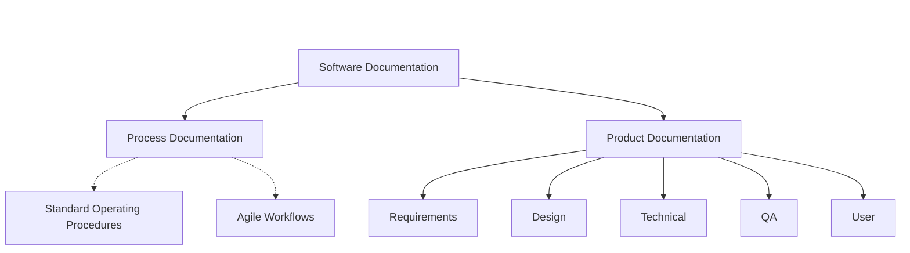

# 09 - Software Documentation


## 1. Jargon Translation

- **Process Documentation**:
  - *Official Definition*: Documents that describe how to complete a task or a business process.
  - *Under the Hood*: The rulebook for the team. E.g., "How do we approve vacation time?" or "How do we deploy code on Fridays?"
- **Product Documentation**:
  - *Official Definition*: Information about the software that describes what the product is and how it functions.
  - *Under the Hood*: The manual for the actual software. E.g., "What does this button do?" or "How does the database connect to the API?"
- **Traceability Matrix**:
  - *Official Definition*: A document that maps and traces user requirements with test cases to ensure that all requirements are covered by tests.
  - *Under the Hood*: A giant spreadsheet that proves to the client that you didn't forget to test any of the features they asked for.
- **SOP (Standard Operating Procedure)**:
  - *Official Definition*: Step-by-step instructions compiled by an organization to help workers carry out complex routine operations.
  - *Under the Hood*: An extremely detailed checklist designed so that even if the lead engineer is on vacation, a junior engineer can still safely update the servers.

## 2. Topics Introduced in Lecture Transcript

1. Formats and Audiences of Documentation
2. Product vs Process Documentation
3. The Five Categories of Product Documentation
4. SOPs (Standard Operating Procedures)
5. Maintenance of Documentation

## 3. Exhaustive Deep Dive & Structured Notes

### Formats and Audiences
Documentation isn't just giant text manuals anymore. It comes in three primary formats:
* **Written** (Text, Markdown, PDFs)
* **Video** (Tutorials, screen recordings)
* **Graphical** (Flowcharts, UI mockups, architecture diagrams)

Documentation is written for vastly different audiences. A **Software Developer** needs deep technical specs, a **QA Engineer** needs test scenarios, and an **End User** needs a simple FAQ. Writing for the correct audience is critical.

### The Two Major Categories of Documentation
All documentation is divided into two buckets:
1. **Product Documentation**: Explains *what* the software is and *how* it works.
2. **Process Documentation**: Explains *how* the human team operates and completes tasks.

### The Five Types of Product Documentation
1. **Requirements Documentation**: Written during the Planning Phase. Contains the SRS, SysRS, and User Acceptance Specs. Read primarily by developers and QA.
2. **Design Documentation**: Written by Architects. Explains how the software will be built conceptually and technically to meet the requirements.
3. **Technical Documentation**: Includes code comments, API specs, and engineering working papers. Intended purely for other developers to understand the codebase.
4. **Quality Assurance Documentation**: Includes Test Plans, Test Scenarios, and Traceability Matrices. Used by the QA team to track testing metrics.
5. **User Documentation**: Includes FAQs, Installation Guides, and Tutorials. Intended strictly for the end-users operating the software.

### Standard Operating Procedures (SOPs)
While Process Documentation gives a high-level overview of a business process, an SOP zooms in. It is a highly detailed, organization-specific, step-by-step guide for complex tasks (e.g., merging code into the `main` branch). They can be hierarchical outlines, flowcharts, or strict checklists.

### Maintenance
Documentation must be kept up to date. If the UI changes, the User Manual must change. This updating happens formally during the **Maintenance Phase** of the SDLC. Stale documentation is often worse than no documentation, as it actively misleads users and developers.



## 4. Step-by-Step Breakdown: Executing an SOP

**Scenario**: A Junior Developer needs to merge their code into the production branch.
1. **Locate the SOP**: The developer opens the company wiki to find the "Code Merge SOP".
2. **Step 1 - Run Tests**: The SOP explicitly states, "Run `npm run test` locally and attach a screenshot of passing tests to the Pull Request."
3. **Step 2 - Peer Review**: The SOP mandates, "Tag exactly two Senior Engineers for code review."
4. **Step 3 - Approval**: The developer waits for two green checkmarks.
5. **Step 4 - Merge & Document**: The developer clicks merge, and as per the final SOP step, updates the Jira ticket status to "Done".

## 5. Concrete Examples

* **Process Documentation Example**: The company handbook detailing how to request a new laptop from IT.
* **Product Documentation Example**: The README file explaining how to install the new photo-editing application.
* **Technical Documentation Example**: A developer leaving a comment above a complex math formula in the code explaining *why* they divided by 100.
* **QA Documentation Example**: A matrix mapping the requirement "User must be able to log in" to the specific test case "Test_Login_Success_01".

## 6. Code Blocks

```markdown
<!-- A standard example of Technical Documentation: The README.md -->

# E-Commerce Payment Service

## Overview
This microservice handles processing credit cards via the Stripe API.

## Installation
1. Run `npm install`
2. Copy `.env.example` to `.env` and add your Stripe Secret Key.
3. Run `npm run start:dev`

## Architecture
- `src/controllers`: Handles incoming HTTP requests.
- `src/services`: Contains the business logic for Stripe integration.

## SOP for Deploying
* **NEVER** deploy on Fridays. 
* To deploy, run `npm run deploy:prod` and monitor the DataDog dashboard for 15 minutes.
```

## 7. Related Concepts

1. **JSDoc / JavaDoc**: A standard way to write comments directly above functions in the code so that documentation websites can be generated automatically.
2. **Confluence / Notion / Wikis**: The standard enterprise software tools used to host Process Documentation and SOPs.
3. **Swagger / OpenAPI**: A tool that automatically generates beautiful, interactive Technical Documentation for APIs.
4. **Docs as Code**: The modern philosophy of storing documentation inside the Git repository right next to the source code, so they can be versioned together.
5. **Agile Documentation Philosophy**: "Working software over comprehensive documentation." Agile teams only write documentation that provides immediate value, avoiding 500-page manuals nobody reads.

## 8. Key Takeaways (Flashcard-Ready)

- **Q: What is the main difference between Product and Process documentation?**
  - A: Product documentation describes how the software functions, while process documentation describes how the human team completes tasks.
- **Q: What are the three formats documentation can take?**
  - A: Written, Video, and Graphical.
- **Q: What is an SOP?**
  - A: A Standard Operating Procedure; a highly detailed, step-by-step instruction manual for completing an organization-specific complex task.
- **Q: What does Technical Documentation consist of?**
  - A: Code comments, API specs, and working papers intended to help other developers understand the code's behavior.
- **Q: When should documentation officially be updated in the SDLC?**
  - A: During the Maintenance Phase (though practically, it should be updated continuously).

## 9. 💡 The Secret Engineering Trick

**Docs as Code**
Historically, code lived in Git, and documentation lived in a separate Word Document on a shared drive. This guaranteed the documentation would instantly become outdated. Modern engineers use the **Docs as Code** approach: they write documentation in Markdown (`.md`) files and store them directly inside the codebase repository. When a developer makes a Pull Request to change the code, they are forced to update the Markdown file in the exact same Pull Request. If the docs aren't updated, the code isn't merged.

## 10. Interview Questions Section

### 1. What is the difference between Product and Process documentation?

* **Simple Definition**: Product documentation explains how to use the microwave. Process documentation explains how the factory workers assemble the microwave.
* **Official Definition**: Product documentation relates to the product's features, functionality, and usage. Process documentation describes the requirements and steps for the quality implementation of a business process or team workflow.
* **Primary Responsibilities / Core Details**:
  * Product documentation is for users, developers, and QA.
  * Process documentation is for employees, HR, and management.
  * Both must be kept up to date to be useful.
* **Real-World Example**: A `README.md` explaining how an API works is Product Documentation. A Wiki page explaining how developers should request PTO is Process Documentation.
* **Best Coding/Development Practices**:
  * **Keep them separate**: Don't put your company's PTO policy inside the code repository's README. Keep Process docs in a Wiki, and Product docs near the code.
    * *Example Code (Wiki structure vs Repo structure)*:
      ```bash
      # Repository (Product Docs)
      /src
      README.md # How to run the app
      api-specs.yaml # How the API works
      
      # Confluence Wiki (Process Docs)
      /Engineering
        /Onboarding Guide
        /How to Deploy to AWS
      ```

### 2. What are the 5 categories of Product Documentation?

* **Simple Definition**: Planning it, designing it, coding it, testing it, and using it.
* **Official Definition**: Requirements, Design, Technical, Quality Assurance, and User documentation.
* **Primary Responsibilities / Core Details**:
  * **Requirements**: Defines what to build (SRS).
  * **Design**: Defines how to build it structurally.
  * **Technical**: Explains the code (comments, APIs).
  * **QA**: Proves it works (Test plans).
  * **User**: Explains how to operate it (Manuals).
* **Real-World Example**: A video game company writes Requirements for a jump mechanic, Design docs for the physics engine, Technical docs inside the C++ code, QA docs tracking jumping bugs, and User docs inside the game's tutorial level.
* **Best Coding/Development Practices**:
  * **Automate Technical Docs**: Use tools like Swagger to generate API documentation directly from the code, ensuring it never goes out of sync.
    * *Example Code (Swagger/OpenAPI annotation)*:
      ```javascript
      /**
       * @swagger
       * /users:
       *   get:
       *     description: Returns a list of users
       *     responses:
       *       200:
       *         description: Successful response
       */
      app.get('/users', (req, res) => { ... });
      ```

### 3. What is an SOP and why is it important?

* **Simple Definition**: A foolproof recipe for a complicated task.
* **Official Definition**: A Standard Operating Procedure is written documentation explaining step-by-step how to accomplish a common, complex, organization-specific task.
* **Primary Responsibilities / Core Details**:
  * Removes ambiguity and guesswork.
  * Ensures consistency in quality.
  * Critical for onboarding new employees.
  * Can be flowcharts, outlines, or step-by-step lists.
* **Real-World Example**: Deploying a database update is dangerous. An SOP lists the exact 10 commands to run in the terminal to back up the database, apply the update, and verify success, ensuring nobody accidentally deletes production data.
* **Best Coding/Development Practices**:
  * **Keep SOPs actionable**: SOPs should not be philosophical; they should be concrete commands and checklists.
    * *Example Code (A concrete SOP checklist in Markdown)*:
      ```markdown
      ### SOP: Emergency Rollback
      - [ ] 1. Ping `@devops` in Slack `#emergencies`
      - [ ] 2. Run `aws elasticbeanstalk swap-environment-cnames`
      - [ ] 3. Verify traffic is routed to the old environment.
      ```

### 4. Who reads Requirements documentation vs User documentation?

* **Simple Definition**: Requirements are for the builders; User docs are for the buyers.
* **Official Definition**: Requirements documentation is intended for the internal development team (developers, architects, QA) to understand what must be built. User documentation is intended for external end-users to understand how to operate the finished software.
* **Primary Responsibilities / Core Details**:
  * Requirements use highly technical and precise language.
  * User documentation uses plain language and focuses on UI/UX workflows.
  * Requirements are written in the Planning phase.
  * User documentation is written toward the end of the SDLC.
* **Real-World Example**: A software architect reads the SRS to understand how many transactions per second the database must handle. A grandmother reads the User FAQ to understand how to upload a photo to her profile.
* **Best Coding/Development Practices**:
  * **Tailor the language**: Never use internal technical jargon in User documentation.
    * *Example Code (Bad vs Good User Doc)*:
      ```markdown
      # BAD (Too technical for a user)
      To upload a photo, make a multipart/form-data POST request to the /api/v1/media endpoint.
      
      # GOOD (User-focused)
      To upload a photo, click the "Select Image" button on your profile page and choose a file from your computer.
      ```

### 5. Why is documentation maintenance critical?

* **Simple Definition**: Because a map that leads you to a cliff is worse than having no map at all.
* **Official Definition**: Documentation must be kept up-to-date (typically during the maintenance phase) to reflect changes in the software's UI, business logic, or infrastructure. Stale documentation misleads users and developers.
* **Primary Responsibilities / Core Details**:
  * Requires dedicated resources and time allocation from management.
  * Must be reviewed periodically for accuracy.
  * Reduces support tickets and developer onboarding time.
* **Real-World Example**: An API endpoint is changed from `/users` to `/api/v2/users`. If the technical documentation is not updated, every single client trying to integrate with the API will fail and open angry support tickets.
* **Best Coding/Development Practices**:
  * **Enforce Documentation Updates in CI/CD**: Treat documentation updates as a strict requirement for code reviews.
    * *Example Code (Pull Request Template enforcing doc updates)*:
      ```markdown
      ## Pull Request Checklist
      - [ ] Code compiles and tests pass.
      - [ ] I have updated the README.md if I added a new environment variable.
      - [ ] I have updated the Swagger API docs if I changed a route.
      ```
