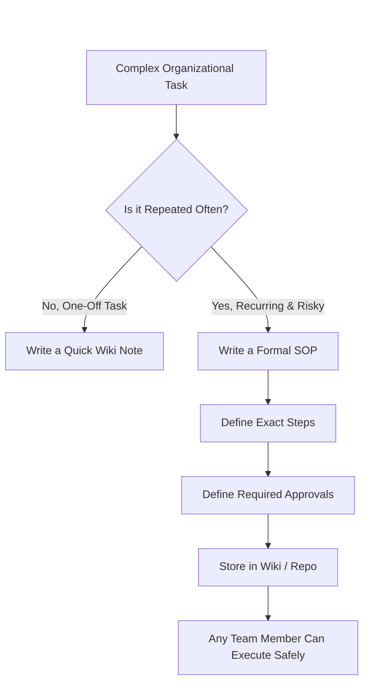
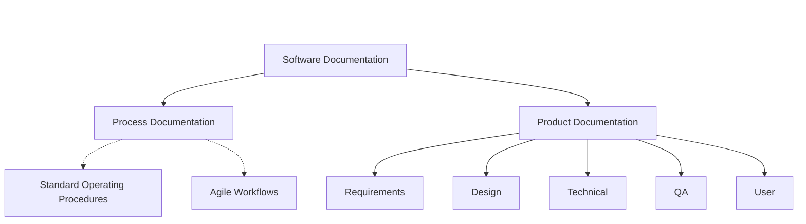

# 09 - Software Documentation


## 1. Jargon Translation

- **Process Documentation**:
  - *Official Definition*: Documents that describe how to complete a task or a business process.
  - *Under the Hood*: The rulebook for the team. E.g., "How do we approve vacation time?" or "How do we deploy code on Fridays?"
- **Product Documentation**:
  - *Official Definition*: Information about the software that describes what the product is and how it functions.
  - *Under the Hood*: The manual for the actual software. E.g., "What does this button do?" or "How does the database connect to the API?"
- **Traceability Matrix**:
  - *Official Definition*: A document that maps and traces user requirements with test cases to ensure that all requirements are covered by tests.
  - *Under the Hood*: A giant spreadsheet that proves to the client that you didn't forget to test any of the features they asked for.
- **SOP (Standard Operating Procedure)**:
  - *Official Definition*: Step-by-step instructions compiled by an organization to help workers carry out complex routine operations.
  - *Under the Hood*: An extremely detailed checklist designed so that even if the lead engineer is on vacation, a junior engineer can still safely update the servers.

## 2. Topics Introduced in Lecture Transcript

1. Formats and Audiences of Documentation
2. Product vs Process Documentation
3. The Five Categories of Product Documentation
4. SOPs (Standard Operating Procedures)
5. Maintenance of Documentation

## 3. Exhaustive Deep Dive & Structured Notes

### Formats and Audiences
Documentation isn't just giant text manuals anymore. It comes in three primary formats:
* **Written** (Text, Markdown, PDFs)
* **Video** (Tutorials, screen recordings)
* **Graphical** (Flowcharts, UI mockups, architecture diagrams)

Documentation is written for vastly different audiences. A **Software Developer** needs deep technical specs, a **QA Engineer** needs test scenarios, and an **End User** needs a simple FAQ. Writing for the correct audience is critical.

### The Two Major Categories of Documentation
All documentation is divided into two buckets:
1. **Product Documentation**: Explains *what* the software is and *how* it works.
2. **Process Documentation**: Explains *how* the human team operates and completes tasks.

### The Five Types of Product Documentation
1. **Requirements Documentation**: Written during the Planning Phase. Contains the SRS, SysRS, and User Acceptance Specs. Read primarily by developers and QA.
2. **Design Documentation**: Written by Architects. Explains how the software will be built conceptually and technically to meet the requirements.
3. **Technical Documentation**: Includes code comments, API specs, and engineering working papers. Intended purely for other developers to understand the codebase.
4. **Quality Assurance Documentation**: Includes Test Plans, Test Scenarios, and Traceability Matrices. Used by the QA team to track testing metrics.
5. **User Documentation**: Includes FAQs, Installation Guides, and Tutorials. Intended strictly for the end-users operating the software.

The five categories exist because each one answers a completely different question for a completely different reader. Laying them side by side makes the boundaries obvious:

| Category | Answers the Question | Primary Audience | Typical Artifacts | Written During |
| :--- | :--- | :--- | :--- | :--- |
| **Requirements** | "What must this system do?" | Developers, Architects, QA | SRS, SysRS, User Acceptance Specs | Planning Phase |
| **Design** | "How will it be structurally built?" | Architects, Senior Developers | Architecture diagrams, Design Documents | Design Phase |
| **Technical** | "How does the code actually work?" | Other Developers | Code comments, API specs, JSDoc | Development Phase |
| **Quality Assurance** | "How do we prove it works?" | QA Engineers | Test Plans, Test Scenarios, Traceability Matrices | Testing Phase |
| **User** | "How do I use this?" | End-Users, Customers | FAQs, Installation Guides, Tutorials | Deployment / Maintenance |

### Standard Operating Procedures (SOPs)
While Process Documentation gives a high-level overview of a business process, an SOP zooms in. It is a highly detailed, organization-specific, step-by-step guide for complex tasks (e.g., merging code into the `main` branch). They can be hierarchical outlines, flowcharts, or strict checklists.



### Maintenance
Documentation must be kept up to date. If the UI changes, the User Manual must change. This updating happens formally during the **Maintenance Phase** of the SDLC. Stale documentation is often worse than no documentation, as it actively misleads users and developers.



## 4. Step-by-Step Breakdown: Executing an SOP

**Scenario**: A Junior Developer needs to merge their code into the production branch.
1. **Locate the SOP**: The developer opens the company wiki to find the "Code Merge SOP".
2. **Step 1 - Run Tests**: The SOP explicitly states, "Run `npm run test` locally and attach a screenshot of passing tests to the Pull Request."
3. **Step 2 - Peer Review**: The SOP mandates, "Tag exactly two Senior Engineers for code review."
4. **Step 3 - Approval**: The developer waits for two green checkmarks.
5. **Step 4 - Merge & Document**: The developer clicks merge, and as per the final SOP step, updates the Jira ticket status to "Done".

## 5. Concrete Examples

* **Process Documentation Example**: The company handbook detailing how to request a new laptop from IT.
* **Product Documentation Example**: The README file explaining how to install the new photo-editing application.
* **Technical Documentation Example**: A developer leaving a comment above a complex math formula in the code explaining *why* they divided by 100.
* **QA Documentation Example**: A matrix mapping the requirement "User must be able to log in" to the specific test case "Test_Login_Success_01".

## 6. Code Blocks

```markdown
<!-- A standard example of Technical Documentation: The README.md -->

# E-Commerce Payment Service

## Overview
This microservice handles processing credit cards via the Stripe API.

## Installation
1. Run `npm install`
2. Copy `.env.example` to `.env` and add your Stripe Secret Key.
3. Run `npm run start:dev`

## Architecture
- `src/controllers`: Handles incoming HTTP requests.
- `src/services`: Contains the business logic for Stripe integration.

## SOP for Deploying
* **NEVER** deploy on Fridays. 
* To deploy, run `npm run deploy:prod` and monitor the DataDog dashboard for 15 minutes.
```

## 7. Related Concepts

1. **JSDoc / JavaDoc**: A standard way to write comments directly above functions in the code so that documentation websites can be generated automatically.
2. **Confluence / Notion / Wikis**: The standard enterprise software tools used to host Process Documentation and SOPs.
3. **Swagger / OpenAPI**: A tool that automatically generates beautiful, interactive Technical Documentation for APIs.
4. **Docs as Code**: The modern philosophy of storing documentation inside the Git repository right next to the source code, so they can be versioned together.
5. **Agile Documentation Philosophy**: "Working software over comprehensive documentation." Agile teams only write documentation that provides immediate value, avoiding 500-page manuals nobody reads.

## 8. Key Takeaways (Flashcard-Ready)

- **Q: What is the main difference between Product and Process documentation?**
  - A: Product documentation describes how the software functions, while process documentation describes how the human team completes tasks.
- **Q: What are the three formats documentation can take?**
  - A: Written, Video, and Graphical.
- **Q: What is an SOP?**
  - A: A Standard Operating Procedure; a highly detailed, step-by-step instruction manual for completing an organization-specific complex task.
- **Q: What does Technical Documentation consist of?**
  - A: Code comments, API specs, and working papers intended to help other developers understand the code's behavior.
- **Q: When should documentation officially be updated in the SDLC?**
  - A: During the Maintenance Phase (though practically, it should be updated continuously).

## 9. 💡 The Secret Engineering Trick

**Docs as Code**
Historically, code lived in Git, and documentation lived in a separate Word Document on a shared drive. This guaranteed the documentation would instantly become outdated. Modern engineers use the **Docs as Code** approach: they write documentation in Markdown (`.md`) files and store them directly inside the codebase repository. When a developer makes a Pull Request to change the code, they are forced to update the Markdown file in the exact same Pull Request. If the docs aren't updated, the code isn't merged.

## 10. Interview Questions Section

### 1. What is the difference between Product and Process documentation?

* **Simple Definition**: Imagine a restaurant. Product documentation is the menu handed to the customer, describing exactly what each dish is, what's in it, and how spicy it is. Process documentation is the laminated card taped inside the kitchen that tells the cooks the exact temperature to fry the chicken at and how long to let it rest. One describes the meal; the other describes the recipe for making the meal consistently, every single time, regardless of which cook is on shift.
* **Official Definition**: Product documentation is information that describes the software product itself — its features, functionality, architecture, and usage — intended to help readers understand or operate the system. Process documentation describes the requirements, standards, and step-by-step procedures a team follows to plan, build, test, and maintain that product, governing how the human organization operates rather than describing what the software does.
* **Primary Responsibilities / Core Details**:
  * **Scope of Product Docs**: Covers requirements, design, technical internals, QA artifacts, and end-user guidance — everything a reader needs to understand or use the software.
  * **Scope of Process Docs**: Covers workflows, meeting cadences, SOPs, coding standards, and organizational policy — everything a reader needs to understand how the team works.
  * **Audience Split**: Product docs are read by anyone touching the software (developers, testers, end-users). Process docs are read almost exclusively by internal employees (engineers, HR, management).
  * **Lifespan**: Product documentation typically changes whenever a feature changes. Process documentation changes far less often, since it governs stable organizational habits rather than a rapidly shifting codebase.
  * **Ownership**: Product documentation is usually owned by whoever built the feature (developers, architects, technical writers). Process documentation is usually owned by team leads, Scrum Masters, or engineering managers.
  * **Failure Mode**: Bad Product documentation causes users and developers to misuse or misunderstand the software. Bad Process documentation causes teams to duplicate effort, break conventions, or onboard new hires inconsistently.
  * **Update Trigger**: Product documentation should be updated in the same Pull Request as the code change that made it necessary. Process documentation is typically updated on a slower cadence, revisited during retrospectives or quarterly planning when the team notices a workflow has stopped matching reality.
* **Real-World Example**: At a mid-sized fintech company, the `README.md` inside the `payments-service` repository (Product Documentation) explains that the service exposes a `/charge` endpoint accepting a card token and amount. Meanwhile, a completely separate Confluence page titled "Incident Response Runbook" (Process Documentation) explains the exact Slack channels to ping, the exact dashboard to check, and the exact escalation order to follow if that `/charge` endpoint starts throwing 500 errors at 3 AM. A new engineer needs both documents, but for entirely different reasons.
* **Best Coding/Development Practices**:
  * **Keep Them in Separate Systems**: Don't put your company's PTO policy inside the code repository's README, and don't bury critical API usage instructions inside a Wiki only HR ever opens. Keep Process docs in a Wiki, and Product docs directly beside the code.
    ```bash
    # Repository (Product Docs — versioned with the code)
    /src
    README.md        # How to run and use the app
    api-specs.yaml    # How the API works, request/response shapes

    # Confluence Wiki (Process Docs — versioned by policy, not by commit)
    /Engineering
      /Onboarding Guide
      /How to Deploy to AWS
      /Incident Response Runbook
    ```
  * **Cross-Link, Don't Duplicate**: If a Process doc needs to reference a Product detail (like an API endpoint), link to the live Product doc instead of copy-pasting it, so the two never silently drift out of sync.
    ```markdown
    <!-- Inside the Wiki's "Incident Response Runbook" -->
    For the exact request/response shape of the `/charge` endpoint,
    see the live API spec: [api-specs.yaml](https://github.com/org/payments-service/blob/main/api-specs.yaml)
    ```
  * **Assign an Explicit Owner to Each**: Every repository should have a named owner for its README (usually the tech lead), and every team Wiki space should have a named owner for its SOPs (usually the Scrum Master), so nobody assumes "someone else" is keeping it current.
  * **Audit for Misplaced Content During Onboarding**: A brand-new hire is the best possible auditor for documentation placement, because they haven't yet learned to "just know" where things actually live. Ask every new team member to flag anywhere a Product concept was explained in a Process doc, or vice versa.
    ```markdown
    > Onboarding Task: "As you read the README and the Wiki this week,
    > flag any sentence that feels like it belongs in the OTHER document."
    ```
* **Visual Aid (Mermaid Flowchart)**:
  ```mermaid
  flowchart TD
      margin_1((" "))
      style margin_1 fill:none,stroke:none
      margin_1 ~~~ Docs

      Docs[Software Documentation] --> Product[Product Documentation]
      Docs --> Process[Process Documentation]

      Product -->|Describes| P1["What the software IS<br>and how it functions"]
      Product --> P2[Lives Beside the Code]
      Product --> P3[Owned by Developers]

      Process -->|Describes| Q1["How the TEAM<br>operates and works"]
      Process --> Q2[Lives in a Wiki]
      Process --> Q3[Owned by Team Leads]
  ```
* **Core Focus Areas**: Audience Separation | Documentation Ownership | Wiki vs Repository Placement | Sync Discipline

### 2. What are the 5 categories of Product Documentation?

* **Simple Definition**: Building a car requires five completely different kinds of paperwork: a spec sheet describing what the car must do (Requirements), an engineering blueprint of how the engine fits together (Design), an internal manual for mechanics explaining the wiring (Technical), a stack of crash-test reports proving it's safe (Quality Assurance), and the glossy owner's manual in the glovebox (User). Software needs the exact same five categories, and skipping any one of them leaves a gap someone will eventually fall into.
* **Official Definition**: Product documentation is formally divided into five categories — Requirements, Design, Technical, Quality Assurance, and User documentation — each corresponding to a distinct phase of the SDLC and a distinct reader who needs a distinct kind of information about the product.
* **Primary Responsibilities / Core Details**:
  * **Requirements Documentation**: Captures the SRS, SysRS, and User Acceptance Specs written during Planning; read primarily by developers, architects, and QA to understand *what* must be built.
  * **Design Documentation**: Written by architects during the Design phase; explains the conceptual and technical blueprint (database schemas, API contracts, component boundaries) that developers implement.
  * **Technical Documentation**: Includes code comments, API specs, and engineering working papers, written during Development; intended purely for other developers to understand the codebase's internal logic.
  * **Quality Assurance Documentation**: Includes Test Plans, Test Scenarios, and Traceability Matrices produced during Testing; used by QA to prove every requirement has been verified.
  * **User Documentation**: Includes FAQs, Installation Guides, and Tutorials produced near Deployment; intended strictly for the non-technical end-user operating the finished software.
  * **The Common Thread**: Each category maps almost perfectly onto one phase of the SDLC, meaning documentation debt in any single category usually signals a rushed or skipped phase.
  * **Not Mutually Exclusive**: In small teams, a single document sometimes blends two categories (e.g., a lightweight Design doc that also lists functional Requirements), but the five distinct *purposes* still need to be satisfied somewhere, even if the physical files are merged for convenience.
* **Real-World Example**: A video game studio writes Requirements documentation describing exactly how a double-jump mechanic should feel (SRS), Design documentation showing the physics engine's gravity curve (blueprint), Technical documentation as C++ comments inside the `PlayerController` class, QA documentation tracking every jump-related bug found during a playtest, and User documentation as the in-game tutorial popup that says "Press A twice to double-jump." Losing any single one of these five creates a real, specific problem: without QA docs, nobody can prove the jump was ever actually tested; without Design docs, the next physics engineer who touches gravity has no blueprint to work from and risks silently breaking the feel of every other jump-dependent mechanic in the game.
* **Best Coding/Development Practices**:
  * **Automate Technical Docs Where Possible**: Use tools like Swagger/OpenAPI to generate API documentation directly from code annotations, so Technical documentation can never silently drift out of sync with the actual implementation.
    ```javascript
    /**
     * @swagger
     * /users:
     *   get:
     *     description: Returns a list of users
     *     responses:
     *       200:
     *         description: Successful response
     */
    app.get('/users', (req, res) => { /* ... */ });
    ```
  * **Template Your Requirements Docs**: Use a consistent SRS template across every project so developers always know exactly where to find functional vs. non-functional requirements.
    ```markdown
    ## SRS Template
    ### 1. Functional Requirements
    ### 2. Non-Functional Requirements (Performance, Security)
    ### 3. External Interface Requirements
    ```
  * **Version User Documentation Alongside Releases**: Tag your User documentation with the same version number as the software release it describes, so support teams can pull up the exact manual a customer is actually using.
    ```json
    { "docVersion": "2.4.0", "appliesToRelease": "2.4.0" }
    ```
  * **Assign a Documentation Reviewer per Category**: Just as code has a required reviewer, assign a specific reviewer role per documentation category (e.g., a senior architect signs off on Design docs, a QA lead signs off on Test Plans) so quality is enforced consistently, not left to whoever remembers.
    ```markdown
    > CODEOWNERS file
    /docs/design/*    @lead-architect
    /docs/qa/*        @qa-lead
    /docs/user/*      @support-team
    ```
* **Visual Aid (Mermaid Flowchart)**:
  ```mermaid
  flowchart TD
      margin_1((" "))
      style margin_1 fill:none,stroke:none
      margin_1 ~~~ Product

      Product[Product Documentation] --> R[Requirements]
      Product --> D[Design]
      Product --> T[Technical]
      Product --> Q[Quality Assurance]
      Product --> U[User]

      R -->|Planning Phase| R1[SRS / SysRS]
      D -->|Design Phase| D1[Architecture Blueprint]
      T -->|Development Phase| T1[Code Comments / API Specs]
      Q -->|Testing Phase| Q1[Test Plans / Traceability]
      U -->|Deployment Phase| U1[FAQs / Manuals]
  ```
* **Core Focus Areas**: SDLC Phase Mapping | Reader-Specific Content | Automated Documentation Generation | Version Alignment

### 3. What is an SOP and why is it important?

* **Simple Definition**: An SOP is the difference between telling someone "go land the plane" and handing them a laminated pre-landing checklist with 40 exact steps in the exact right order. Pilots don't rely on memory or improvisation for something that dangerous and repetitive — they follow the checklist every single time, and so should engineers for their own high-risk, recurring tasks.
* **Official Definition**: A Standard Operating Procedure (SOP) is written, organization-specific documentation that explains, in explicit and unambiguous step-by-step detail, exactly how to accomplish a common, complex, or high-risk operational task, so that the outcome is identical regardless of who performs it.
* **Primary Responsibilities / Core Details**:
  * **Removes Ambiguity**: An SOP leaves zero room for personal interpretation on tasks where interpretation is dangerous — like deploying to production or rotating a database credential.
  * **Ensures Consistency**: The same task executed by five different engineers on five different days should produce the exact same result, every time.
  * **Critical for Onboarding**: New hires can safely execute complex, high-stakes procedures on day one by following the SOP, rather than needing months of tribal knowledge.
  * **Reduces the Bus Factor**: If the one engineer who "just knows" how to do something leaves the company, the SOP ensures that knowledge doesn't leave with them.
  * **Format Flexibility**: SOPs can be written as hierarchical outlines, flowcharts, or literal checkbox checklists — whatever format is fastest to follow under pressure.
  * **Scope Boundary**: SOPs are deliberately narrow and task-specific; they are not meant to explain broad philosophy (that belongs in higher-level Process documentation), only exact mechanical steps.
  * **Legal and Compliance Weight**: In regulated industries (healthcare, finance, aviation), SOPs are often not optional best practice but a legal requirement, and auditors will explicitly ask to see them alongside evidence they were actually followed.
* **Real-World Example**: Deploying a database schema migration is inherently dangerous — one wrong command can corrupt production data. A well-written SOP lists the exact 10 terminal commands to run: back up the database, apply the migration in a transaction, run a verification query, and only then release the lock. A junior engineer following that SOP at 2 AM during an on-call rotation is just as safe as the senior engineer who originally designed the migration strategy — the SOP transfers the senior engineer's judgment into a repeatable artifact that doesn't require them to be awake, or even employed at the company anymore, for the task to be done safely.
* **Best Coding/Development Practices**:
  * **Keep SOPs Actionable, Not Philosophical**: An SOP should read like a checklist of commands, not an essay about why the task matters.
    ```markdown
    ### SOP: Emergency Rollback
    - [ ] 1. Ping `@devops` in Slack `#emergencies`
    - [ ] 2. Run `aws elasticbeanstalk swap-environment-cnames`
    - [ ] 3. Verify traffic is routed to the old environment.
    - [ ] 4. Post the incident timestamp in `#incidents`.
    ```
  * **Store SOPs Where They'll Actually Be Found During a Crisis**: Pin high-risk SOPs (like rollback or incident response) directly in the on-call tool or channel description, not three folders deep in a Wiki nobody can find under pressure.
    ```markdown
    <!-- Slack channel topic for #emergencies -->
    Topic: Rollback SOP → wiki.company.com/emergency-rollback | On-call: @devops
    ```
  * **Version and Date-Stamp SOPs**: Infrastructure changes over time; an outdated SOP is actively dangerous. Require a "Last Verified" date on every SOP and review them quarterly.
    ```markdown
    > **SOP Last Verified**: 2026-06-01 by @jane.doe
    > If this procedure has not been tested in the last 90 days, verify it before relying on it.
    ```
  * **Rehearse High-Risk SOPs Before You Need Them**: An SOP that has never actually been executed under realistic conditions is only a theory. Schedule periodic "fire drills" — like practicing the rollback SOP on a staging environment — so the team is confident, not just hopeful, when a real incident hits.
    ```markdown
    > Quarterly Fire Drill: Simulate a production outage on staging
    > and time how long it takes an on-call engineer to complete
    > the Emergency Rollback SOP from memory, using only the doc.
    ```
* **Visual Aid (Mermaid Flowchart)**:
  ```mermaid
  flowchart TD
      margin_1((" "))
      style margin_1 fill:none,stroke:none
      margin_1 ~~~ Task

      Task[High-Risk, Recurring Task] --> Write[Write Explicit SOP]
      Write --> Steps[Exact Steps / Commands]
      Write --> Approvals[Required Approvals]
      Write --> Storage[Store in Discoverable Location]

      Storage --> Execute{Any Team Member Executes}
      Execute -->|Follows SOP Exactly| Safe[Consistent, Safe Outcome]
      Execute -->|Improvises Instead| Risk[Unpredictable, Risky Outcome]
  ```
* **Core Focus Areas**: Risk Reduction | Consistency at Scale | Bus Factor Mitigation | Onboarding Acceleration

### 4. Who reads Requirements documentation vs User documentation?

* **Simple Definition**: Requirements documentation is the architect's blueprint handed to the construction crew — dense, technical, and full of load-bearing calculations. User documentation is the "Welcome Home" booklet handed to the family who buys the finished house, explaining which switch controls which light. Both describe the same building, but one is written for people who build things and the other for people who simply live in them.
* **Official Definition**: Requirements documentation is intended for the internal development team — developers, architects, and QA engineers — to precisely understand what functionality must be built and to what standard. User documentation is intended for external, non-technical end-users to understand how to operate the finished, deployed software.
* **Primary Responsibilities / Core Details**:
  * **Language Register**: Requirements documentation uses precise, technical, often formal language (e.g., "the system shall respond within 200ms"). User documentation uses plain, friendly, task-oriented language (e.g., "click the blue button to save your changes").
  * **Timing in the SDLC**: Requirements documentation is written first, during the Planning phase, before any code exists. User documentation is written last, typically during Deployment or early Maintenance, once the feature is stable enough to describe accurately.
  * **Level of Detail**: Requirements documentation must be exhaustive and unambiguous, since it's the legal and technical contract for what gets built. User documentation deliberately omits internal detail the user doesn't need or want.
  * **Verification Method**: Requirements are verified through Testing (does the code satisfy the SRS?). User documentation is verified through usability testing (can a real, non-technical person actually follow it successfully?).
  * **Failure Cost**: An unclear Requirements document causes developers to build the wrong feature, which is extremely expensive to fix. Unclear User documentation causes support tickets and user frustration, which is costly but far cheaper to correct.
  * **Overlap in Practice**: The URS (User Requirement Specification) sits conceptually between the two — it captures business needs in the language of the end-user, but is read internally by the team during Planning, acting as a translation bridge between what the customer wants and what the SRS formally specifies.
* **Real-World Example**: Before a payments feature is built, a software architect reads a Requirements document stating "the system shall process a transaction and return a confirmation within 2 seconds under a load of 10,000 concurrent users," and designs the database indexing strategy around that exact number. Months later, once the feature ships, a non-technical customer reads a completely different User document that simply says, "Tap 'Pay Now' and wait for the green checkmark." Neither reader would find the other document useful — the architect doesn't need "tap the button," and the customer doesn't need "10,000 concurrent users."
* **Best Coding/Development Practices**:
  * **Tailor the Language to the Audience, Every Time**: Never let internal technical jargon leak into User documentation, and never let vague, hand-wavy language leak into Requirements documentation.
    ```markdown
    # BAD (Too technical for a user)
    To upload a photo, make a multipart/form-data POST request to the /api/v1/media endpoint.

    # GOOD (User-focused)
    To upload a photo, click the "Select Image" button on your profile page and choose a file from your computer.
    ```
  * **Write Requirements as Testable Statements**: Every line of a Requirements document should be phrased so a QA engineer could write a pass/fail test directly from it.
    ```markdown
    # BAD (Vague, not testable)
    The app should be fast.

    # GOOD (Precise, testable)
    The homepage must fully render in under 1.5 seconds on a 4G connection.
    ```
  * **Usability-Test Your User Docs on Real Non-Technical Users**: Before publishing, hand the User documentation to someone outside engineering and watch them attempt the task without help.
    ```markdown
    > Usability Test Log: 3/5 test users could not find the "Select Image" button
    > without help. Action: Add a screenshot with an arrow to the guide.
    ```
  * **Keep a Single Source of Truth Between Them**: Even though the audiences differ, both documents describe the same underlying feature. Store the canonical feature description once (e.g., in a product spec) and generate both the technical Requirements summary and the plain-language User guide from it, rather than writing them independently and letting them contradict each other.
    ```markdown
    > /docs/feature-photo-upload.md   <-- single source of truth
    >   ├─ generates → requirements-photo-upload.md (technical)
    >   └─ generates → user-guide-photo-upload.md (plain language)
    ```
* **Visual Aid (Mermaid Flowchart)**:
  ```mermaid
  flowchart TD
      margin_1((" "))
      style margin_1 fill:none,stroke:none
      margin_1 ~~~ Start

      Start[Software Feature] --> Reqs[Requirements Documentation]
      Start --> UserDoc[User Documentation]

      Reqs -->|Written In| Planning[Planning Phase]
      Reqs -->|Read By| Devs[Developers / Architects / QA]
      Reqs -->|Verified Via| Testing[Automated Testing]

      UserDoc -->|Written In| Deploy[Deployment / Maintenance Phase]
      UserDoc -->|Read By| Users[Non-Technical End-Users]
      UserDoc -->|Verified Via| Usability[Usability Testing]
  ```
* **Core Focus Areas**: Audience-Driven Language | SDLC Timing | Testability | Usability Verification

### 5. Why is documentation maintenance critical?

* **Simple Definition**: A GPS app that confidently tells you to turn left onto a road that was demolished last year is worse than no GPS at all — you'd have at least looked out the window yourself. Stale documentation does exactly this: it speaks with total confidence about a system that no longer exists, actively steering developers and users toward mistakes they wouldn't have made if the document had simply been silent.
* **Official Definition**: Documentation maintenance is the ongoing, deliberate process of updating existing documentation to accurately reflect changes in a software system's UI, business logic, API contracts, or infrastructure, formally occurring during the Maintenance phase of the SDLC but ideally happening continuously alongside every code change.
* **Primary Responsibilities / Core Details**:
  * **Requires Dedicated Resources**: Documentation upkeep is real engineering work and must be explicitly allocated time and ownership by management, not treated as an unpaid afterthought.
  * **Must Be Reviewed Periodically**: Even documentation nobody has consciously changed can silently drift out of accuracy as surrounding systems evolve; scheduled reviews catch this decay.
  * **Reduces Support Load**: Accurate documentation is the cheapest possible support ticket deflection — a correct FAQ answers a question before a human has to.
  * **Reduces Onboarding Time**: New engineers ramp up dramatically faster when the README they're reading actually matches the code they're looking at.
  * **Prevents Silent Trust Erosion**: Once a team gets burned by documentation that lied to them, they stop trusting *all* documentation and revert to word-of-mouth, which defeats the entire purpose of writing it down.
  * **Compounding Cost of Neglect**: Each outdated document makes the next one feel less worth maintaining too, creating a downward spiral toward an entirely undocumented, tribal-knowledge codebase.
  * **Maintenance Is Not Optional Overhead**: Teams that treat documentation upkeep as "nice to have, if there's time" consistently end up with the least reliable documentation, precisely because there is never spare time; maintenance has to be budgeted the same way bug fixes and security patches are.
* **Real-World Example**: A backend team renames an API endpoint from `/users` to `/api/v2/users` as part of a versioning cleanup, but forgets to update the Technical documentation. Three weeks later, a partner integration team follows the (now-incorrect) documented endpoint, gets a stream of 404 errors, opens an urgent support ticket, and loses a full day of their own development time — all because one Markdown file wasn't updated in the same Pull Request as the code. The fix takes the original developer thirty seconds; the damage it caused a partner team, and the trust it cost with them, takes considerably longer to repair.
* **Best Coding/Development Practices**:
  * **Enforce Documentation Updates in Code Review**: Treat a missing documentation update as a legitimate reason to block a Pull Request, exactly like a failing test.
    ```markdown
    ## Pull Request Checklist
    - [ ] Code compiles and tests pass.
    - [ ] I have updated the README.md if I added a new environment variable.
    - [ ] I have updated the Swagger API docs if I changed a route.
    ```
  * **Automate Staleness Detection Where Possible**: Use tools that fail a CI build if code changes touch a route but the corresponding OpenAPI spec file wasn't also modified in the same commit.
    ```yaml
    # GitHub Actions: fail the build if routes changed without a matching spec update
    - name: Check docs are in sync
      run: node scripts/verify-openapi-sync.js
    ```
  * **Schedule Recurring Documentation Audits**: Put a calendar reminder on the team's Sprint cadence to spot-check a handful of older docs for accuracy, rather than waiting for a customer to discover the drift.
    ```markdown
    > Sprint Ritual: Every 4th Friday, one engineer audits 3 random
    > docs from the Wiki and files a ticket for anything stale.
    ```
  * **Make Documentation Debt Visible, Like Technical Debt**: File a ticket in the same backlog developers already use whenever a piece of documentation is known to be stale, instead of relying on someone's memory. A visible, trackable ticket is far more likely to get fixed than an informal "we should update that sometime."
    ```markdown
    > JIRA-4821: [DOCS] README for payments-service references
    > deprecated /users endpoint. Update before next sprint review.
    ```
* **Visual Aid (Mermaid Flowchart)**:
  ```mermaid
  flowchart TD
      margin_1((" "))
      style margin_1 fill:none,stroke:none
      margin_1 ~~~ Change

      Change[Code / UI / Infra Changes] --> Check{Was Documentation Updated?}
      Check -->|Yes, Same PR| Fresh[Documentation Stays Accurate]
      Check -->|No| Stale[Documentation Becomes Stale]

      Stale --> Mislead[Misleads Users & Developers]
      Mislead --> Tickets[Support Tickets & Wasted Time]
      Mislead --> Trust[Erodes Trust in All Documentation]
  ```
* **Core Focus Areas**: Continuous Accuracy | CI-Enforced Sync | Support Deflection | Organizational Trust
