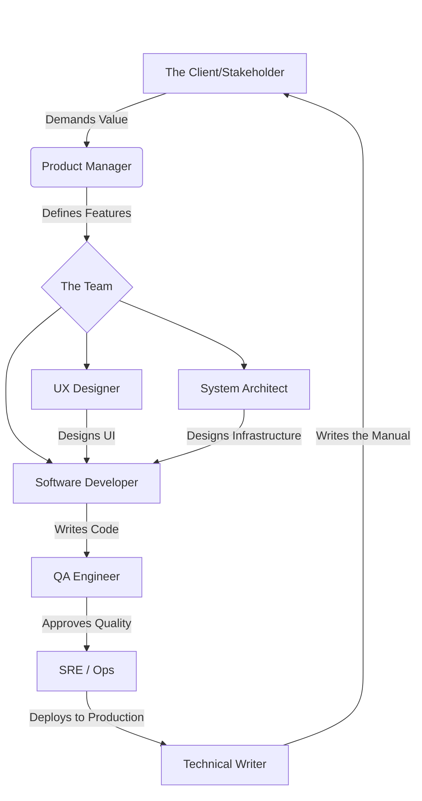

# 10 - Roles in Software Engineering Projects


## 1. Jargon Translation

- **Scrum Master**:
  - *Official Definition*: A facilitator for an Agile development team who ensures the team follows Scrum practices and values.
  - *Under the Hood*: A bulldozer whose entire job is clearing roadblocks so the developers can code without being interrupted by bureaucracy or meetings.
- **SRE (Site Reliability Engineer)**:
  - *Official Definition*: An engineer who bridges development and operations by combining software engineering expertise with IT systems management.
  - *Under the Hood*: The digital firefighter who wakes up at 3 AM when the servers crash, figures out why, and writes code to ensure it never happens again.
- **Product Manager**:
  - *Official Definition*: The person responsible for the vision and roadmap of a product, ensuring it provides value to the stakeholders.
  - *Under the Hood*: The "mini-CEO" of the product who decides *what* features should be built next, but not *how* they are built.
- **Stakeholder**:
  - *Official Definition*: Any individual or group that has an interest in the project and can affect or be affected by its outcomes.
  - *Under the Hood*: The people paying for the software, using the software, or getting fired if the software fails.

## 2. Topics Introduced in Lecture Transcript

1. Core Management & Vision Roles (Product Manager, Project Manager, Scrum Master, Stakeholders)
2. Core Technical & Design Roles (System Architect, UX Designer, Software Developer)
3. Core Quality & Support Roles (Tester/QA, SRE, Technical Writer)

## 3. Exhaustive Deep Dive & Structured Notes

Software is rarely built by a single "coder in a basement" anymore. Modern software requires highly specialized, cross-functional teams.

### Management & Vision
* **Stakeholders**: The ultimate judge of the software. They define requirements and accept/reject the final product.
* **Product Manager (or Product Owner in Agile)**: The visionary. They deeply understand the client's needs and determine *what* features are most valuable to build next.
* **Project Manager (Waterfall)**: The coordinator. They deal with budgeting, scheduling, and resource allocation.
* **Scrum Master (Agile)**: The facilitator. Unlike a Project Manager, a Scrum Master doesn't budget or plan; they focus strictly on team communication, protecting developers from outside distractions, and enforcing Agile values.

### Technical & Design
* **System Architect (or Solution Architect)**: The structural designer. They don't usually write day-to-day code; instead, they design the high-level inner structure, database schemas, and server layouts.
* **UX (User Experience) Designer**: The human bridge. They design how the software *feels* to use, balancing intuitive design with robust functionality.
* **Software Developer**: The builder. They take the Architect's blueprints, the UX Designer's mockups, and the Product Manager's requirements, and translate them into functional code.

### Quality & Support
* **Tester / QA Engineer**: The quality gatekeeper. They write and execute test cases (often automating them) to find bugs before the software reaches the customer.
* **SRE (Site Reliability Engineer)**: The stabilizer. They automate server scaling, troubleshoot production crashes, and ensure the app stays online 99.99% of the time.
* **Technical Writer**: The translator. They take complex technical jargon and turn it into readable manuals, reports, and FAQs for non-technical users.



## 4. Step-by-Step Breakdown: A Feature's Journey

**Scenario**: The Stakeholder wants a "One-Click Checkout" feature.
1. **Product Manager**: Agrees this is valuable and adds it to the top of the backlog.
2. **Scrum Master**: Helps the team figure out how much time they need to build it during the Sprint Planning meeting.
3. **UX Designer**: Draws mockups showing exactly where the new "Buy Now" button goes.
4. **System Architect**: Designs the secure database pathway so the credit card doesn't get hacked.
5. **Software Developer**: Writes the Javascript to make the button actually work.
6. **QA Engineer**: Tries to break the button by clicking it 500 times in a row.
7. **SRE**: Configures the cloud servers so they don't crash when 10,000 people use the new button on Black Friday.
8. **Technical Writer**: Updates the "How to Shop" page on the company website.

## 5. Concrete Examples

Let's look at how these roles view a database crash:
* **Product Manager**: "We are losing $10,000 an hour! When will this be fixed?"
* **Developer**: "My code was perfect, the database must have run out of memory."
* **SRE**: "The database ran out of memory, I'm writing an automation script to scale up the RAM next time."
* **QA Engineer**: "I'll add a load-test to catch this before it happens again."
* **Scrum Master**: "Can we discuss why this happened in tomorrow's Retrospective meeting?"

## 6. Code Blocks

```markdown
<!-- A standard GitHub Pull Request (PR) shows how these roles interact in the real world -->

# Feature: One-Click Checkout

**Developer**: Added the Stripe API integration.
**UX Designer**: ⚠️ Please change the button color to Hex `#FF5733`.
**QA Engineer**: ❌ PR Rejected. Integration test #45 failed when I used an expired credit card.
**System Architect**: ⚠️ Please ensure you are not logging the CVV code in the error logs.
**Product Manager**: ✅ This looks great, when can we ship it?
**SRE**: ✅ Terraform scripts are ready for deployment.
```

## 7. Related Concepts

1. **DevOps Culture**: A philosophy that merges the Developers (Dev) and the SREs/Ops (Ops) into a single continuous pipeline, breaking down the wall between "writing code" and "deploying code".
2. **Cross-Functional Teams (Squads)**: Instead of having a "QA Department" and a "Dev Department", Agile teams form "Squads" where one Developer, one QA, and one Product Manager sit at the same desk and own a single feature together.
3. **The "Full Stack" Developer**: A modern term for a developer who is expected to know a little bit of UX design, a little bit of architecture, and a little bit of SRE work.

## 8. Key Takeaways (Flashcard-Ready)

- **Q: What is the primary difference between a Project Manager and a Scrum Master?**
  - A: A Project Manager focuses on scheduling, budgeting, and planning. A Scrum Master focuses on team communication, removing roadblocks, and ensuring Agile values are met.
- **Q: What does a System Architect do?**
  - A: They design the essential characteristics of the inner structure and technical infrastructure of the software, rather than writing the day-to-day feature code.
- **Q: What is the main goal of a UX Designer?**
  - A: To balance making the software intuitive and easy to use while still being robust enough to address all technical requirements.
- **Q: How does an SRE differ from a standard Developer?**
  - A: A developer writes the product code. An SRE focuses on the infrastructure, automating deployments, tracking crashes, and ensuring high reliability/uptime.
- **Q: What is the role of a Technical Writer?**
  - A: To translate highly technical material into readable documentation, manuals, and FAQs for non-technical end-users.

## 9. 💡 The Secret Engineering Trick

**The "Bus Factor"**
The "Bus Factor" is a morbid but critical engineering metric: *How many team members would have to be hit by a bus before the project completely stalls?* If only your System Architect knows how the database is structured, your Bus Factor is 1. High-functioning teams force cross-training (having developers do QA work, having QA write documentation) to ensure the Bus Factor is as high as possible. Never let a single role become a bottleneck.

## 10. Interview Questions Section

### 1. What is the difference between a Product Manager and a Project Manager?

* **Simple Definition**: The Product Manager decides *where* the ship is sailing. The Project Manager ensures the crew has enough food and fuel to get there on time.
* **Official Definition**: A Product Manager focuses on the product's vision, requirements, and value to the user. A Project Manager focuses on execution, timelines, budgets, and resource allocation.
* **Primary Responsibilities / Core Details**:
  * Product Managers write User Stories and prioritize the backlog.
  * Project Managers write Gantt charts and track deadlines.
  * Product Managers answer "What are we building?"
  * Project Managers answer "When will it be done?"
* **Real-World Example**: A Product Manager decides the app needs a Dark Mode because users are requesting it. The Project Manager calculates that Dark Mode will take 3 developers exactly 4 weeks to build, and adjusts the budget accordingly.
* **Best Coding/Development Practices**:
  * **Protect Developer Time**: Use automated issue-tracking systems (like Jira) so Project Managers can see progress without interrupting developers for constant status updates.
    * *Example Code (Automating Status Updates via Git Hooks)*:
      ```bash
      # A developer's commit message automatically moves the Jira ticket
      git commit -m "Fix login bug. Closes PROJ-123"
      ```

### 2. How does an SRE differ from a traditional Software Developer?

* **Simple Definition**: Developers build the engine. SREs make sure the engine never overheats while driving down the highway.
* **Official Definition**: Software Developers write the application code to meet business requirements. Site Reliability Engineers (SREs) apply software engineering principles to operations, focusing on system reliability, scalability, and automation.
* **Primary Responsibilities / Core Details**:
  * Developers focus on adding new features (Velocity).
  * SREs focus on keeping the system stable (Reliability).
  * SREs write "Infrastructure as Code" (IaC) using tools like Terraform or Ansible.
  * SREs manage incident response and on-call rotations.
* **Real-World Example**: A Developer writes the code for a new video streaming feature. The SRE writes the script that automatically spins up 50 new AWS servers when 100,000 people try to watch the stream at once.
* **Best Coding/Development Practices**:
  * **Infrastructure as Code**: SREs should never click buttons in a cloud console; all infrastructure should be defined in code.
    * *Example Code (Terraform script written by an SRE)*:
      ```hcl
      resource "aws_instance" "web_server" {
        ami           = "ami-0c55b159cbfafe1f0"
        instance_type = "t2.micro"
        tags = {
          Name = "Production-API"
        }
      }
      ```

### 3. What is the role of a System Architect?

* **Simple Definition**: The person who draws the blueprints for the skyscraper before the construction workers start pouring concrete.
* **Official Definition**: A System Architect designs the essential characteristics of the inner structure and technical aspects of the software, providing a high-level roadmap for the development team.
* **Primary Responsibilities / Core Details**:
  * Makes high-level technology choices (e.g., choosing PostgreSQL over MongoDB).
  * Designs microservice boundaries and API contracts.
  * Ensures the system will be scalable and secure.
  * Usually the most experienced technical person on the team.
* **Real-World Example**: Instead of just letting developers build a massive, tangled codebase, the Architect steps in and says, "We are going to split this into three separate microservices that communicate via an event bus."
* **Best Coding/Development Practices**:
  * **Document Decisions**: Architects must formally document *why* they chose a specific technology so future developers don't question it. This is called an ADR (Architecture Decision Record).
    * *Example Code (Markdown ADR)*:
      ```markdown
      # ADR: Using Redis for Caching
      ## Context
      Our database is overwhelmed by read requests on the homepage.
      ## Decision
      We will implement Redis as an in-memory caching layer.
      ## Consequences
      Developers must now ensure cache invalidation is handled correctly.
      ```

### 4. Who is responsible for ensuring the software meets the customer's needs?

* **Simple Definition**: Everyone, but the QA Engineer is the last line of defense, and the Stakeholder is the final judge.
* **Official Definition**: The QA (Quality Assurance) Engineer is specifically responsible for executing test cases to verify the software matches requirements. The Product Manager ensures the requirements actually provide value. The Stakeholder officially accepts the software.
* **Primary Responsibilities / Core Details**:
  * QA catches bugs.
  * Product Managers validate the vision.
  * Stakeholders validate the business impact.
* **Real-World Example**: The developer builds exactly what was requested. QA proves it works without crashing. But the Stakeholder rejects it because the market changed and they need a different feature now.
* **Best Coding/Development Practices**:
  * **Automate Quality Checks**: QA should not manually click through the app for every release. They should write automated scripts that run on every code push.
    * *Example Code (Automated UI Test using Cypress)*:
      ```javascript
      describe('Customer Login Flow', () => {
        it('should allow a valid customer to log in', () => {
          cy.visit('/login');
          cy.get('input[name=username]').type('testuser');
          cy.get('input[name=password]').type('password123');
          cy.get('button[type=submit]').click();
          cy.url().should('include', '/dashboard');
        });
      });
      ```

### 5. Why is cross-functional communication critical, and who facilitates it in Agile?

* **Simple Definition**: If the designer doesn't talk to the developer, you get a beautiful button that does absolutely nothing. The Scrum Master forces them to talk.
* **Official Definition**: Cross-functional communication ensures that architecture, design, code, and infrastructure align. In Agile, the Scrum Master facilitates this by clearing roadblocks and hosting daily standups.
* **Primary Responsibilities / Core Details**:
  * Prevents "Silos" (where QA only talks to QA, and Devs only talk to Devs).
  * Speeds up development by addressing blockers immediately.
  * The Scrum Master protects the team from external distractions.
* **Real-World Example**: A Developer is stuck because they don't have access to the staging database. Instead of waiting 3 days for an IT ticket, the Scrum Master walks over to the SRE and gets the developer access in 5 minutes.
* **Best Coding/Development Practices**:
  * **Keep Standups Short**: The Scrum Master must strictly enforce that daily communication is fast and action-oriented.
    * *Example Code (A basic daily standup bot script for Slack)*:
      ```javascript
      // Automated bot asks the 3 core Agile questions every morning
      slack.postMessage({
        channel: '#engineering',
        text: "Daily Standup! Answer the following:\n1. What did you do yesterday?\n2. What are you doing today?\n3. Are there any blockers?"
      });
      ```
