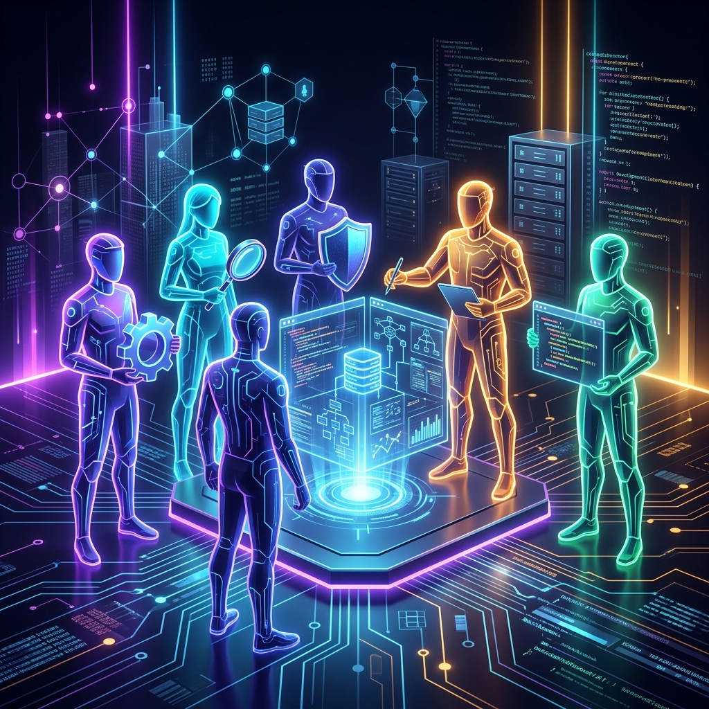
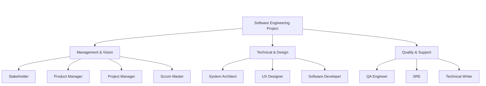
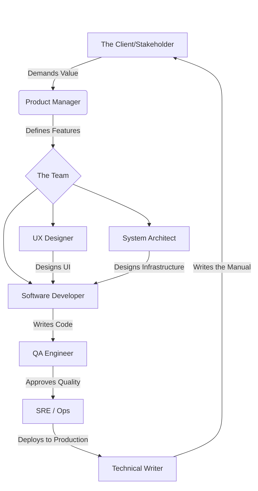

# 10 - Roles in Software Engineering Projects



## 1. Jargon Translation

- **Scrum Master**:
  - *Official Definition*: A facilitator for an Agile development team who ensures the team follows Scrum practices and values.
  - *Under the Hood*: A bulldozer whose entire job is clearing roadblocks so the developers can code without being interrupted by bureaucracy or meetings.
- **SRE (Site Reliability Engineer)**:
  - *Official Definition*: An engineer who bridges development and operations by combining software engineering expertise with IT systems management.
  - *Under the Hood*: The digital firefighter who wakes up at 3 AM when the servers crash, figures out why, and writes code to ensure it never happens again.
- **Product Manager**:
  - *Official Definition*: The person responsible for the vision and roadmap of a product, ensuring it provides value to the stakeholders.
  - *Under the Hood*: The "mini-CEO" of the product who decides *what* features should be built next, but not *how* they are built.
- **Stakeholder**:
  - *Official Definition*: Any individual or group that has an interest in the project and can affect or be affected by its outcomes.
  - *Under the Hood*: The people paying for the software, using the software, or getting fired if the software fails.

## 2. Topics Introduced in Lecture Transcript

1. Core Management & Vision Roles (Product Manager, Project Manager, Scrum Master, Stakeholders)
2. Core Technical & Design Roles (System Architect, UX Designer, Software Developer)
3. Core Quality & Support Roles (Tester/QA, SRE, Technical Writer)

## 3. Exhaustive Deep Dive & Structured Notes

Software is rarely built by a single "coder in a basement" anymore. Modern software requires highly specialized, cross-functional teams.

### Management & Vision
* **Stakeholders**: The ultimate judge of the software. They define requirements and accept/reject the final product.
* **Product Manager (or Product Owner in Agile)**: The visionary. They deeply understand the client's needs and determine *what* features are most valuable to build next.
* **Project Manager (Waterfall)**: The coordinator. They deal with budgeting, scheduling, and resource allocation.
* **Scrum Master (Agile)**: The facilitator. Unlike a Project Manager, a Scrum Master doesn't budget or plan; they focus strictly on team communication, protecting developers from outside distractions, and enforcing Agile values.

### Technical & Design
* **System Architect (or Solution Architect)**: The structural designer. They don't usually write day-to-day code; instead, they design the high-level inner structure, database schemas, and server layouts.
* **UX (User Experience) Designer**: The human bridge. They design how the software *feels* to use, balancing intuitive design with robust functionality.
* **Software Developer**: The builder. They take the Architect's blueprints, the UX Designer's mockups, and the Product Manager's requirements, and translate them into functional code.

### Quality & Support
* **Tester / QA Engineer**: The quality gatekeeper. They write and execute test cases (often automating them) to find bugs before the software reaches the customer.
* **SRE (Site Reliability Engineer)**: The stabilizer. They automate server scaling, troubleshoot production crashes, and ensure the app stays online 99.99% of the time.
* **Technical Writer**: The translator. They take complex technical jargon and turn it into readable manuals, reports, and FAQs for non-technical users.

Nine roles, three categories, one shared goal. Laying them side by side makes it clear that no single role can answer every question a project needs answered:

| Role | Category | Primary Focus | Key Question They Answer |
| :--- | :--- | :--- | :--- |
| **Stakeholder** | Management & Vision | Business outcome | "Does this create value for us?" |
| **Product Manager** | Management & Vision | Feature prioritization | "What should we build next?" |
| **Project Manager** | Management & Vision | Budget & schedule | "When will it be done, and for how much?" |
| **Scrum Master** | Management & Vision | Team facilitation | "What's blocking the team right now?" |
| **System Architect** | Technical & Design | System structure | "How should this be technically built?" |
| **UX Designer** | Technical & Design | User experience | "How should this feel to use?" |
| **Software Developer** | Technical & Design | Implementation | "How do I turn the blueprint into working code?" |
| **QA Engineer** | Quality & Support | Defect detection | "Does this actually work as specified?" |
| **SRE** | Quality & Support | Reliability & uptime | "Will this stay online under real load?" |
| **Technical Writer** | Quality & Support | Communication | "How do I explain this to someone who didn't build it?" |





## 4. Step-by-Step Breakdown: A Feature's Journey

**Scenario**: The Stakeholder wants a "One-Click Checkout" feature.
1. **Product Manager**: Agrees this is valuable and adds it to the top of the backlog.
2. **Scrum Master**: Helps the team figure out how much time they need to build it during the Sprint Planning meeting.
3. **UX Designer**: Draws mockups showing exactly where the new "Buy Now" button goes.
4. **System Architect**: Designs the secure database pathway so the credit card doesn't get hacked.
5. **Software Developer**: Writes the Javascript to make the button actually work.
6. **QA Engineer**: Tries to break the button by clicking it 500 times in a row.
7. **SRE**: Configures the cloud servers so they don't crash when 10,000 people use the new button on Black Friday.
8. **Technical Writer**: Updates the "How to Shop" page on the company website.

## 5. Concrete Examples

Let's look at how these roles view a database crash:
* **Product Manager**: "We are losing $10,000 an hour! When will this be fixed?"
* **Developer**: "My code was perfect, the database must have run out of memory."
* **SRE**: "The database ran out of memory, I'm writing an automation script to scale up the RAM next time."
* **QA Engineer**: "I'll add a load-test to catch this before it happens again."
* **Scrum Master**: "Can we discuss why this happened in tomorrow's Retrospective meeting?"

## 6. Code Blocks

```markdown
<!-- A standard GitHub Pull Request (PR) shows how these roles interact in the real world -->

# Feature: One-Click Checkout

**Developer**: Added the Stripe API integration.
**UX Designer**: ⚠️ Please change the button color to Hex `#FF5733`.
**QA Engineer**: ❌ PR Rejected. Integration test #45 failed when I used an expired credit card.
**System Architect**: ⚠️ Please ensure you are not logging the CVV code in the error logs.
**Product Manager**: ✅ This looks great, when can we ship it?
**SRE**: ✅ Terraform scripts are ready for deployment.
```

## 7. Related Concepts

1. **DevOps Culture**: A philosophy that merges the Developers (Dev) and the SREs/Ops (Ops) into a single continuous pipeline, breaking down the wall between "writing code" and "deploying code".
2. **Cross-Functional Teams (Squads)**: Instead of having a "QA Department" and a "Dev Department", Agile teams form "Squads" where one Developer, one QA, and one Product Manager sit at the same desk and own a single feature together.
3. **The "Full Stack" Developer**: A modern term for a developer who is expected to know a little bit of UX design, a little bit of architecture, and a little bit of SRE work.

## 8. Key Takeaways (Flashcard-Ready)

- **Q: What is the primary difference between a Project Manager and a Scrum Master?**
  - A: A Project Manager focuses on scheduling, budgeting, and planning. A Scrum Master focuses on team communication, removing roadblocks, and ensuring Agile values are met.
- **Q: What does a System Architect do?**
  - A: They design the essential characteristics of the inner structure and technical infrastructure of the software, rather than writing the day-to-day feature code.
- **Q: What is the main goal of a UX Designer?**
  - A: To balance making the software intuitive and easy to use while still being robust enough to address all technical requirements.
- **Q: How does an SRE differ from a standard Developer?**
  - A: A developer writes the product code. An SRE focuses on the infrastructure, automating deployments, tracking crashes, and ensuring high reliability/uptime.
- **Q: What is the role of a Technical Writer?**
  - A: To translate highly technical material into readable documentation, manuals, and FAQs for non-technical end-users.

## 9. 💡 The Secret Engineering Trick

**The "Bus Factor"**
The "Bus Factor" is a morbid but critical engineering metric: *How many team members would have to be hit by a bus before the project completely stalls?* If only your System Architect knows how the database is structured, your Bus Factor is 1. High-functioning teams force cross-training (having developers do QA work, having QA write documentation) to ensure the Bus Factor is as high as possible. Never let a single role become a bottleneck.

## 10. Interview Questions Section

### 1. What is the difference between a Product Manager and a Project Manager?

* **Simple Definition**: Imagine sailing a ship across the ocean. The Product Manager decides *where* the ship is sailing and *why* — Bermuda, because that's where the paying customers actually want to go. The Project Manager is the navigator ensuring the crew has enough food, fuel, and daylight hours to actually get there on schedule, without the boat sinking along the way. One picks the destination; the other gets you there safely and on time.
* **Official Definition**: A Product Manager (or Product Owner in Agile contexts) is responsible for the product's vision, roadmap, and requirements, ensuring the features being built deliver genuine value to users and stakeholders. A Project Manager is responsible for execution — planning timelines, allocating budget and resources, tracking deadlines, and coordinating cross-team dependencies to deliver the product on schedule.
* **Primary Responsibilities / Core Details**:
  * **Product Manager Artifacts**: Writes User Stories, maintains and prioritizes the product backlog, and defines acceptance criteria for features.
  * **Project Manager Artifacts**: Builds Gantt charts, tracks sprint velocity and burn-down charts, and manages the overall project budget.
  * **Question Ownership**: The Product Manager answers "What are we building, and why does it matter?" The Project Manager answers "When will it be done, and what will it cost?"
  * **Organizational Structure**: In smaller companies these two roles are frequently merged into one person; in large enterprises they are almost always separate, sometimes reporting to entirely different departments (Product to the CPO, Project to Operations).
  * **Decision Authority**: The Product Manager has final say over *scope* (what's in or out of a release). The Project Manager has final say over *sequencing* (what order things get built in given resource constraints).
  * **Conflict Point**: The two roles frequently clash productively — the Product Manager wants to add "just one more feature," and the Project Manager has to push back that doing so will blow the deadline, forcing a healthy negotiation over trade-offs.
* **Real-World Example**: A Product Manager at a streaming company decides the app urgently needs a Dark Mode feature because thousands of users have requested it in App Store reviews and it's hurting retention. The Project Manager then breaks that vision down into an execution plan: three developers, four weeks, one UX designer for two of those weeks, and a hard dependency on the design system being finished first — and adjusts the quarterly roadmap and budget accordingly, flagging to the Product Manager that shipping Dark Mode means a different, lower-priority feature slips to next quarter.
* **Best Coding/Development Practices**:
  * **Protect Developer Time from Both Roles**: Use automated issue-tracking systems (like Jira) so both Product and Project Managers can see progress without interrupting developers for constant status updates.
    ```bash
    # A developer's commit message automatically moves the Jira ticket
    git commit -m "Fix login bug. Closes PROJ-123"
    ```
  * **Link User Stories to Timeline Estimates Explicitly**: Ensure every User Story the Product Manager writes carries a Project Manager-approved estimate before it enters a sprint, so scope and schedule never drift apart silently.
    ```markdown
    ## User Story: PROJ-451
    As a user, I want Dark Mode so I can use the app comfortably at night.
    **Estimate (Project Manager)**: 4 weeks, 3 developers, 1 designer.
    **Acceptance Criteria (Product Manager)**: Toggle persists across sessions.
    ```
  * **Hold a Weekly Sync Between the Two Roles**: Schedule a recurring 30-minute sync specifically between Product and Project Manager to reconcile scope changes against the timeline before they surface as surprises to the engineering team.
    ```markdown
    > Recurring Calendar Event: "Scope vs. Schedule Sync"
    > Attendees: Product Manager, Project Manager
    > Agenda: Any new/changed requirements this week? Any timeline risk?
    ```
  * **Give Both Roles Veto Rights Over Different Things**: Formalize that the Product Manager can veto a proposed cut to scope quality, while the Project Manager can veto a timeline that has no realistic chance of success, so disagreements resolve through defined authority rather than seniority or volume.
    ```markdown
    > Escalation Rule: If Product and Project disagree on a tradeoff,
    > the decision escalates to Engineering Leadership within 24 hours
    > — it never just quietly stalls in a Slack thread.
    ```
* **Visual Aid (Mermaid Flowchart)**:
  ```mermaid
  flowchart TD
      margin_1((" "))
      style margin_1 fill:none,stroke:none
      margin_1 ~~~ A

      A[Business Opportunity] --> PM(Product Manager)
      PM -->|Defines Vision & Backlog| Q1["What are we building?"]

      A --> ProjM(Project Manager)
      ProjM -->|Plans Budget & Schedule| Q2["When will it be done?"]

      Q1 --> Team[Engineering Team]
      Q2 --> Team
      Team --> Ship[Feature Shipped On Time & On Value]
  ```
* **Core Focus Areas**: Vision vs Execution | Scope Ownership | Schedule Ownership | Cross-Role Negotiation

### 2. How does an SRE differ from a traditional Software Developer?

* **Simple Definition**: Developers are the engineers who design and build the race car's engine, obsessed with making it faster and adding new features every season. SREs are the pit crew and track engineers who make sure that engine doesn't catch fire at 200 mph, can be repaired in under ten seconds during a pit stop, and survives an entire brutal racing season without falling apart.
* **Official Definition**: Software Developers write application code to implement business requirements and ship new features. Site Reliability Engineers (SREs) apply software engineering principles to IT operations, focusing on system reliability, scalability, automation of infrastructure, and incident response, effectively treating operations problems as software problems to be solved with code.
* **Primary Responsibilities / Core Details**:
  * **Primary Metric**: Developers are typically measured on feature velocity — how much new functionality ships. SREs are measured on reliability metrics like uptime, error budgets, and Mean Time To Recovery (MTTR).
  * **Infrastructure as Code**: SREs write and maintain Infrastructure as Code (IaC) using tools like Terraform, Ansible, or Pulumi, so that servers, networks, and cloud resources are version-controlled just like application code.
  * **On-Call Ownership**: SREs typically own the on-call rotation, are paged first when production goes down, and lead the incident response and postmortem process.
  * **Automation Mindset**: A core SRE philosophy is that any manual, repetitive operational task should eventually be automated away — if an SRE does something by hand twice, the third time it becomes a script.
  * **Error Budgets**: SREs often introduce the concept of an "error budget" — an agreed-upon acceptable amount of downtime per quarter — which gives Product teams a data-driven way to balance shipping new features against system stability.
  * **Overlap with DevOps**: SRE is frequently described as "what happens when you ask a software engineer to design an operations function," and the role heavily overlaps with, and sometimes is used interchangeably with, DevOps Engineer.
  * **Toil Reduction**: A core part of the job is identifying "toil" — manual, repetitive, automatable operational work — and systematically eliminating it, freeing the SRE's own time for higher-leverage engineering rather than firefighting the same issue every week.
* **Real-World Example**: A Developer on a video streaming platform writes the front-end and back-end code for a brand-new live-streaming feature. The SRE, working in parallel, writes the Terraform scripts and auto-scaling policies that automatically spin up 50 additional AWS servers the moment 100,000 concurrent viewers try to watch a popular creator's live stream at once — and just as importantly, writes the alerting rules that page someone the instant server CPU crosses 85%, long before viewers notice any lag.
* **Best Coding/Development Practices**:
  * **Infrastructure as Code, Never Manual Console Clicks**: SREs should never manually click buttons in a cloud console to provision resources; all infrastructure should be defined in version-controlled code so changes are reviewable and repeatable.
    ```hcl
    resource "aws_instance" "web_server" {
      ami           = "ami-0c55b159cbfafe1f0"
      instance_type = "t2.micro"
      tags = {
        Name = "Production-API"
      }
    }
    ```
  * **Define and Track an Error Budget**: Formalize an acceptable downtime threshold so reliability work and feature work can be prioritized against the same shared metric instead of an endless argument.
    ```yaml
    # error-budget-policy.yml
    service: checkout-api
    slo_target: 99.9%          # Allowed: ~43 minutes downtime/month
    current_month_used: 12min  # Budget remaining: 31 minutes
    ```
  * **Write Runbooks for Every Alert**: Every automated alert an SRE configures should link directly to a runbook explaining exactly how to diagnose and resolve it, so an on-call engineer isn't improvising at 3 AM.
    ```yaml
    alert: HighCPUUsage
    threshold: "> 85% for 5 minutes"
    runbook: "https://wiki.company.com/runbooks/high-cpu"
    ```
  * **Conduct Blameless Postmortems**: After every significant incident, SREs lead a blameless postmortem focused entirely on fixing the systemic cause, never on assigning fault to an individual engineer, so people report problems honestly instead of hiding them.
    ```markdown
    > Postmortem Template
    > ## What Happened (Timeline)
    > ## Root Cause (System, not Person)
    > ## Action Items (Owner + Deadline)
    ```
* **Visual Aid (Mermaid Flowchart)**:
  ```mermaid
  flowchart TD
      margin_1((" "))
      style margin_1 fill:none,stroke:none
      margin_1 ~~~ A

      A[New Feature Request] --> Dev(Software Developer)
      Dev -->|Writes Feature Code| Feature[Live-Streaming Feature]

      A --> SRE(Site Reliability Engineer)
      SRE -->|Writes IaC & Alerting| Infra[Auto-Scaling Infrastructure]

      Feature --> Traffic[100,000 Concurrent Viewers]
      Infra --> Traffic
      Traffic --> Uptime[Feature Stays Online]
  ```
* **Core Focus Areas**: Velocity vs Reliability | Infrastructure as Code | Incident Response | Error Budgets

### 3. What is the role of a System Architect?

* **Simple Definition**: Before a single construction worker pours concrete for a skyscraper, a structural engineer draws detailed blueprints specifying exactly where the steel beams go, how deep the foundation must be, and how the building will survive an earthquake. A System Architect does the exact same thing for software — designing the load-bearing structure of a system long before a single developer writes a line of feature code.
* **Official Definition**: A System Architect (or Solution Architect) designs the essential characteristics of a software system's inner structure — its components, their boundaries, how they communicate, and the technologies they're built on — providing a high-level technical roadmap that guides the entire development team's implementation decisions.
* **Primary Responsibilities / Core Details**:
  * **Technology Selection**: Makes high-level, hard-to-reverse technology choices, such as choosing a relational database (PostgreSQL) over a document database (MongoDB) based on the data's actual shape and consistency needs.
  * **Boundary Design**: Designs microservice boundaries and the API contracts between them, deciding what belongs inside a single service versus what should be split into an independent one.
  * **Non-Functional Requirements Ownership**: Is primarily responsible for ensuring the system will be scalable, secure, and maintainable — qualities that are invisible in a demo but catastrophic if ignored.
  * **Cross-Team Consistency**: On large projects with multiple squads, the Architect ensures different teams' services can actually talk to each other correctly, preventing "architecture by accident."
  * **Seniority and Trust**: Is usually the most experienced technical person on the team, and their authority typically comes from track record and trust rather than formal management title.
  * **Not a Full-Time Coder**: While technically capable, the Architect typically writes far less day-to-day feature code than developers, instead spending their time in design reviews, whiteboard sessions, and mentoring.
  * **Balancing Idealism Against Reality**: A good Architect resists the temptation to design the theoretically perfect system and instead designs the best system achievable within the team's actual skill level, timeline, and budget — an architecture nobody can build on schedule is a failed architecture regardless of its elegance.
* **Real-World Example**: Instead of letting six different developers each build database access however they personally prefer — resulting in a tangled, inconsistent codebase — a System Architect steps in during the Design phase of a new e-commerce platform and mandates: "We are splitting this into three separate microservices — Inventory, Orders, and Payments — that communicate exclusively through an event bus, never through direct database access to each other's tables." Six months later, when the Payments team needs to scale independently during a holiday sale, that early boundary decision is the entire reason it's possible without touching Inventory or Orders code at all.
* **Best Coding/Development Practices**:
  * **Document Decisions with Architecture Decision Records (ADRs)**: Architects must formally document *why* they chose a specific technology or pattern so future developers understand the reasoning instead of guessing or accidentally undoing it.
    ```markdown
    # ADR: Using Redis for Caching
    ## Context
    Our database is overwhelmed by read requests on the homepage.
    ## Decision
    We will implement Redis as an in-memory caching layer.
    ## Consequences
    Developers must now ensure cache invalidation is handled correctly.
    ```
  * **Draw the Boundaries Before the Code Exists**: Produce a simple, explicit service-boundary diagram during Design so every developer knows precisely which service owns which data before implementation starts.
    ```markdown
    > Service Boundary Rule: The Orders service NEVER queries the
    > Inventory database directly. It publishes an "OrderPlaced"
    > event; Inventory subscribes and decrements stock itself.
    ```
  * **Review Architecture Changes Like Code**: Require any significant deviation from the agreed architecture to go through a lightweight Architecture Review, not just a standard code review, so structural drift is caught early.
    ```markdown
    > PR Label: `needs-architecture-review`
    > Applied automatically when a PR adds a new service-to-service
    > direct database connection.
    ```
  * **Build Proofs of Concept for High-Risk Decisions**: Before committing the whole team to a major architectural choice, have the Architect (or a small pair) build a small, throwaway proof-of-concept to validate the riskiest assumption cheaply, rather than discovering it's wrong after months of implementation.
    ```markdown
    > Spike Ticket: "Prove the event bus can handle 10k msgs/sec
    > before we commit the Orders/Inventory split to the roadmap."
    > Timebox: 3 days. Throwaway code, not production-bound.
    ```
* **Visual Aid (Mermaid Flowchart)**:
  ```mermaid
  flowchart TD
      margin_1((" "))
      style margin_1 fill:none,stroke:none
      margin_1 ~~~ A

      A[Business Requirements] --> Arch(System Architect)
      Arch -->|Chooses| Tech[Database & Tech Stack]
      Arch -->|Defines| Bound[Service Boundaries]
      Arch -->|Ensures| NFR[Scalability & Security]

      Tech --> Devs[Developers Implement]
      Bound --> Devs
      NFR --> Devs
      Devs --> System[Coherent, Scalable System]
  ```
* **Core Focus Areas**: Structural Design | Technology Selection | Non-Functional Requirements | Cross-Team Consistency

### 4. Who is responsible for ensuring the software meets the customer's needs?

* **Simple Definition**: It's a relay race, not a solo sprint. The Product Manager decides what "meeting the customer's needs" should even mean. The developer builds toward that target. The QA Engineer is the last line of defense, proving the thing actually works before it ships. And the Stakeholder holds the final whistle — they get to say whether the finished race actually crossed the line the customer cared about.
* **Official Definition**: No single role owns customer satisfaction alone; it is a shared responsibility distributed across the team. The Product Manager ensures the requirements themselves provide genuine value. The Software Developer implements those requirements faithfully. The QA Engineer is specifically responsible for executing test cases to verify the software matches the documented requirements. The Stakeholder holds ultimate authority to formally accept or reject the finished product against real business needs.
* **Primary Responsibilities / Core Details**:
  * **QA's Narrow Mandate**: QA catches *implementation* bugs — verifying the software does what the requirements say, not whether the requirements were the right ones to write in the first place.
  * **Product Manager's Mandate**: Validates the *vision* — making sure the requirements QA is testing against actually reflect what will create value for users.
  * **Stakeholder's Mandate**: Validates *business impact* — even flawlessly-built, bug-free software can still be rejected if market conditions changed or it no longer serves the business goal.
  * **The Gap Between "Correct" and "Valuable"**: Software can pass every single QA test case and still fail the customer completely, because QA proves correctness against a spec, not usefulness against reality.
  * **Feedback Loop Ownership**: The Product Manager is typically responsible for closing the loop back to engineering when a Stakeholder rejects a "correct" product, translating "this isn't what we need anymore" into new, revised requirements.
  * **User Acceptance Testing (UAT)**: This is the formal mechanism, usually run by the Stakeholder or actual end-users, that sits after QA and specifically tests for real-world business value rather than just technical correctness.
* **Real-World Example**: A developer builds a sophisticated analytics dashboard exactly as specified in the SRS. QA runs a full regression suite and confirms it works flawlessly under every documented test case, with zero bugs. But when it's presented to the Stakeholder during UAT, they reject it outright — not because anything is broken, but because a competitor launched a simpler, faster product that quarter, and the market has shifted toward speed over feature-depth. The software is technically perfect and completely rejected in the same breath, because "correct" and "valuable" turned out to be two different questions.
* **Best Coding/Development Practices**:
  * **Automate Quality Checks So QA Time Goes to Judgment, Not Repetition**: QA should not manually click through the app for every release; automated scripts should run on every code push, freeing human QA time for exploratory testing that actually questions whether the requirements are right.
    ```javascript
    describe('Customer Login Flow', () => {
      it('should allow a valid customer to log in', () => {
        cy.visit('/login');
        cy.get('input[name=username]').type('testuser');
        cy.get('input[name=password]').type('password123');
        cy.get('button[type=submit]').click();
        cy.url().should('include', '/dashboard');
      });
    });
    ```
  * **Involve the Stakeholder Before the Final Demo, Not Just After**: Show Stakeholders working increments early and often (every sprint, not just at launch) so a market shift or changed priority is caught in week two, not month six.
    ```markdown
    > Sprint Review Invite List: Product Manager, Lead Developer,
    > QA Lead, AND the Stakeholder — every sprint, not just at launch.
    ```
  * **Track "Valuable" Separately from "Correct" in Your Definition of Done**: Add a Definition of Done checklist item that is explicitly about business value, not just test coverage, so the team never confuses the two.
    ```markdown
    ## Definition of Done
    - [ ] All automated tests pass (Correctness)
    - [ ] Stakeholder has reviewed and confirmed continued relevance (Value)
    ```
  * **Run Lightweight Market Checks Alongside QA, Not After**: Have the Product Manager re-validate the requirement against current market conditions in parallel with QA's test cycle, rather than waiting until the final demo to discover the world has moved on.
    ```markdown
    > Parallel Checklist Before Release:
    > QA: "Does it pass every test case?" (Running in CI)
    > PM: "Is this still what the market needs?" (Checked this week)
    ```
* **Visual Aid (Mermaid Flowchart)**:
  ```mermaid
  flowchart TD
      margin_1((" "))
      style margin_1 fill:none,stroke:none
      margin_1 ~~~ A

      A[Requirements Written] --> PM{Product Manager: Is this valuable?}
      PM -->|Yes| Dev[Developer Implements]
      Dev --> QA{QA Engineer: Is this correct?}
      QA -->|Bugs Found| Dev
      QA -->|Passes| UAT{Stakeholder: Does this still meet the need?}
      UAT -->|Rejected: Market Changed| PM
      UAT -->|Accepted| Ship[Software Released]
  ```
* **Core Focus Areas**: Shared Accountability | Correctness vs Value | User Acceptance Testing | Feedback Loops

### 5. Why is cross-functional communication critical, and who facilitates it in Agile?

* **Simple Definition**: If the UX Designer draws a gorgeous checkout button but never actually talks to the Developer about how the payment system works underneath it, you end up with a beautiful button that crashes the app the moment someone clicks it. In Agile, the Scrum Master's entire job is making sure that conversation happens *before* the button ships, not after it's already broken in production.
* **Official Definition**: Cross-functional communication is the deliberate, structured exchange of information between different specialized roles (design, architecture, development, QA, operations) to ensure their individually correct decisions actually align into one coherent, working system. In Agile methodologies, the Scrum Master formally facilitates this communication by removing roadblocks, hosting daily standups, and protecting the team's focus from external distractions.
* **Primary Responsibilities / Core Details**:
  * **Prevents Silos**: Without deliberate cross-functional communication, teams naturally drift into silos — QA only talks to QA, Developers only talk to Developers — and integration problems are discovered far too late.
  * **Speeds Up Blocker Resolution**: Open communication channels mean a blocker gets addressed in minutes through a quick conversation rather than sitting in a ticket queue for days.
  * **Scrum Master's Protective Role**: The Scrum Master actively shields the team from external distractions (surprise meetings, scope-creep requests) so the cross-functional conversations that do happen stay focused and productive.
  * **Daily Standups as the Core Mechanism**: The daily standup exists specifically to surface cross-role dependencies early — "I'm blocked waiting on the Architect's decision" is exactly the kind of sentence a standup is designed to catch.
  * **Beyond Standups**: Cross-functional communication also happens through sprint planning (aligning Product, Design, and Engineering on scope), and retrospectives (aligning the whole team on process improvements after the fact).
  * **The Cost of Getting It Wrong**: Poor cross-functional communication is one of the single most common root causes cited in project post-mortems — far more often than any individual technical mistake.
  * **Remote and Async Considerations**: In distributed teams, the Scrum Master's facilitation role extends to async communication norms too — deciding when a written Slack thread is sufficient versus when a real-time call is required to resolve a cross-functional disagreement quickly.
* **Real-World Example**: A Developer building a new payment feature is completely blocked because they lack access to the staging database needed to test against realistic data. In a poorly communicating organization, this becomes a formal IT ticket that takes three days to resolve, quietly stalling the entire sprint. In a well-facilitated Agile team, the Developer mentions the blocker in the daily standup, the Scrum Master immediately walks over to the SRE in person, and the developer has staging access within five minutes — turning a three-day stall into a five-minute conversation purely through deliberate, facilitated communication.
* **Best Coding/Development Practices**:
  * **Keep Standups Short and Blocker-Focused**: The Scrum Master must strictly enforce that daily communication stays fast and action-oriented, answering three questions and nothing more.
    ```javascript
    // Automated bot asks the 3 core Agile questions every morning
    slack.postMessage({
      channel: '#engineering',
      text: "Daily Standup! Answer the following:\n1. What did you do yesterday?\n2. What are you doing today?\n3. Are there any blockers?"
    });
    ```
  * **Make Blockers Impossible to Ignore**: Tag blocking issues distinctly in your issue tracker so they visually stand out and get triaged by the Scrum Master immediately, rather than sitting unnoticed in a general backlog.
    ```markdown
    > JIRA Label: `🚧-BLOCKED`
    > Auto-notifies the Scrum Master in Slack the moment this label is applied.
    ```
  * **Pair Cross-Functionally, Not Just Within a Discipline**: Occasionally pair a Developer with a UX Designer, or a QA Engineer with an SRE, for a short working session, so communication channels exist *before* a blocker forces them into existence under pressure.
    ```markdown
    > Sprint Ritual: One "cross-pairing" session per sprint —
    > any two team members from different disciplines work
    > together on one ticket for an hour.
    ```
  * **Visualize Dependencies, Don't Just Talk About Them**: Maintain a simple, visible dependency board showing which roles are waiting on which other roles, so cross-functional blockers are obvious at a glance instead of buried in memory or chat history.
    ```markdown
    > Dependency Board Entry:
    > "Frontend team BLOCKED on: Backend API contract (Owner: @architect, ETA: Thu)"
    ```
* **Visual Aid (Mermaid Flowchart)**:
  ```mermaid
  flowchart TD
      margin_1((" "))
      style margin_1 fill:none,stroke:none
      margin_1 ~~~ A

      A[Developer Hits a Blocker] --> Standup[Raised in Daily Standup]
      Standup --> SM(Scrum Master)
      SM -->|Removes Roadblock| SRE[Talks to SRE / Relevant Role]
      SRE -->|Grants Access / Unblocks| Dev[Developer Resumes Work]

      SM -.->|Protects From| Distraction[External Distractions]
  ```
* **Core Focus Areas**: Silo Prevention | Scrum Master Facilitation | Standup Discipline | Cross-Disciplinary Pairing
