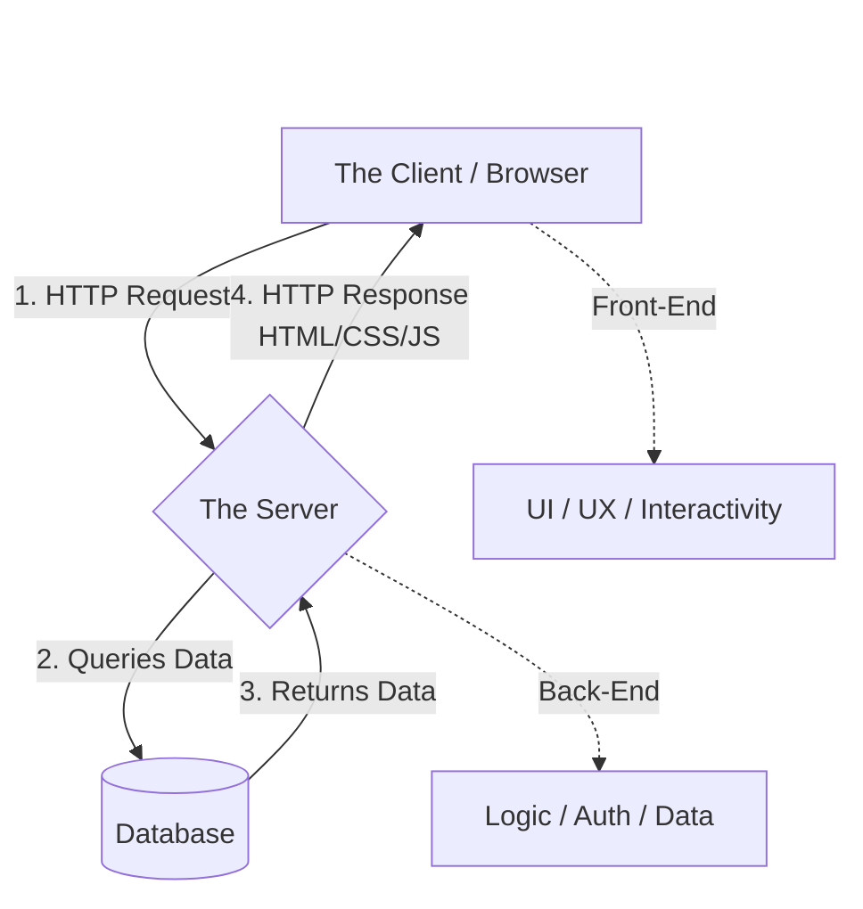

# 01 - Overview of Web and Cloud Development

<!-- IMAGE_PROMPT: A high-fidelity conceptual 3D isometric technical illustration of Web and Cloud Development. In the center, a futuristic glowing browser window (representing front-end client-side) is connected via illuminated fiber-optic data streams to a robust cloud server architecture with databases, microservices, and API endpoints (representing back-end and cloud). Dark sleek theme with glowing neon cyan, violet, and electric amber lighting. High aesthetic quality, crisp detail, no text. -->

## 1. Jargon Translation

- **Static Content**:
  - _Official Definition_: Content displayed by websites that is previously stored on the server and delivered to the client exactly as it is.
  - _Under the Hood_: A printed poster. Everyone who looks at it sees the exact same thing, and it never changes until someone physically swaps the poster.
- **Dynamic Content**:
  - _Official Definition_: Content generated each time it is requested by the client, often involving data from databases or external systems.
  - _Under the Hood_: A personalized digital billboard. It changes based on who is looking at it, what time it is, and what data it pulled from a server (like your Facebook newsfeed).
- **Front-End**:
  - _Official Definition_: The client-side environment dealing with everything the user can see and interact with.
  - _Under the Hood_: The steering wheel, dashboard, and shiny paint job of a car. It's the part the driver actually touches.
- **Back-End**:
  - _Official Definition_: The server-side environment that handles logic, functionality, authentication, and database connections before data is sent to the client.
  - _Under the Hood_: The engine, transmission, and wiring hidden under the hood. You don't see it, but without it, the car isn't moving.
- **IDE (Integrated Development Environment)**:
  - _Official Definition_: A software application that provides comprehensive facilities to computer programmers for software development, combining code editing, building, and debugging.
  - _Under the Hood_: A super-powered Swiss Army Knife for writing code. Instead of just a text editor (like Notepad), it has built-in spell-check for code, tools to instantly run the code, and connections to save it to the cloud.

## 2. Topics Introduced in Lecture Transcript

1. Client-Server Communication Basics
2. The Anatomy of a Webpage (HTML, CSS, JavaScript)
3. Static vs. Dynamic Content
4. Cloud Applications
5. The Developer Spectrum (Front-End, Back-End, Full-Stack)
6. Developer Tools: Code Editors and IDEs

## 3. Exhaustive Deep Dive & Structured Notes

### The Client-Server Relationship

The foundation of the internet is a request-response cycle. You (the **Client**) launch a browser and type a URL. The browser acts as your messenger, asking the **Server** (a powerful computer living in a data center) for the website. The server gathers the requested data and sends a response back to the client.

### The Three Pillars of the Web

When a server responds, it typically sends three types of files:

1. **HTML (HyperText Markup Language)**: Defines the raw structure. (The skeleton and walls of a house).
2. **CSS (Cascading Style Sheets)**: Adds style, colors, and layout. (The paint and interior decorating).
3. **JavaScript (JS)**: Adds interactivity and dynamic behavior. (The electricity and plumbing).

### Static vs. Dynamic

- **Static Websites**: Fast and cheap to host. Every user gets the exact same pre-written HTML file.
- **Dynamic Websites**: The server actually runs a program to generate the HTML on the fly. It pulls data from a database so that User A sees their own profile, and User B sees their own profile. Most modern websites are a hybrid of both.

### Cloud Applications

Cloud apps operate similarly to websites but rely heavily on scalable, resilient cloud-based backend infrastructure (like AWS, Azure, or IBM Cloud) for data storage and massive processing, rather than a single dedicated physical server.

### The Developer Spectrum

- **Front-End Developers**: Specialize in HTML, CSS, JavaScript, and client-side frameworks (like React or Vue). They care about UI/UX, animations, and accessibility.
- **Back-End Developers**: Specialize in server logic, security/authentication, API creation, and connecting to SQL or NoSQL databases. They care about data integrity and performance.
- **Full-Stack Developers**: Unicorns who have the skills to build both the entire front-end UI and the entire back-end server infrastructure.

| Dimension | Front-End Developer | Back-End Developer |
| :--- | :--- | :--- |
| **Core Languages** | HTML, CSS, JavaScript | Node.js, Python, Java, SQL |
| **Primary Concern** | UI/UX, accessibility, animations | Data integrity, security, performance |
| **Runs Where** | The user's browser | A remote server / the cloud |
| **Typical Output** | Rendered pages and interactions | APIs, database queries, business logic |

### The Developer's Toolbox

To write code, you need a text editor.

- **Simple Code Editors**: Sublime Text, Atom, Vim. Lightweight and fast.
- **IDEs (Integrated Development Environments)**: VS Code, Visual Studio, Eclipse, NetBeans. These incorporate debugging, Git/GitHub integration, and massive extension libraries to make coding vastly more efficient.



## 4. Step-by-Step Breakdown: Loading a Webpage

**Scenario**: A user visits `www.example.com`.

1. **The Request**: The user types the URL. The browser translates the URL into an IP address and sends an HTTP Request to the Server.
2. **The Logic (Back-End)**: The server receives the request. The Back-End code realizes this is a dynamic page and queries the database for the user's latest data.
3. **The Assembly**: The server takes the database data and injects it into an HTML template.
4. **The Response**: The server sends the finalized HTML, along with CSS for styling and JS for interactivity, back to the browser.
5. **The Render (Front-End)**: The browser reads the HTML, applies the CSS paint, and executes the JavaScript. The user finally sees the website.

## 5. Concrete Examples

- **Static Content**: A restaurant's "About Us" page. It says "Established in 1990" and never changes unless the developer edits the code.
- **Dynamic Content**: The restaurant's "Order Online" shopping cart. The total price updates dynamically based on what you click, fetching tax rates from a database.
- **Front-End Task**: Making the "Submit" button turn green when hovered over.
- **Back-End Task**: Ensuring that when the "Submit" button is clicked, the credit card is actually charged and the order is saved to the database securely.

## 6. Code Blocks

```html
<!-- FRONT-END: A simple HTML and JS file that runs in the browser -->
<html>
  <style>
    button {
      background-color: blue;
      color: white;
    }
  </style>
  <body>
    <button id="alertBtn">Click Me</button>
    <script>
      // This JavaScript runs entirely on the Client side
      document.getElementById("alertBtn").onclick = function () {
        alert("Hello from the Front-End!");
      };
    </script>
  </body>
</html>
```

```javascript
// BACK-END: A simple Node.js server that runs on the Server side

const http = require("http");

// This logic never reaches the user's browser; it stays on the server.
const server = http.createServer((request, response) => {
  if (request.url === "/api/user") {
    // A Back-End developer would query a database here
    response.writeHead(200, { "Content-Type": "application/json" });
    response.end(JSON.stringify({ username: "john_doe", role: "admin" }));
  }
});

server.listen(3000, () =>
  console.log("Server is securely running on port 3000"),
);
```

**What happens if... the Back-End fails to handle missing routes (404 Error)?**
If a user requests an API endpoint that doesn't exist, the server will hang indefinitely unless handled, providing a terrible UX.

```javascript
// BAD PRACTICE: Hanging requests on unmatched routes
const server = http.createServer((request, response) => {
  if (request.url === "/api/user") {
    response.end("User Data");
  }
  // What happens if they request /api/unknown?
  // The server does nothing. The browser spins forever until it times out.
});

// GOOD PRACTICE: Proper fallback/error handling
const server = http.createServer((request, response) => {
  if (request.url === "/api/user") {
    response.writeHead(200, { "Content-Type": "application/json" });
    response.end(JSON.stringify({ user: "john" }));
  } else {
    // 404 Fallback
    response.writeHead(404, { "Content-Type": "text/plain" });
    response.end("404 Not Found");
  }
});
```

## 7. Related Concepts

1. **HTTP/HTTPS**: The actual language/protocol that the Client and Server use to talk to each other over the internet.
2. **APIs (Application Programming Interfaces)**: The structured bridges that allow a Front-End to easily request data from a Back-End.
3. **Relational vs. NoSQL Databases**: Relational (SQL) uses strict tables. NoSQL (like MongoDB) uses flexible JSON-like documents. Back-end developers must choose which is best.
4. **Version Control (Git)**: The tool developers use to save checkpoints of their code, collaborate without overwriting each other, and undo catastrophic mistakes.
5. **Continuous Integration/Continuous Deployment (CI/CD)**: The automated pipelines that allow developers to test and deploy their cloud applications rapidly without taking the server down.

## 8. Key Takeaways (Flashcard-Ready)

- **Q: What are the three core languages returned by a server to a browser?**
  - A: HTML (Structure), CSS (Style), and JavaScript (Interactivity).
- **Q: What is the difference between Static and Dynamic content?**
  - A: Static content is pre-stored and identical for everyone. Dynamic content is generated on the fly, often using databases, to provide a personalized experience.
- **Q: What does a Front-End developer do?**
  - A: They build everything that happens on the client-side—what the user sees and interacts with (UI/UX).
- **Q: What does a Back-End developer do?**
  - A: They build the server-side logic, secure authentication processes, and database connections.
- **Q: What is an IDE?**
  - A: An Integrated Development Environment; a robust software tool that combines code editing, compiling, debugging, and version control (e.g., VS Code).

## 9. 💡 The Secret Engineering Trick

**The "Fake It Till You Make It" API (Mocking)**
When a Full-Stack team is building a new app, the Front-End developers usually can't finish their UI until the Back-End developers finish the database. **The Trick**: Front-End developers use tools like `json-server` or `Postman` to create a "Mock API." It acts exactly like a real server and returns fake, hardcoded JSON data. This allows the Front-End team to build the entire UI while the Back-End team is still writing the real database logic, doubling development speed!

## 10. Interview Questions Section

### 1. Can you explain the difference between Front-End and Back-End development?

- **Simple Definition**: Front-End development is like the shiny, inviting storefront of a retail shop where customers browse, touch products, and interact with the cashier. Back-End development is the massive, hidden warehouse in the back, complete with inventory management systems, security guards, and supply chain logistics that actually make the store function and ensure the right product reaches the front.
- **Official Definition**: Front-end development focuses on the client-side environment, handling everything the user interacts with directly by rendering HTML, CSS, and JavaScript in the user's browser. Back-end development focuses on the server-side architecture, managing the core application logic, database interactions, authentication, and secure data processing before transmitting any information to the client via APIs.
- **Primary Responsibilities / Core Details**:
  - **Front-End: Cross-Browser Compatibility**: Ensuring the application renders correctly across Chrome, Firefox, Safari, and Edge.
  - **Front-End: Responsive Design**: Utilizing CSS media queries or frameworks (like Tailwind or Bootstrap) to ensure the UI adapts flawlessly to mobile, tablet, and desktop screens.
  - **Front-End: State Management**: Managing the application's state (e.g., whether a user is logged in, what is in their cart) using tools like Redux or React Context.
  - **Front-End: Accessibility (a11y)**: Building interfaces that are usable by people with disabilities, utilizing semantic HTML and ARIA labels.
  - **Back-End: API Design**: Architecting secure, scalable RESTful or GraphQL APIs that the front-end can consume to retrieve or mutate data.
  - **Back-End: Database Management**: Designing database schemas (SQL or NoSQL), optimizing queries for speed, and managing data migrations.
  - **Back-End: Security & Authentication**: Implementing robust security measures, including JWT authentication, password hashing (bcrypt), CORS policies, and rate-limiting to prevent DDoS attacks.
  - **Back-End: Server Architecture**: Managing the server environment, load balancing, and deploying microservices using Node.js, Express, and cloud providers.
- **Real-World Example**: In an application like Netflix, the Front-End is the interactive carousel you scroll through on your smart TV or laptop, the video player controls, and the smooth animations when you hover over a movie. The Back-End is the massive server farm calculating complex machine-learning algorithms to recommend movies based on your watch-history database, securely verifying your subscription payment, and streaming the encrypted video files to your device.
- **Best Coding/Development Practices**:
  - **Practice 1: Strict API Decoupling**: A modern application should have a front-end that communicates with the back-end exclusively via an API. They should never be tightly coupled or share the same process memory.
    ```javascript
    // FRONT-END: Decoupled API Fetch using async/await
    async function fetchMovies() {
      try {
        const response = await fetch("https://api.myapp.com/v1/movies");
        if (!response.ok) throw new Error("Network response was not ok");
        const data = await response.json();
        renderUI(data);
      } catch (error) {
        console.error("Failed to fetch movies:", error);
      }
    }
    ```
  - **Practice 2: Back-End Input Validation**: Never trust data coming from the Front-End. The Back-End must rigorously validate and sanitize all incoming data before processing it or saving it to a database.
    ```javascript
    // BACK-END: Validating input using Express and Joi
    const Joi = require('joi');
    app.post('/api/users', (req, res) => {
      const schema = Joi.object({ username: Joi.string().alphanum().min(3).max(30).required() });
      const { error } = schema.validate(req.body);
      if (error) return res.status(400).send(error.details[0].message);
      // Proceed to save user
    });
    ```
  - **Practice 3: Front-End Error Boundaries**: Implement graceful error handling on the front-end so that if the back-end crashes or returns an error, the user sees a friendly UI instead of a blank white screen.
    ```javascript
    // FRONT-END: React Error Boundary Concept
    class ErrorBoundary extends React.Component {
      state = { hasError: false };
      static getDerivedStateFromError(error) { return { hasError: true }; }
      render() {
        if (this.state.hasError) return <h1>Something went wrong on our servers. Please try again later.</h1>;
        return this.props.children;
      }
    }
    ```
- **Visual Aid (Mermaid Flowchart)**:
  ```mermaid
  flowchart TD
      margin_1((" "))
      style margin_1 fill:none,stroke:none
      margin_1 ~~~ Client
      
      subgraph "Front-End (Client Side)"
          Client[User Browser]
          UI[HTML / CSS / React]
          State[Redux / State Mgmt]
          Client --> UI
          UI <--> State
      end
      
      subgraph "Internet"
          REST[RESTful API over HTTPS]
      end
      
      subgraph "Back-End (Server Side)"
          Server[Node.js / Express Server]
          Auth[Authentication / JWT]
          DB[(PostgreSQL / MongoDB)]
          Server <--> Auth
          Server <--> DB
      end
      
      State <-->|JSON Data| REST
      REST <-->|JSON Data| Server
  ```
- **Core Focus Areas**: UI/UX & Browser APIs | Server Logic & Security | Database Management | API Architecture

### 2. What is the difference between Static and Dynamic content?

- **Simple Definition**: Static content is like a printed restaurant menu sitting on a table; it says exactly the same thing for every customer and never changes until management reprints it. Dynamic content is like a digital smart-menu above the counter; it hides items that are sold out in real-time, displays different specials depending on the time of day, and customizes recommendations based on your loyalty card.
- **Official Definition**: Static elements consist of pre-rendered HTML, CSS, and image files stored on a web server and delivered to the client exactly as they are without any server-side modification. Dynamic elements are generated dynamically on a per-request basis by server-side logic (such as Node.js, PHP, or Python) that queries a database or external service to assemble customized HTML or JSON payloads.
- **Primary Responsibilities / Core Details**:
  - **Static: Speed and Caching**: Because static files don't require database lookups, they can be served incredibly fast and cached globally on Edge networks.
  - **Static: Low Infrastructure Cost**: Hosting static files requires minimal computing power, making it extremely cost-effective compared to running application servers.
  - **Static: Security**: With no server-side logic or database connections to exploit, pure static sites have a remarkably small attack surface.
  - **Dynamic: Personalization**: Dynamic content allows for user-specific data, such as shopping carts, customized dashboards, and private messaging.
  - **Dynamic: Real-Time Updates**: Content can be updated instantly across the globe simply by altering a database row, without needing to redeploy the website code.
  - **Dynamic: Processing Power**: Requires dedicated application servers and databases, which introduces latency and requires scaling strategies (like load balancing) as traffic grows.
- **Real-World Example**: When you visit Amazon.com, the logo, the background colors, and the general layout framework are **Static content** delivered instantly. However, the "Recommended for You" section, the current price of an item (which fluctuates), and the number of items in your specific shopping cart are entirely **Dynamic content** fetched from their massive back-end databases.
- **Best Coding/Development Practices**:
  - **Practice 1: Utilize Content Delivery Networks (CDNs)**: Always offload static assets (images, CSS, frontend JS bundles) to a CDN (like Cloudflare or AWS CloudFront) to reduce load on your main dynamic application server.
    ```javascript
    // BACK-END / CLOUD: Configuring an Express server to point static assets to a CDN
    // Instead of serving images directly from Node, point the UI to a CDN URL
    const cdnUrl = process.env.NODE_ENV === 'production' 
      ? 'https://cdn.myapp.com/assets/' 
      : '/local-assets/';
    // Send this URL to the frontend so it fetches static files from the Edge network
    ```
  - **Practice 2: Implement Caching for Dynamic Queries**: If a dynamic database query is expensive but the data doesn't change every single second, cache the result temporarily so it behaves like static content for subsequent requests.
    ```javascript
    // BACK-END: Caching dynamic database queries with Redis
    app.get('/api/trending', async (req, res) => {
      // 1. Check if we have a cached static version of the dynamic data
      const cachedData = await redisClient.get("trending_items");
      if (cachedData) return res.json(JSON.parse(cachedData)); // Lightning fast static-like response
      
      // 2. If not, perform the heavy dynamic query
      const items = await db.query("SELECT * FROM items ORDER BY popularity DESC LIMIT 10");
      
      // 3. Cache the result for 5 minutes (300 seconds)
      await redisClient.set("trending_items", JSON.stringify(items), { EX: 300 });
      res.json(items);
    });
    ```
  - **Practice 3: Static Site Generation (SSG) for Hybrid Apps**: Modern frameworks like Next.js allow you to pre-render dynamic data into static HTML at build time, offering the best of both worlds (speed of static, data of dynamic).
    ```javascript
    // FRONT-END (Next.js): Generating static pages from dynamic data
    export async function getStaticProps() {
      // This runs AT BUILD TIME, turning dynamic API data into a static HTML file
      const res = await fetch('https://api.myapp.com/posts');
      const posts = await res.json();
      return { props: { posts } }; // The resulting page is entirely static
    }
    ```
- **Visual Aid (Mermaid Flowchart)**:
  ```mermaid
  flowchart TD
      margin_1((" "))
      style margin_1 fill:none,stroke:none
      margin_1 ~~~ User
      
      User[Client Browser]
      
      subgraph "Static Delivery"
          CDN[Content Delivery Network]
          StaticFiles[(HTML/CSS/Images)]
          CDN <--> StaticFiles
      end
      
      subgraph "Dynamic Delivery"
          AppServer[Node.js App Server]
          Database[(PostgreSQL DB)]
          AppServer <-->|Heavy Queries| Database
      end
      
      User -->|Requests Static Assets| CDN
      User -->|Requests Custom Data| AppServer
  ```
- **Core Focus Areas**: Edge Caching | Database Querying | Hybrid Rendering (SSG/SSR) | Performance Optimization

### 3. What is an IDE and why wouldn't you just use a standard text editor?

- **Simple Definition**: Writing code in a standard text editor like Notepad is like trying to build a house using only a hammer and nails; it's possible, but grueling. An Integrated Development Environment (IDE) is like having an entire automated construction yard with blueprints, power tools, safety inspectors, and scaffolding built right in.
- **Official Definition**: An Integrated Development Environment (IDE) is a comprehensive software suite that consolidates essential developer tools into a single graphical user interface. It typically bundles a source code editor, build automation tools, a debugger, and intelligent code completion (IntelliSense), significantly streamlining the software development lifecycle.
- **Primary Responsibilities / Core Details**:
  - **Syntax Highlighting & Formatting**: Visually distinguishing keywords, variables, and strings, and automatically formatting code spacing to adhere to team standards (e.g., Prettier).
  - **Intelligent Code Completion (IntelliSense)**: Predicting what the developer wants to type based on context, imported libraries, and variable types, drastically reducing typos and speeding up development.
  - **Integrated Debugging**: Allowing developers to set "breakpoints" to pause code execution in real-time, inspect variable values, and step through logic line-by-line without relying on primitive `console.log` statements.
  - **Version Control Integration**: Providing built-in graphical interfaces for Git, allowing developers to stage, commit, push, and resolve merge conflicts without ever leaving the editor.
  - **Terminal Integration**: Embedding a command-line interface directly inside the window so developers can run servers, execute scripts, and install packages concurrently.
  - **Extensibility**: Supporting massive ecosystems of plugins and extensions to add features like database explorers, Docker container management, and AI coding assistants.
- **Real-World Example**: If a backend developer is writing a Node.js route and accidentally types `req.body.uesrname` instead of `username`, a standard text editor will happily save the file, leading to a crash in production. An IDE like Visual Studio Code (VS Code) will immediately underline the typo in red *before* the file is even saved, flag it as an error, and offer a quick-fix suggestion.
- **Best Coding/Development Practices**:
  - **Practice 1: Commit IDE Workspace Settings**: Ensure every developer on your team has identical formatting rules by committing a workspace settings file to your repository. This prevents Git conflicts caused by different tab/space preferences.
    ```json
    // .vscode/settings.json
    {
      "editor.formatOnSave": true,
      "editor.defaultFormatter": "esbenp.prettier-vscode",
      "javascript.preferences.quoteStyle": "single",
      "files.trimTrailingWhitespace": true
    }
    ```
  - **Practice 2: Utilize Integrated Debuggers**: Stop using `console.log` for complex debugging. Configure a `launch.json` file in your IDE to attach a debugger to your Node.js process so you can inspect memory states dynamically.
    ```json
    // .vscode/launch.json
    {
      "version": "0.2.0",
      "configurations": [
        {
          "type": "node",
          "request": "launch",
          "name": "Launch Program",
          "skipFiles": ["<node_internals>/**"],
          "program": "${workspaceFolder}/server.js"
        }
      ]
    }
    ```
  - **Practice 3: Enforce Linting Rules**: Install ESLint extensions in your IDE to enforce strict JavaScript code quality rules in real-time as you type, catching anti-patterns immediately.
    ```javascript
    // .eslintrc.json configuration
    {
      "env": { "node": true, "es2021": true },
      "extends": "eslint:recommended",
      "rules": {
        "no-unused-vars": "warn",
        "eqeqeq": "error", // Enforce strict equality (===)
        "no-console": "off"
      }
    }
    ```
- **Visual Aid (Mermaid Flowchart)**:
  ```mermaid
  flowchart TD
      margin_1((" "))
      style margin_1 fill:none,stroke:none
      margin_1 ~~~ Dev
      
      Dev[Developer]
      
      subgraph "Integrated Development Environment (IDE)"
          Editor[Smart Code Editor]
          Linter[Real-time Linter / Error Checking]
          Debugger[Interactive Debugger]
          Git[Integrated Version Control]
          Terminal[Embedded Shell]
          
          Editor <--> Linter
          Editor <--> Debugger
          Editor <--> Git
          Editor <--> Terminal
      end
      
      Dev -->|Writes Code| Editor
      Git -->|Commits To| GitHub[(Remote Repo)]
  ```
- **Core Focus Areas**: Developer Productivity | Code Quality Assurance | Interactive Debugging | Environment Standardization

### 4. What are the core responsibilities of a Full-Stack Developer?

- **Simple Definition**: A Full-Stack Developer is like a master restaurateur who can seamlessly transition from designing the dining room layout and greeting customers (Front-End) to cooking complex meals in the kitchen and managing the supply chain logistics (Back-End). They own the entire lifecycle of the product.
- **Official Definition**: A Full-Stack Developer possesses comprehensive skills, knowledge, and practical experience across both front-end (client-side) and back-end (server-side) environments. They are capable of architecting, building, deploying, and maintaining a complete web application independently, navigating databases, servers, APIs, and user interfaces.
- **Primary Responsibilities / Core Details**:
  - **End-to-End Architecture**: Designing how the entire system communicates, from the database schema up to the final UI components.
  - **Front-End Implementation**: Writing HTML, CSS, and JavaScript using frameworks like React, Angular, or Vue to build responsive, accessible user interfaces.
  - **API Development**: Creating robust REST or GraphQL endpoints in Node.js, Python, or Java to serve data securely to the client.
  - **Database Administration**: Designing relational (SQL) or document (NoSQL) schemas, writing optimized queries, and ensuring data integrity.
  - **DevOps & Deployment**: Managing cloud infrastructure (AWS/Azure), configuring CI/CD pipelines, and deploying containerized applications using Docker.
  - **Troubleshooting & Debugging**: Tracing complex bugs that span across the network stack, identifying whether the issue lies in the browser, the API payload, the server logic, or the database query.
- **Real-World Example**: When building a new "User Registration" feature, a Front-End developer would only build the form. A Back-End developer would only build the secure database insertion. A Full-Stack developer will build the HTML form, write the JavaScript to validate the email format, write the Node.js API to receive the data, write the bcrypt logic to hash the password, write the SQL query to save it to PostgreSQL, and deploy the updated code to AWS.
- **Best Coding/Development Practices**:
  - **Practice 1: Use Unified JavaScript Stacks (e.g., MERN)**: To maximize context-switching efficiency, Full-Stack developers often use JavaScript everywhere—MongoDB, Express, React, and Node.js. This allows them to share utility functions and types across the stack.
    ```javascript
    // SHARED UTILITY: This validation logic can be used on BOTH Front-End and Back-End
    // shared/validators.js
    const isValidEmail = (email) => {
      const regex = /^[^\s@]+@[^\s@]+\.[^\s@]+$/;
      return regex.test(email);
    };
    module.exports = { isValidEmail };
    ```
  - **Practice 2: Monorepo Structures for Small Teams**: Keep the frontend and backend in a single Git repository (a Monorepo) using workspaces. This makes it infinitely easier to coordinate API changes and deploy features simultaneously.
    ```json
    // Root package.json in a Full-Stack Monorepo
    {
      "name": "full-stack-app",
      "private": true,
      "workspaces": [
        "packages/client",
        "packages/server",
        "packages/shared"
      ],
      "scripts": {
        "dev": "concurrently "npm run dev --workspace=packages/server" "npm run dev --workspace=packages/client""
      }
    }
    ```
  - **Practice 3: API Contract First Development**: Before writing any UI code or Database logic, define exactly what the JSON response will look like. This prevents mismatched expectations between the front and back of the stack.
    ```yaml
    # OPENAPI SPEC (Contract First)
    paths:
      /api/users:
        post:
          summary: Registers a new user
          requestBody:
            content:
              application/json:
                schema:
                  type: object
                  properties:
                    email: { type: string }
          responses:
            '201':
              description: User created successfully
    ```
- **Visual Aid (Mermaid Flowchart)**:
  ```mermaid
  flowchart TD
      margin_1((" "))
      style margin_1 fill:none,stroke:none
      margin_1 ~~~ FS
      
      FS(("Full-Stack<br>Developer"))
      
      subgraph "Front-End Domain"
          UI[React / Vue UI]
          CSS[Styling / Layout]
      end
      
      subgraph "Back-End Domain"
          API[Node.js / Express API]
          Auth[Security & JWT]
          DB[(SQL / NoSQL DB)]
      end
      
      subgraph "DevOps Domain"
          Cloud[AWS / Deployment]
      end
      
      FS -->|Designs| UI
      FS -->|Styles| CSS
      FS -->|Architects| API
      FS -->|Secures| Auth
      FS -->|Queries| DB
      FS -->|Deploys To| Cloud
      
      UI <-->|Consumes| API
      API <-->|Reads/Writes| DB
  ```
- **Core Focus Areas**: Cross-Stack Architecture | Unified Tooling | Full Lifecycle Ownership | DevOps Integration

### 5. Why are Cloud Applications considered more resilient than traditional websites?

- **Simple Definition**: A traditional website relies on a single massive physical server located in a single building; if the power goes out in that building, the website dies. A Cloud Application is like a swarm of bees distributed across multiple hives globally; if one hive is destroyed, the swarm instantly regroups in another hive without missing a beat, ensuring the queen (your data) is always safe.
- **Official Definition**: Cloud Applications are engineered to leverage distributed cloud-based back-end infrastructure (IaaS/PaaS). This architecture natively supports horizontal scaling, automated geographic redundancy, managed data replication, and self-healing systems, providing unparalleled high availability and disaster resilience compared to monolithic on-premise servers.
- **Primary Responsibilities / Core Details**:
  - **Horizontal Scalability (Elasticity)**: Traditional servers scale "vertically" (buying a bigger CPU). Cloud apps scale "horizontally" (spawning 100 identical small servers instantly when traffic spikes, and terminating them when traffic drops).
  - **Geographic Redundancy**: Cloud applications deploy across multiple Availability Zones (AZs) or Regions (e.g., US-East and EU-West). If a hurricane wipes out a data center, traffic routes to another continent in milliseconds.
  - **Managed Services**: Cloud providers (AWS, Azure, IBM Cloud) manage the underlying hardware, OS patching, and database backups automatically, eliminating massive operational overhead.
  - **Microservices Architecture**: Cloud apps are often broken down into tiny independent pieces. If the "billing" microservice crashes, the "video streaming" microservice keeps running perfectly.
  - **Self-Healing Infrastructure**: Tools like Kubernetes monitor the health of cloud applications. If a container crashes, the system automatically detects it and spins up a fresh replacement instantly.
- **Real-World Example**: During the Superbowl, millions of people suddenly open a sports app to check scores. A traditional on-premise server would melt under the abrupt pressure, returning 503 Service Unavailable errors. A well-architected Cloud Application automatically detects the CPU load rising, spins up 50 extra virtual server instances for exactly 4 hours, handles the massive traffic spike flawlessly, and then shuts them down to save money once the game ends.
- **Best Coding/Development Practices**:
  - **Practice 1: Build Stateless Servers (12-Factor App Methodology)**: To take advantage of cloud elasticity, back-end servers must be completely "stateless." They cannot store user session data or uploaded files on their local hard drives, because that specific server might be destroyed by the auto-scaler 5 minutes later.
    ```javascript
    // BAD PRACTICE (Stateful): Storing sessions in the server's RAM
    let memorySessions = {}; 
    app.post('/login', (req, res) => { memorySessions[req.body.user] = true; });

    // GOOD PRACTICE (Stateless for the Cloud): Using self-contained JWT tokens
    const jwt = require('jsonwebtoken');
    app.post('/login', (req, res) => {
      // The server generates a token and forgets about it.
      // Any newly spawned cloud server can verify this token later.
      const token = jwt.sign({ user: req.body.user }, process.env.SECRET);
      res.json({ token });
    });
    ```
  - **Practice 2: Offload State to Managed Services**: If you need to store files or sessions, offload them to managed cloud services (like AWS S3 for files, or Redis for sessions) that exist independently of your application servers.
    ```javascript
    // BACK-END: Offloading file storage to Cloud Object Storage (AWS S3) instead of local disk
    const AWS = require('aws-sdk');
    const s3 = new AWS.S3();
    
    app.post('/upload', (req, res) => {
      const params = { Bucket: 'my-cloud-bucket', Key: 'file.jpg', Body: req.file.buffer };
      s3.upload(params, (err, data) => {
        if (err) return res.status(500).send("Cloud upload failed");
        res.send("File saved to resilient cloud storage!");
      });
    });
    ```
  - **Practice 3: Implement Graceful Shutdowns**: Because cloud infrastructure constantly creates and destroys your application instances, your Node.js code must handle termination signals gracefully to finish processing active requests before dying.
    ```javascript
    // BACK-END: Handling Cloud termination signals (SIGTERM)
    const server = app.listen(3000);
    
    process.on('SIGTERM', () => {
      console.log('Cloud provider requested shutdown. Closing server gracefully...');
      server.close(() => {
        console.log('All active requests finished. Shutting down database connections.');
        db.close();
        process.exit(0);
      });
    });
    ```
- **Visual Aid (Mermaid Flowchart)**:
  ```mermaid
  flowchart TD
      margin_1((" "))
      style margin_1 fill:none,stroke:none
      margin_1 ~~~ LB
      
      Users[Global Users] --> LB{Cloud Load Balancer}
      
      subgraph "Availability Zone A (US-East)"
          Server1[App Instance 1]
          Server2[App Instance 2]
      end
      
      subgraph "Availability Zone B (US-West)"
          Server3[App Instance 3]
          Server4[App Instance 4]
      end
      
      subgraph "Managed Cloud Services"
          DB[(Managed Replicated DB)]
          Cache[(Redis Cache Cluster)]
          S3[Object Storage]
      end
      
      LB --> Server1
      LB --> Server2
      LB --> Server3
      LB --> Server4
      
      Server1 <--> DB
      Server2 <--> DB
      Server3 <--> DB
      Server4 <--> DB
      
      Server1 <--> Cache
      Server2 <--> Cache
      Server3 <--> Cache
      Server4 <--> Cache
      
      Server1 <--> S3
      Server2 <--> S3
      Server3 <--> S3
      Server4 <--> S3
  ```
- **Core Focus Areas**: Horizontal Scalability | Stateless Architecture | Managed Services | High Availability
