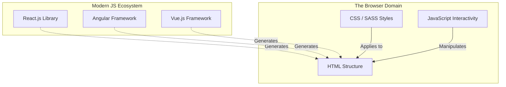

# 02 - Learning Front-End Development

<!-- IMAGE_PROMPT: A high-fidelity conceptual 3D isometric technical illustration of Front-End Web Development. The image shows a deconstructed, glowing web page breaking down into three distinct floating layers: an architectural blueprint layer (HTML), a vibrant paint and styling layer with palettes and brushes (CSS), and a dynamic, electrifying logic layer with gears and interactive nodes (JavaScript). Sleek dark background with neon cyan, magenta, and yellow accents. High aesthetic quality, crisp detail, no text. -->

## 1. Jargon Translation

- **HTML (Hypertext Markup Language)**:
  - _Official Definition_: The standard markup language for documents designed to be displayed in a web browser, defining the physical structure and meaning of web content.
  - _Under the Hood_: The structural skeleton and load-bearing walls of a house. It dictates where the doors (links) and windows (images) go, but it doesn't care what color they are.
- **CSS (Cascading Style Sheets)**:
  - _Official Definition_: A style sheet language used for describing the presentation of a document written in HTML, including colors, layout, and fonts.
  - _Under the Hood_: The interior designer and the paint job. It takes the bare structure and makes it visually appealing, ensuring it looks good whether viewed on a massive TV or a tiny phone.
- **JavaScript**:
  - _Official Definition_: A high-level, object-oriented programming language that allows the implementation of complex features and interactivity on web pages.
  - _Under the Hood_: The electricity, plumbing, and moving parts of the house. It's what makes the garage door open when you press a button, or the lights turn on when motion is detected.
- **SASS (Syntactically Awesome Style Sheets)**:
  - _Official Definition_: A preprocessor scripting language that is interpreted or compiled into Cascading Style Sheets, extending CSS with features like variables and nested rules.
  - _Under the Hood_: A superpower upgrade for your interior designer. Instead of mixing the exact same shade of blue paint 50 times (standard CSS), SASS lets you mix it once in a bucket (a variable) and pour it wherever needed.
- **Responsive Design**:
  - _Official Definition_: An approach to web design that makes web pages render well on a variety of devices and window or screen sizes using fluid, proportion-based grids.
  - _Under the Hood_: Water being poured into different glasses. No matter the shape of the container (desktop, tablet, phone), the website fluidly reshapes itself to fit perfectly.

## 2. Topics Introduced in Lecture Transcript

1. The Foundational Front-End Languages (HTML, CSS, JavaScript)
2. Structural Layout vs. Styling
3. Cross-Browser and Cross-Device Compatibility
4. CSS Preprocessors (SASS and LESS)
5. Adaptive vs. Responsive Web Design
6. The JavaScript Framework/Library Landscape (Angular, React.js, Vue.js)
7. The Continuous Evolution of Front-End Roles

## 3. Exhaustive Deep Dive & Structured Notes

### The Front-End Foundation

Whenever you visit an online shopping website, every menu you navigate, product category you click, and shopping cart you view is part of the Front-End. Front-end developers use three core languages in conjunction to build these experiences:

1. **HTML (The Structure)**
   - Used to create the **physical structure** of the website.
   - Contains structural elements: Text, hyperlinks, images, videos, page dividers (`<div>`), and buttons.
   - Ensures proper semantic formatting so that browsers understand how to interpret and display the page consistently.
   - **Analogy**: Like a house that has just been constructed, providing the raw framework.

2. **CSS (The Styling)**
   - Used to add glamour, appeal, and aesthetic design to the bare HTML structure.
   - Provides a standard method to define, apply, and manage style characteristics.
   - Ensures uniformity across the site: pleasing fonts, attractive colors, intuitive layouts.
   - **Cross-Browser Compatibility**: CSS is heavily utilized to ensure websites render correctly on Google Chrome, Safari, Firefox, and across multiple devices (PCs, mobile devices, iPads).

3. **JavaScript (The Interactivity)**
   - An object-oriented programming language used to make websites intuitive, interactive, and quick to react.
   - **How they work together**: 
     - **HTML**: Adds the "Login" button to the screen.
     - **CSS**: Makes the button blue with rounded corners.
     - **JavaScript**: Adds the actual logic so that when the user clicks the button, the login process actually initiates.

### Advanced Styling: CSS Preprocessors

Writing massive CSS files can become chaotic. Developers use preprocessors to write cleaner, more organized styles.

- **SASS (Syntactically Awesome Style Sheets)**
  - An extension of CSS, fully compatible with all CSS versions.
  - Allows the use of **variables** (storing a color code once and reusing it), **nested rules** (writing CSS hierarchically), and **inline imports**.
  - Speeds up the creation of complex stylesheets.
- **LESS (Learner Style Sheets)**
  - Enhances CSS by adding more dynamic styles and functions.
  - Backwards compatible with CSS.
  - Utilizes **LESS.js**, a JavaScript tool that converts (compiles) LESS styles into standard CSS styles that the browser can understand.

### Adaptive vs. Responsive Design

Modern websites must work on massive 4K monitors and tiny mobile phones.

- **Adaptive Design**:
  - The server detects the device type and serves a completely different, specific version of the website for that screen size.
  - Example: An airline website might show a massive dashboard on a PC, but if you log in on a phone, it redirects you to a completely different layout specifically built for mobile that hides non-essential information.
- **Responsive Design**:
  - A single website layout that fluidly and automatically resizes itself to the device it is being accessed from.
  - Example: The same product features are displayed on both PC and mobile, but the content dynamically stacks vertically and the images shrink smoothly as the screen gets smaller.

### JavaScript Frameworks and Libraries

To avoid reinventing the wheel, programmers use application frameworks and libraries written in JavaScript to build complex, device-responsive applications efficiently.

| Framework / Library | Backed By | Key Characteristics |
| :--- | :--- | :--- |
| **Angular** | Google (Open-source) | A complete framework. Renders HTML quickly. Has built-in tools for complex tasks like routing (navigating pages) and form validation. |
| **React.js** | Facebook (Meta) | A library, NOT a complete suite of tools. Highly focused on building and rendering UI components to drop into a page. Lacks built-in routing; requires third-party tools (like React Router). |
| **Vue.js** | Community | Focuses primarily on the "Vue" (view) layer (UI, buttons, visual components). Extremely flexible, adaptable, and scalable. Can act as a simple library or a full framework. |



## 4. Step-by-Step Breakdown: Building a Modern Component

**Scenario**: A Front-End developer is tasked with building a "Product Card" for an online store.

1. **Structuring (HTML)**: The developer writes an `<article>` tag containing an `` for the product photo, an `<h2>` for the title, and a `<button>` to add it to the cart.
2. **Styling (SASS/CSS)**: The developer creates a SASS file, defining a variable `$brand-color: #ff5500;`. They apply this variable to the button's background and use CSS Flexbox to position the image perfectly above the title.
3. **Compiling (LESS/SASS)**: A tool converts the developer's SASS code into standard CSS so the browser can read it.
4. **Interactivity (JavaScript/React)**: The developer writes a React component for the button. They add an `onClick` event listener so that when clicked, the shopping cart icon in the top right corner increments by 1.
5. **Responsiveness Check**: The developer shrinks the browser window. Using CSS media queries (Responsive Design), the product card automatically shrinks its image and expands its button for easier mobile tapping.

## 5. Concrete Examples

- **HTML only**: A raw Wikipedia page with no styling. Just links and text.
- **SASS vs CSS**: In CSS you write `color: #ff0000;` 50 times. In SASS, you write `$primary: #ff0000;` once, and use `color: $primary;` 50 times. If the brand color changes to blue, you only change the variable once.
- **Adaptive**: Typing `facebook.com` on a phone and being automatically redirected to `m.facebook.com`.
- **Responsive**: Shrinking your browser window on a desktop and watching a grid of 4 images seamlessly snap into a single column of images.

## 6. Code Blocks

```html
<!-- FRONT-END: Combining HTML, CSS, and JS in a single file -->
<!DOCTYPE html>
<html>
<head>
  <style>
    /* CSS Styling */
    .product-card {
      border: 1px solid #ccc;
      padding: 20px;
      width: 250px;
      text-align: center; /* Ensures uniformity in layout */
    }
    .buy-btn {
      background-color: green;
      color: white;
      padding: 10px 15px;
      cursor: pointer;
    }
  </style>
</head>
<body>
  <!-- HTML Structure -->
  <div class="product-card">
    <h2>Awesome Sneakers</h2>
    <p>$99.99</p>
    <button class="buy-btn" id="addToCart">Add to Cart</button>
  </div>

  <!-- JavaScript Interactivity -->
  <script>
    const button = document.getElementById("addToCart");
    // Adding the actual logic to the structural button
    button.addEventListener("click", () => {
      button.innerText = "Added!";
      button.style.backgroundColor = "gray";
      alert("Item added to your cart!");
    });
  </script>
</body>
</html>
```

**What happens if... you use a Library (React) vs a full Framework (Angular)?**
If you are building a massive enterprise application and you need a robust way to validate complex user forms and navigate between 50 different pages securely:

```javascript
// USING ANGULAR (Framework)
// Angular has a built-in FormBuilder and built-in Router. You just import them directly from Angular.
import { FormBuilder, Validators } from '@angular/forms';
import { Router } from '@angular/router';
// Everything is included out-of-the-box.

// USING REACT.JS (Library)
// React only cares about rendering the UI. It has NO built-in form validation or routing.
import React from 'react';
// BAD PRACTICE / MISTAKE: Assuming React handles routing natively.
// If you want routing, you MUST install a third-party tool:
// npm install react-router-dom
import { BrowserRouter as Router, Route } from 'react-router-dom';
// If you want form validation, you MUST install another third-party tool (like Formik or Yup).
```

## 7. Related Concepts

1. **Virtual DOM**: A lightweight copy of the HTML DOM used by frameworks like React to calculate updates extremely fast without refreshing the whole page.
2. **Webpack / Bundlers**: Tools that take all your separate JS, SASS, and image files and compress them into one highly optimized package for the browser to download quickly.
3. **AJAX / Fetch API**: The JavaScript mechanisms used by the front-end to silently request new data from the back-end without causing the browser to flash white and reload the page.
4. **Single Page Applications (SPA)**: Modern websites (often built with React/Angular) that load only one single HTML page, and JavaScript dynamically rewrites the content as the user navigates, making it feel like a fast desktop app.
5. **CSS Flexbox / Grid**: Modern CSS layout modules that make creating complex, responsive, and adaptive grid designs exponentially easier than older float-based methods.

## 8. Key Takeaways (Flashcard-Ready)

- **Q: What is the specific purpose of HTML, CSS, and JS?**
  - A: HTML creates the physical structure, CSS designs the style and layout, and JavaScript adds interactivity.
- **Q: What is the main advantage of SASS or LESS?**
  - A: They are CSS preprocessors that allow developers to use programming concepts like variables and nested rules, making stylesheets faster to write and easier to maintain.
- **Q: What is the difference between Adaptive and Responsive design?**
  - A: Adaptive serves a completely different layout based on the device, while Responsive uses one layout that fluidly resizes itself to fit any screen.
- **Q: How does React.js differ from Angular?**
  - A: React is a UI library focused solely on rendering components (requiring third-party tools for routing), while Angular is a complete framework with built-in tools for routing and form validation.
- **Q: Why is cross-browser compatibility important for Front-End developers?**
  - A: Because users access sites using different engines (Chrome, Firefox, Safari) and devices (PCs, iPads, phones), and the developer must ensure the site functions and looks identical across all of them.

## 9. The Trick Section

- **💡 The Secret Engineering Trick:** **The "Mobile-First" Styling Approach**. When writing CSS for a responsive design, junior developers often write the desktop styles first, and then write complex overrides to shrink the site for mobile phones. *The Trick*: Senior front-end engineers code "Mobile-First". They write the default CSS so the site looks perfect on a tiny mobile screen with zero media queries. Then, they add `min-width` media queries to *enhance* and expand the design only if the screen is large enough (like an iPad or Desktop). This results in far less CSS code, fewer bugs, and faster load times on mobile devices.

## 10. Interview Questions Section

### 1. Explain the distinct roles of HTML, CSS, and JavaScript in modern web architecture.

- **Simple Definition**: Think of building a car. HTML is the chassis, the engine block, and the steering column—the raw physical components. CSS is the glossy red paint, the leather seats, and the aerodynamic curves—the styling. JavaScript is the onboard computer system that actually fires the spark plugs, operates the GPS, and turns the headlights on when it gets dark.
- **Official Definition**: HTML (Hypertext Markup Language) defines the semantic structure and raw content of a web document. CSS (Cascading Style Sheets) dictates the visual presentation, layout, and cross-device responsiveness of that structure. JavaScript is a client-side programming language executed by the browser engine that manipulates the Document Object Model (DOM) to introduce dynamic behavior, state management, and asynchronous API interactions.
- **Primary Responsibilities / Core Details**:
  - **HTML Semantics**: Ensuring the correct tags (`<header>`, `<article>`, `<nav>`) are used so that screen readers and search engines (SEO) can understand the content's hierarchy.
  - **HTML Accessibility (a11y)**: Applying ARIA attributes and `alt` text to structural elements to ensure compliance with web accessibility standards.
  - **CSS Architecture**: Implementing scalable CSS methodologies like BEM (Block Element Modifier) or utilizing utility-first frameworks (like Tailwind) to maintain massive codebases.
  - **CSS Responsive Layouts**: Utilizing Flexbox and CSS Grid to construct fluid, proportion-based interfaces that adapt seamlessly to viewport changes.
  - **JS DOM Manipulation**: Programmatically selecting HTML nodes and altering their properties, classes, or inner content based on user interaction.
  - **JS Asynchronous Operations**: Utilizing the `Fetch` API or `Axios` to retrieve data from a backend server in the background without refreshing the page.
  - **JS Event Handling**: Listening for complex user interactions (clicks, keyboard strokes, drag-and-drop actions) and triggering appropriate logic functions.
- **Real-World Example**: On a banking application, HTML creates the table structure holding your transaction history. CSS ensures alternating rows have slightly different background colors so it's easy to read, and stacks the table into cards if viewed on a phone. JavaScript is responsible for sorting the table by date when you click the "Date" column header, instantly rearranging the data without asking the server for a new page.
- **Best Coding/Development Practices**:
  - **Practice 1: Separation of Concerns**: Never mix these three languages in the same file if building a traditional application. Keep HTML structural, CSS purely visual, and JavaScript purely logical.
    ```html
    <!-- BAD PRACTICE: Inline styles and inline JS mixed into HTML -->
    <button style="color: red; padding: 10px;" onclick="alert('Clicked!')">Click</button>

    <!-- GOOD PRACTICE: Clean semantic HTML -->
    <button class="btn-danger" id="submitBtn">Click</button>
    ```
  - **Practice 2: Use Semantic HTML5 Tags**: Always prefer structural HTML5 tags over generic `<div>` tags. It vastly improves SEO and accessibility.
    ```html
    <!-- BAD PRACTICE -->
    <div class="header"> <div class="nav">Links</div> </div>

    <!-- GOOD PRACTICE -->
    <header> <nav>Links</nav> </header>
    ```
  - **Practice 3: Defer Non-Critical JavaScript**: JavaScript blocks the parsing of HTML. Always place your `<script>` tags at the very bottom of the `<body>`, or use the `defer` attribute, so the user can see the CSS/HTML paint instantly while the logic loads in the background.
    ```html
    <!-- GOOD PRACTICE: Using defer -->
    <head>
      <script src="heavy-logic.js" defer></script>
    </head>
    ```
- **Visual Aid (Mermaid Flowchart)**:
  ```mermaid
  flowchart TD
      margin_1((" "))
      style margin_1 fill:none,stroke:none
      margin_1 ~~~ DOM
      
      subgraph "Browser Rendering Engine"
          HTML[HTML File]
          CSS[CSS File]
          JS[JavaScript File]
          
          DOM[Document Object Model]
          CSSOM[CSS Object Model]
          RenderTree{Render Tree}
      end
      
      HTML -->|Parses Structure| DOM
      CSS -->|Parses Styling| CSSOM
      
      DOM --> RenderTree
      CSSOM --> RenderTree
      
      JS <-->|Reads & Mutates| DOM
      JS <-->|Reads & Mutates| CSSOM
      
      RenderTree --> Screen[Final UI Painted to Screen]
  ```
- **Core Focus Areas**: Semantic Structure | Presentation & Layout | Dynamic DOM Manipulation | Separation of Concerns

### 2. What are the key differences between Responsive and Adaptive web design?

- **Simple Definition**: Responsive design is like a liquid poured into a glass; whether the glass is wide, tall, or curved, the liquid smoothly adjusts its shape to fit the exact container perfectly. Adaptive design is like buying clothes; you don't buy one magically stretching shirt, you buy three distinct, pre-tailored shirts (Small, Medium, Large) and choose the one that fits your current body size.
- **Official Definition**: Responsive Web Design (RWD) utilizes fluid grids, flexible images, and CSS media queries to ensure a single HTML layout dynamically scales and reorganizes itself based on the exact pixel width of the viewport. Adaptive Web Design (AWD) relies on predefined screen size breakpoints; the server or client detects the device class (mobile, tablet, desktop) and loads a distinctly crafted, static layout specifically optimized for that device.
- **Primary Responsibilities / Core Details**:
  - **Responsive: Fluid Grids**: Elements are sized using relative units (percentages, `vw`, `vh`) rather than absolute pixels (`px`), allowing them to stretch and squeeze dynamically.
  - **Responsive: Media Queries**: CSS rules that apply only when the browser crosses specific pixel thresholds (e.g., `@media (max-width: 768px)`), triggering layout shifts.
  - **Responsive: Single Codebase**: Maintenance is generally easier because there is only one HTML file and one core CSS file to update for all devices.
  - **Responsive: Performance Overhead**: Because all CSS and HTML for every device size is sent to the browser simultaneously, mobile devices download desktop styles they might never use.
  - **Adaptive: Optimized Payloads**: Adaptive design often detects the device on the backend and only sends the HTML/CSS required for that specific device, resulting in vastly superior loading speeds for mobile users.
  - **Adaptive: Device-Specific UX**: Allows designers to create wildly different user experiences. A complex financial dashboard shown on desktop might be completely replaced by a simplified "quick action" menu on mobile.
  - **Adaptive: Higher Maintenance**: Requires developing, testing, and maintaining multiple distinct templates (e.g., one for 320px, one for 768px, one for 1200px).
- **Real-World Example**: A **Responsive** news website will have 3 columns of articles on a desktop. As you slowly drag the browser window to make it smaller, the images smoothly shrink until it suddenly snaps into 1 column. An **Adaptive** airline website detects you are on an iPhone and immediately loads `m.airline.com`—a completely unique interface with massive, thumb-friendly buttons for "Check-In" and "Boarding Pass," hiding the desktop site's complex flight-booking calendar entirely.
- **Best Coding/Development Practices**:
  - **Practice 1: Relative Sizing in Responsive Design**: Never hardcode container widths using pixels. Use percentages or `rem` units so the container scales with the screen.
    ```css
    /* BAD PRACTICE: Rigid, breaks on small screens */
    .container { width: 1200px; }

    /* GOOD PRACTICE: Fluid and Responsive */
    .container { 
      width: 100%; 
      max-width: 1200px; /* Stops growing on massive screens */
      padding: 0 20px; 
    }
    ```
  - **Practice 2: Responsive Images**: Ensure images never overflow their parent containers on small devices by forcing them to scale down.
    ```css
    /* GOOD PRACTICE: Responsive Image Reset */
    img {
      max-width: 100%; /* Image will shrink to fit container */
      height: auto;    /* Maintains aspect ratio */
      display: block;
    }
    ```
  - **Practice 3: Server-Side User-Agent Detection (Adaptive)**: If building an Adaptive experience, detect the device on the Node.js backend to prevent sending massive desktop payloads to mobile networks.
    ```javascript
    // BACK-END: Simple Adaptive Detection via Express
    app.get('/', (req, res) => {
      const userAgent = req.headers['user-agent'].toLowerCase();
      
      if (userAgent.includes('mobi')) {
        // Send a highly optimized, distinct mobile HTML template
        res.render('mobile-layout'); 
      } else {
        // Send the heavy, feature-rich desktop template
        res.render('desktop-layout'); 
      }
    });
    ```
- **Visual Aid (Mermaid Flowchart)**:
  ```mermaid
  flowchart TD
      margin_1((" "))
      style margin_1 fill:none,stroke:none
      margin_1 ~~~ Start
      
      Start[User Requests Website] --> Server{Back-End Server}
      
      subgraph "Adaptive Design Flow"
          Server -->|Detects Mobile Phone| MobTemp[Loads Distinct Mobile Template]
          Server -->|Detects Desktop PC| DeskTemp[Loads Distinct Desktop Template]
      end
      
      subgraph "Responsive Design Flow"
          Server -->|Sends Single Payload| HTMLCSS[Universal HTML & CSS]
          HTMLCSS --> Browser{Client Browser width?}
          Browser -->|< 768px| MobView[CSS Stacks Elements Vertically]
          Browser -->|> 768px| DeskView[CSS Shows Multi-Column Grid]
      end
  ```
- **Core Focus Areas**: Fluid Layouts | Media Queries | Payload Optimization | Device Contextual UX

### 3. Why do developers use CSS preprocessors like SASS or LESS?

- **Simple Definition**: Writing standard CSS is like building a massive LEGO castle using only single 1x1 bricks; it takes forever, you repeat the same motions thousands of times, and if you want to change the color of a tower, you have to replace 500 individual bricks. SASS/LESS is like having prefabricated LEGO walls, towers, and automated blueprints. You define the blueprint once, and the preprocessor automatically generates the thousands of individual bricks for you.
- **Official Definition**: SASS (Syntactically Awesome Style Sheets) and LESS are CSS preprocessors that extend standard CSS syntax by introducing programmatic paradigms such as variables, mixins, functions, and nesting. Code written in these languages cannot be executed by a browser directly; it must be compiled into standard CSS via a build tool before deployment.
- **Primary Responsibilities / Core Details**:
  - **Variables**: Allows developers to store exact hexadecimal color codes, typography stacks, and spacing units in a single centralized location.
  - **Nesting**: Enables developers to write CSS rules mimicking the visual hierarchy of the HTML DOM, reducing redundant class name typing and improving readability.
  - **Mixins**: Allows developers to create reusable blocks of CSS declarations (like complex flexbox centering rules) that can be injected anywhere with a single line.
  - **Partials and Imports**: Facilitates splitting a massive 10,000-line CSS file into dozens of small, manageable files (e.g., `_buttons.scss`, `_header.scss`) that are compiled into one single file for production.
  - **Mathematical Operations**: Permits dynamic calculations directly within the stylesheet (e.g., `width: 100% / 3;`).
  - **Compilation Overhead**: Introduces a necessary build step into the development pipeline. Browsers only read `.css`, so `.scss` or `.less` files must be processed by Node.js tools before they can be viewed.
- **Real-World Example**: A company goes through a massive rebranding and changes their primary corporate color from "Ocean Blue" to "Neon Purple." If the website was built with raw CSS, a developer must execute a dangerous "Find and Replace" across 50 different files, hoping they don't accidentally replace the wrong blue. If the site was built with SASS, the developer opens the `_variables.scss` file, changes `$brand-primary: #0000FF;` to `$brand-primary: #800080;`, recompiles the code in 2 seconds, and the entire website is perfectly updated.
- **Best Coding/Development Practices**:
  - **Practice 1: Centralize Variables**: Always extract colors, fonts, and spacing into a dedicated `_variables.scss` file. Never hardcode a hex value in a component file.
    ```scss
    // _variables.scss
    $primary-color: #3498db;
    $spacing-md: 16px;

    // _button.scss
    .btn {
      background-color: $primary-color; // GOOD PRACTICE
      padding: $spacing-md;
    }
    ```
  - **Practice 2: Limit Nesting Depth**: Deeply nested SASS compiles into overly specific, massive CSS selectors that destroy performance and are impossible to override. Never nest more than 3 levels deep.
    ```scss
    // BAD PRACTICE: Over-nesting (Compiles to: .header .nav ul li a { ... })
    .header { .nav { ul { li { a { color: red; } } } } }

    // GOOD PRACTICE: Keep specificity low
    .header-nav-link {
      color: red;
      &:hover { color: blue; } // The '&' references the parent class
    }
    ```
  - **Practice 3: Utilize Mixins for Repetitive Patterns**: Stop rewriting flexbox centering code. Create a mixin to keep your codebase DRY (Don't Repeat Yourself).
    ```scss
    // SASS Mixin Definition
    @mixin flex-center {
      display: flex;
      justify-content: center;
      align-items: center;
    }

    // Usage
    .hero-banner {
      @include flex-center;
      height: 100vh;
    }
    ```
- **Visual Aid (Mermaid Flowchart)**:
  ```mermaid
  flowchart TD
      margin_1((" "))
      style margin_1 fill:none,stroke:none
      margin_1 ~~~ Dev
      
      Dev[Front-End Developer]
      
      subgraph "SASS Preprocessor Workflow"
          Vars[_variables.scss]
          Btns[_buttons.scss]
          Layout[_layout.scss]
          
          Main["main.scss<br>Imports all partials"]
          Compiler{Node SASS Compiler}
      end
      
      Dev -->|Writes| Vars & Btns & Layout
      Vars --> Main
      Btns --> Main
      Layout --> Main
      
      Main --> Compiler
      Compiler -->|Compiles to| CSS[Standard main.css]
      CSS --> Browser[Client Browser]
  ```
- **Core Focus Areas**: DRY Code Architecture | Maintainability | Compilation Pipelines | Programmatic Styling

### 4. Compare and contrast Angular, React.js, and Vue.js.

- **Simple Definition**: Angular is like buying a fully furnished, highly secure corporate office building; it has strict rules on where desks go, but everything you need (security, routing, plumbing) is built-in and guaranteed to work. React is like buying a massive pile of high-quality lumber and power tools; you have infinite freedom to build exactly what you want, but you have to assemble the plumbing (routing) and security yourself. Vue is like buying a modular smart-home; it's clean, easy to assemble, and scales up beautifully depending on which modules you choose to plug in.
- **Official Definition**: Angular is a comprehensive, opinionated TypeScript-based framework maintained by Google, providing built-in solutions for routing, HTTP requests, and state management. React.js is a declarative JavaScript library maintained by Facebook, focused exclusively on rendering view components efficiently via a Virtual DOM, relying heavily on third-party ecosystems for application-level architecture. Vue.js is a progressive, community-driven JavaScript framework that offers a highly adaptable architecture, blending the declarative components of React with the structured, HTML-template-based approach of Angular.
- **Primary Responsibilities / Core Details**:
  - **Angular (Framework)**: Enforces strict architecture (MVC - Model View Controller). Excellent for massive enterprise teams because every Angular project looks structurally identical, reducing onboarding time. Uses TypeScript by default.
  - **Angular (Built-in Tools)**: Includes Angular Router, `HttpClient` for API requests, and robust Form validation modules straight out of the box. No decision fatigue.
  - **React.js (Library)**: Completely unopinionated. Developers can organize files however they want. Requires developers to independently research, install, and maintain third-party packages for routing (React Router) and state (Redux/Zustand).
  - **React.js (JSX and Virtual DOM)**: Utilizes JSX, a syntax extension allowing developers to write HTML directly inside JavaScript files. It uses a Virtual DOM to batch updates, making UI rendering incredibly fast.
  - **Vue.js (Progressive)**: Designed to be incrementally adoptable. You can drop it into a standard HTML file just to add a bit of interactivity, or scale it up with Vue Router and Vuex to build a massive Single Page Application.
  - **Vue.js (Single File Components)**: Highly praised for its `.vue` files, which elegantly separate `<template>` (HTML), `<script>` (JS), and `<style>` (CSS) into one cohesive, readable file per component.
- **Real-World Example**: If a massive bank is building an enterprise dashboard with 100 developers, they choose **Angular** because its strict rules prevent junior developers from breaking the architecture. If a disruptive startup wants to build a highly interactive, custom social media feed rapidly, they choose **React** for its massive ecosystem of open-source plugins. If a small agency needs to quickly revamp a legacy website by injecting modern interactive charts without rewriting the whole site, they choose **Vue**.
- **Best Coding/Development Practices**:
  - **Practice 1: React - Isolate Side Effects**: In React, API calls must be isolated inside `useEffect` hooks with proper dependency arrays to prevent catastrophic infinite rendering loops.
    ```javascript
    // GOOD PRACTICE: React fetching data safely
    import React, { useState, useEffect } from 'react';

    function UserProfile({ userId }) {
      const [data, setData] = useState(null);

      // Effect only runs when 'userId' changes
      useEffect(() => {
        fetch(`/api/user/${userId}`)
          .then(res => res.json())
          .then(data => setData(data));
      }, [userId]); // Dependency array

      return <div>{data ? data.name : "Loading..."}</div>;
    }
    ```
  - **Practice 2: Angular - Use Dependency Injection**: Angular dictates that services (like API fetchers) should be injected into components, keeping the code highly testable.
    ```typescript
    // GOOD PRACTICE: Angular Dependency Injection (TypeScript)
    import { Component } from '@angular/core';
    import { UserService } from './user.service';

    @Component({
      selector: 'app-profile',
      template: `<div>{{ user?.name }}</div>`
    })
    export class ProfileComponent {
      user: any;
      // UserService is automatically injected by Angular
      constructor(private userService: UserService) {
        this.userService.getUser().subscribe(data => this.user = data);
      }
    }
    ```
  - **Practice 3: Vue - Scope Your Styles**: When building Vue components, always use the `scoped` attribute on your style tags to prevent component CSS from accidentally bleeding into and breaking the rest of the application.
    ```html
    <!-- GOOD PRACTICE: Vue Single File Component -->
    <template>
      <button class="btn">Click</button>
    </template>

    <script>
    export default { name: 'MyButton' }
    </script>

    <!-- 'scoped' ensures this CSS ONLY affects this specific component -->
    <style scoped>
    .btn { background: blue; }
    </style>
    ```
- **Visual Aid (Mermaid Flowchart)**:
  ```mermaid
  flowchart TD
      margin_1((" "))
      style margin_1 fill:none,stroke:none
      margin_1 ~~~ JS
      
      JS{Modern JavaScript Ecosystem}
      
      subgraph "Angular (The Framework)"
          A_Core[Core Rendering]
          A_Route[Built-in Router]
          A_HTTP[Built-in HttpClient]
          A_Core --- A_Route --- A_HTTP
      end
      
      subgraph "React.js (The Library)"
          R_Core[Core UI Rendering]
          R_Route[Third-Party: React-Router]
          R_HTTP[Third-Party: Axios/Fetch]
          R_Core -.- R_Route -.- R_HTTP
      end
      
      subgraph "Vue.js (The Progressive Layer)"
          V_Core[Core Vue Instance]
          V_Route[Optional: Vue Router]
          V_HTTP[Optional: Pinia/Vuex]
          V_Core -.- V_Route -.- V_HTTP
      end
      
      JS --> A_Core
      JS --> R_Core
      JS --> V_Core
  ```
- **Core Focus Areas**: Architectural Constraints | Ecosystem Dependence | Component Rendering | State Management

### 5. Why is the Virtual DOM important for front-end frameworks?

- **Simple Definition**: Imagine you are a painter painting a massive mural of a city. The client asks you to change the color of one car. Updating the "Real DOM" is like scraping all the paint off the entire wall and repainting the entire city from scratch just to change the car. Updating via the "Virtual DOM" is like making a quick sketch of the city on a piece of paper, erasing the car on the paper, comparing the paper to the wall, and then using a tiny brush to repaint *only* that specific car on the real wall.
- **Official Definition**: The Virtual DOM (VDOM) is an in-memory, lightweight JavaScript representation of the actual browser DOM. When an application's state changes, modern frameworks (like React or Vue) generate a new Virtual DOM tree, execute a highly efficient "diffing" algorithm to compare it against the previous Virtual DOM tree, and then calculate the absolute minimum number of expensive read/write operations required to update the Real DOM.
- **Primary Responsibilities / Core Details**:
  - **Performance Bottleneck**: The Real DOM (the browser's actual HTML tree) is extremely slow to manipulate. Every time an element is changed, the browser must recalculate CSS layouts and trigger a slow "repaint" of the screen.
  - **In-Memory Speed**: The Virtual DOM exists purely in JavaScript memory (RAM). Manipulating it is lightning fast because it does not trigger any visual browser repaints.
  - **The Diffing Algorithm**: When state changes, a new VDOM is created. The algorithm (often called "Reconciliation" in React) compares the new VDOM against a snapshot of the old VDOM to detect exactly what changed.
  - **Batch Processing**: Instead of sending 100 individual update commands to the browser, the VDOM calculates the changes and sends a single, highly optimized batch update to the Real DOM.
  - **Declarative UI**: Because the framework handles DOM updates automatically behind the scenes, developers can write "declarative" code (describing *what* the UI should look like based on state) rather than "imperative" code (writing manual `document.getElementById().innerHTML` commands).
  - **Cross-Platform Potential**: Because the VDOM is just an abstract representation, the same logic can be used to render native mobile apps (React Native) instead of just web browsers.
- **Real-World Example**: Consider a social media feed with 1,000 comments. A user clicks "Like" on comment #450. Without a Virtual DOM, a naive script might re-render the entire `<ul>` list of 1,000 comments, causing the browser to freeze for a second and scroll the user to the top. With a Virtual DOM, React updates the "Like Count" state in memory, diffs the new tree against the old tree, realizes *only* the text inside `span#like-450` changed, and surgically updates that exact pixel on the screen in one millisecond.
- **Best Coding/Development Practices**:
  - **Practice 1: Use Unique Keys in Lists**: When rendering arrays of data (like a list of products), you must provide a unique `key` attribute. This is how the Virtual DOM's diffing algorithm keeps track of elements if they are reordered or deleted without tearing down the whole list.
    ```javascript
    // GOOD PRACTICE: Providing unique keys to aid the VDOM
    function ShoppingList({ items }) {
      return (
        <ul>
          {items.map(item => (
            // The 'key' helps the VDOM algorithm efficiently diff changes
            <li key={item.id}>{item.name}</li> 
          ))}
        </ul>
      );
    }
    ```
  - **Practice 2: Avoid Direct DOM Manipulation**: If you are using a Virtual DOM framework like React or Vue, never use `document.querySelector` or `innerHTML`. Direct manipulation bypasses the Virtual DOM, causing severe bugs and overriding framework state.
    ```javascript
    // BAD PRACTICE: Bypassing the VDOM
    function BadComponent() {
      const mutateDOM = () => document.getElementById("title").innerText = "Hacked!";
      return <h1 id="title" onClick={mutateDOM}>Original Title</h1>;
    }

    // GOOD PRACTICE: Letting state drive the VDOM
    function GoodComponent() {
      const [title, setTitle] = useState("Original Title");
      return <h1 onClick={() => setTitle("Updated via State!")}>{title}</h1>;
    }
    ```
  - **Practice 3: Memoization for Expensive Components**: Even though the VDOM is fast, generating the Javascript tree for massive components can still consume CPU. Use `React.memo` to tell the VDOM to completely skip the diffing process for a component if its inputs (props) haven't changed.
    ```javascript
    // GOOD PRACTICE: Optimizing VDOM diffing for heavy components
    import React from 'react';

    const HeavyDataGrid = React.memo(function HeavyDataGrid({ data }) {
      // The VDOM will skip diffing this entirely if 'data' remains the same
      return <ComplexTable data={data} />;
    });
    ```
- **Visual Aid (Mermaid Flowchart)**:
  ```mermaid
  flowchart TD
      margin_1((" "))
      style margin_1 fill:none,stroke:none
      margin_1 ~~~ State
      
      State["Application State Changes<br>e.g., User clicks 'Like'"] --> VDOM1
      
      subgraph "Fast In-Memory Process (JavaScript)"
          VDOM1[New Virtual DOM Tree]
          VDOM2[Old Virtual DOM Snapshot]
          
          VDOM1 --> Diff{"Diffing Algorithm<br>'Reconciliation'"}
          VDOM2 --> Diff
      end
      
      Diff -->|Calculates exact difference| Patch[Minimal Patch Operations]
      
      subgraph "Slow Browser Process"
          Patch --> RealDOM[Actual Browser DOM]
          RealDOM --> Paint[Browser Repaints Screen]
      end
  ```
- **Core Focus Areas**: In-Memory Rendering | Reconciliation Algorithms | Declarative Programming | Browser Repaint Optimization
