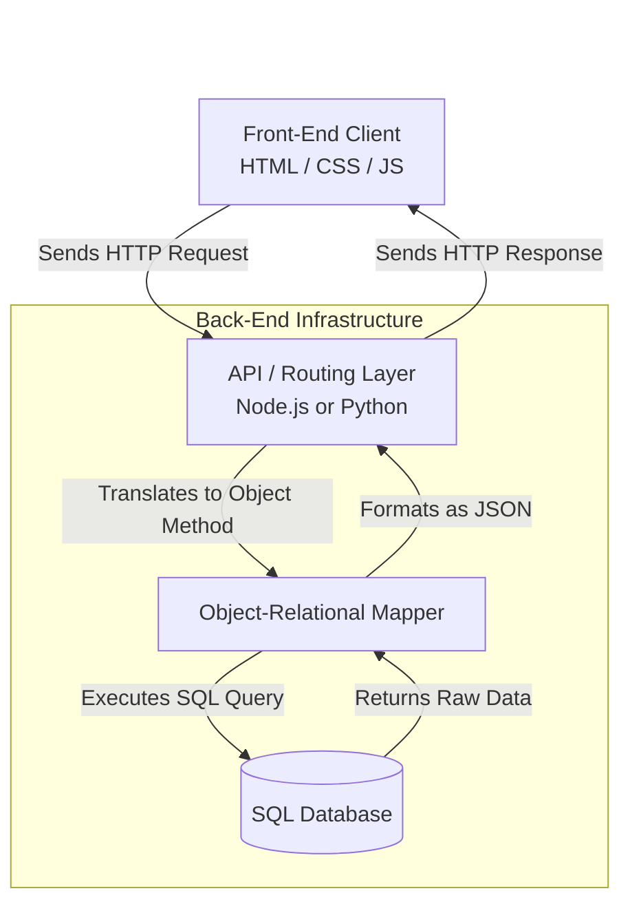

# 03 - The Importance of Back-End Development

<!-- IMAGE_PROMPT: A high-fidelity conceptual 3D isometric technical illustration of Back-End Web Development. The image shows a glowing, futuristic server rack architecture connected to a vibrant blue front-end screen via glowing fiber optic cables. Inside the server infrastructure, dynamic data streams (representing APIs and JSON) route through complex geometric nodes (representing routing and logic), eventually resting in a monolithic, deeply glowing metallic cylinder (the database). Sleek dark background with neon blue, deep purple, and emerald green accents. High aesthetic quality, crisp detail, no text. -->

## 1. Jargon Translation

- **API (Application Programming Interface)**:
  - _Official Definition_: A set of rules and protocols that allows one software application to communicate with another, often utilizing data structures like JSON or XML.
  - _Under the Hood_: The waiter at a restaurant. You (the front-end) give your order to the waiter (the API), who takes it to the kitchen (the back-end/database) and brings your food back to you. You don't need to know how the kitchen cooked it.
- **Route / Endpoint**:
  - _Official Definition_: A route is a defined path (URL) within a web application that maps to specific backend logic. An endpoint is the exact, final destination URL where an API can be accessed by a client application.
  - _Under the Hood_: The exact mailing address of a specific department within a massive corporation. If you send a letter to the wrong suite number (a missing endpoint), you get a "Return to Sender" stamp (a 404 Error).
- **ORM (Object-Relational Mapping)**:
  - _Official Definition_: A programming technique that allows developers to query and manipulate data from a database using an object-oriented paradigm, abstracting away raw SQL queries.
  - _Under the Hood_: A professional translator working between you (who speaks Python/JavaScript) and a foreign archivist (the SQL database). You speak your native language to the translator, and they handle the complex task of talking to the archivist.
- **Node.js**:
  - _Official Definition_: A cross-platform, open-source JavaScript runtime environment that executes JavaScript code outside a web browser.
  - _Under the Hood_: Giving JavaScript a passport so it can finally leave the web browser and travel freely into the server room to control actual computer hardware.
- **Authentication vs. Authorization**:
  - _Official Definition_: Authentication is the process of verifying a user's identity. Authorization is the process of verifying what specific resources or actions that authenticated user is permitted to access.
  - _Under the Hood_: Authentication is showing your ID at the front door to prove who you are. Authorization is the security guard checking their clipboard to see if you are allowed to enter the VIP room.

## 2. Topics Introduced in Lecture Transcript

1. The Core Distinction Between Front-End and Back-End Responsibilities
2. The Collaborative Request-Response Lifecycle
3. Application Security (Authentication, Authorization, Sensitive Data)
4. Client-Server Communication Mechanics (APIs, Routes, Endpoints)
5. Expanding JavaScript's Domain (Node.js and Express)
6. The Python Ecosystem (Django and Flask)
7. Data Persistence and Abstraction (Databases, SQL, and ORMs)

## 3. Exhaustive Deep Dive & Structured Notes

### The Invisible Infrastructure
If the front-end of an application is the beautiful interior of a house, the back-end is the foundation, the plumbing, and the electrical wiring hidden behind the drywall. 
- **The Front-End** (HTML, CSS, JavaScript) is responsible strictly for presenting information and collecting inputs.
- **The Back-End** exists to process those inputs, run the heavy computational logic, secure the environment, retrieve historical data from databases, and serve it back to the client. Without the back-end, an online store is just an empty, non-functional picture of a store.

### Collaboration and The Lifecycle of a Purchase
Front-end and back-end engineers must collaborate deeply. If the front-end sends a login request structured in a way the back-end doesn't expect, the application breaks. 
Consider a user purchasing an item:
1. **Search**: The user types "Blue Sneakers" into the front-end. The front-end packages this string and sends it as an API request.
2. **Retrieval**: The back-end application receives the request, translates it into a database query (often via an ORM), retrieves the records, formats them into a JSON package, and sends it back.
3. **Checkout**: When the user pays, the back-end must safely encrypt the credit card number, communicate with external payment gateways (like Stripe or PayPal), and update the database inventory, all while ensuring no malicious actors intercept the traffic.

### The Mechanics of Communication
Back-end developers act as air traffic controllers by defining strict pathways for data to travel.
- **APIs**: Act as the agreed-upon contract between the client and server. The data is usually formatted as **JSON** (JavaScript Object Notation) or **XML**.
- **Routes & Endpoints**: Every time you navigate to a site or click a button, a specific path (a route) is targeted. If a client attempts to plug into a "socket" (endpoint) that the back-end developer hasn't created, the server safely rejects the request and returns a `404 Not Found` error.

### The Back-End Language Landscape
Modern servers require specific languages and frameworks to operate efficiently.
- **JavaScript**: Originally confined to browsers, the invention of **Node.js** allowed JS to run on servers. Frameworks like **Express** make it incredibly fast to build robust APIs, allowing developers to write both front-end and back-end in a single language.
- **Python**: Heavily favored for its clean syntax and immense flexibility. Beyond basic API routing via **Flask** or massive enterprise architecture via **Django**, Python's back-end ecosystem seamlessly integrates with data analysis and machine learning tools.

| Dimension | Node.js (Express) | Python (Django / Flask) |
| :--- | :--- | :--- |
| **Concurrency Model** | Single-threaded, async event loop | Traditionally synchronous |
| **Best At** | High-volume, real-time I/O (chat, streaming) | Data-heavy, ML/AI-integrated apps |
| **Framework Style** | Minimalist (Express) | Batteries-included (Django) or minimalist (Flask) |
| **Team Advantage** | Same language as the front-end | Cleaner syntax for large teams |

### Visualizing the Client-Server Architecture


## 4. Step-by-Step Breakdown: The API Request Lifecycle

Understanding how a back-end responds to a front-end action is critical. When a user clicks "View Profile":
1. **Trigger**: Front-end JavaScript detects the click and executes a `fetch()` request targeting `https://api.example.com/users/123`.
2. **Routing**: The back-end server receives the HTTP request and checks its internal **Routing Table** to see if `/users/:id` exists.
3. **Authentication/Middleware**: Before retrieving the data, the back-end checks if the user's session token is valid (Authentication) and if they are allowed to view this specific profile (Authorization).
4. **Database Query (ORM)**: The back-end controller logic utilizes an **ORM** to query the database (e.g., `User.findById(123)`), abstracting the raw SQL away.
5. **Data Formatting**: The database returns the raw row of data. The back-end strips out sensitive info (like password hashes) and packages the remaining data into a JSON object.
6. **Response**: The back-end sends an HTTP `200 OK` status alongside the JSON payload back to the client, where the front-end dynamically renders it to the screen.

## 5. Concrete Examples

- **A Missing Endpoint (404 Error)**: If a user types `amazon.com/secret-admin-panel`, that request is routed to Amazon's backend. The backend scans its list of registered API routes. Finding no match for `/secret-admin-panel`, it triggers a fallback response returning a `404 Not Found` status, actively protecting the server from crashing due to an unhandled request.
- **The Power of an ORM**: Instead of writing complex, error-prone SQL strings inside their code like `SELECT * FROM users WHERE email = 'test@test.com'`, a developer using an ORM simply writes `User.findOne({ email: 'test@test.com' })`. The ORM handles translating that into highly optimized, secure SQL under the hood.

## 6. Code Blocks

```javascript
// A minimal working backend route using Node.js and Express
const express = require('express');
const app = express();

// Middleware to parse incoming JSON payloads
app.use(express.json());

// Defining an API Route and Endpoint (GET request)
app.get('/api/products/:id', async (req, res) => {
    try {
        // Extract the requested product ID from the URL parameters
        const productId = req.params.id;
        
        // Use an ORM (conceptual) to fetch data from the database
        const product = await Database.Product.findById(productId);
        
        // If the product doesn't exist in the database, return a 404
        if (!product) {
            return res.status(404).json({ error: "Product not found" });
        }
        
        // Serve the data back to the front-end client as JSON
        res.status(200).json(product);
        
    } catch (error) {
        // Catch server errors and return a 500 status
        res.status(500).json({ error: "Internal Server Error" });
    }
});

app.listen(3000, () => console.log('Server running on port 3000'));
```

**What happens if... you forget to use `try/catch` in an asynchronous route?**
If the database connection randomly fails or the ORM throws an unexpected error, an unhandled Promise rejection will occur. In modern Node.js environments, an unhandled rejection will instantly crash the entire backend server. Every user currently on the website will be kicked off because the server process abruptly terminated. Always wrap async database calls in `try/catch` blocks or use a centralized error-handling middleware.

## 7. Related Concepts

1. **Load Balancing**: The practice of distributing incoming API requests across multiple identical backend servers to ensure no single server becomes overwhelmed and crashes during high traffic spikes.
2. **Microservices Architecture**: Instead of building one massive back-end application (a monolith), developers split the back-end into dozens of tiny, independent APIs (e.g., an Authentication service, a Billing service, an Inventory service) that communicate with each other.
3. **SQL vs NoSQL**: Different database paradigms. SQL (PostgreSQL, MySQL) requires strict, structured tables and relationships, while NoSQL (MongoDB) stores unstructured JSON-like documents, offering flexibility for rapidly changing apps.
4. **JWT (JSON Web Tokens)**: A highly secure, standardized token used in back-end development to verify user sessions without constantly querying the database to check if a user is logged in.
5. **CI/CD (Continuous Integration/Continuous Deployment)**: A DevOps practice where backend code changes are automatically tested and deployed to live servers the moment a developer merges their code, ensuring fast and reliable updates.

## 8. Key Takeaways (Flashcard-Ready)

- **Q: What is the primary difference in focus between a Front-End and Back-End Developer?**
  - A: The front-end focuses entirely on client presentation and user interaction, while the back-end focuses on processing logic, server infrastructure, security, and database management.
- **Q: What is an API and why is it essential?**
  - A: An Application Programming Interface is a set of rules allowing different software entities to communicate. It is the vital bridge connecting the front-end interface to the back-end data servers.
- **Q: What occurs on the back-end when an endpoint is missing?**
  - A: The routing logic fails to find a matching path and safely returns a 404 Not Found error to the client, preventing the server from executing undefined logic.
- **Q: Why was Node.js a revolutionary tool for web developers?**
  - A: It allowed developers to execute JavaScript on the server side, meaning engineers could write both the front-end and the back-end using a single, unified programming language.
- **Q: What is the benefit of using an ORM (Object-Relational Mapping) tool?**
  - A: ORMs abstract away complex SQL queries, allowing developers to interact with the database using standard programming objects (like JavaScript or Python objects), significantly speeding up development and reducing syntax errors.

## 9. The Trick Section

- **💡 The Secret Engineering Trick:** **Never Trust the Client**. It is a fundamental rule of backend engineering that you must assume all data coming from the front-end is potentially malicious or broken. Junior developers often implement strict validation on front-end forms (e.g., preventing a user from entering text in a "Phone Number" field) and assume the backend is safe. *The Trick*: Malicious actors can easily bypass front-end forms and send raw HTTP requests directly to your API endpoint. Senior engineers *always* duplicate their validation logic on the backend. If an incoming payload fails backend validation, they immediately reject the request with a `400 Bad Request` status before the data ever touches the database.

## 10. Interview Questions Section

### 1. Define the fundamental differences between Front-End and Back-End architecture and explain how they collaborate.

- **Simple Definition**: Imagine a high-end restaurant. The front-end is the dining room—the ambient lighting, the beautifully printed menus, the tablecloths, and the polite waiters taking your order. It's everything the customer touches and experiences. The back-end is the roaring kitchen—the industrial ovens, the chaotic line cooks, the walk-in freezers, and the inventory management system. The customer never sees the kitchen, but without it, they never get their food.
- **Official Definition**: Front-End architecture is comprised of client-side technologies (HTML, CSS, JavaScript) parsed and executed locally within a user's web browser, focusing entirely on graphical user interface (GUI) rendering and capturing user inputs. Back-End architecture is the server-side infrastructure comprising the application logic, APIs, web servers, and database management systems. It is responsible for business logic execution, data persistence, and secure authentication.
- **Primary Responsibilities / Core Details**:
  - **Environment Separation**: Front-end code runs completely isolated inside the memory of the client's local device (laptop or phone). Back-end code runs on centralized, highly secure remote servers (like AWS or Google Cloud).
  - **Resource Management**: The back-end acts as the singular source of truth for an application. It manages the databases, caching layers (like Redis), and file storage systems (like AWS S3).
  - **Security Barrier**: The back-end is the only layer trusted with sensitive operations, such as hashing passwords via algorithms like bcrypt, processing financial transactions, and verifying API keys.
  - **Performance Optimization**: Back-end engineers must optimize server response times, ensure database queries run efficiently, and set up load balancers to distribute traffic.
  - **Collaboration**: The two layers collaborate via HTTP requests. The front-end makes an asynchronous request to the back-end for data; the back-end processes the logic and returns a serialized JSON payload, which the front-end then parses and paints to the screen.
- **Real-World Example**: Consider Spotify. The front-end is the sleek, dark-themed app interface on your phone where you tap the "Play" button. The back-end is the massive distributed server network that instantly verifies your premium subscription status, queries a database of millions of songs to find the correct audio file, and securely streams those encrypted data packets to your device in real-time.
- **Best Coding/Development Practices**:
  - **Practice 1: Strict Separation of Concerns (Decoupling)**: Build your back-end as a pure API that returns JSON, completely agnostic of how the front-end looks. This allows you to build a Web App, an iOS App, and an Android App that all consume the exact same back-end logic without rewriting server code.
    ```javascript
    // GOOD PRACTICE: Returning pure JSON data, not HTML
    app.get('/api/weather', (req, res) => {
        // The backend ONLY provides data. It does not dictate how it looks.
        res.json({ temp: 72, condition: "Sunny", city: "Austin" });
    });
    ```
  - **Practice 2: Version Your APIs**: As your application grows, front-end and back-end updates might become out of sync. Always prefix your backend routes with `/v1/` to ensure older mobile apps don't break when you release `/v2/` of your backend logic.
  - **Practice 3: Implement CORS Securely**: Cross-Origin Resource Sharing (CORS) is a security mechanism. Configure your backend to explicitly reject requests coming from unauthorized front-end domain names to prevent malicious sites from hijacking your API.
- **Visual Aid (Mermaid Flowchart)**:
  ```mermaid
  flowchart TD
      margin_1((" "))
      style margin_1 fill:none,stroke:none
      margin_1 ~~~ ClientBrowser
      
      subgraph "Front-End Environment"
          ClientBrowser[Client Web Browser]
          UI["User Interface<br>(HTML/CSS/JS)"]
          ClientBrowser --> UI
      end
      
      subgraph "Back-End Environment"
          WebServer[Web Server / Load Balancer]
          AppLogic["Application Logic<br>(Node.js/Python)"]
          DB[(Relational Database)]
          
          WebServer --> AppLogic
          AppLogic <-->|SQL/ORM Queries| DB
      end
      
      UI <-->|HTTP Requests / JSON Responses| WebServer
  ```
- **Core Focus Areas**: Client-Server Model | Environment Separation | Single Source of Truth | Application Scaling

### 2. Explain the concept of an API and how Routes and Endpoints facilitate client-server communication.

- **Simple Definition**: An API (Application Programming Interface) is like a heavily guarded drive-thru window at a bank. You (the client) cannot just walk into the vault and grab money (the database). Instead, you pull up to a specific window lane (the Route), speak into the microphone at the end of the lane (the Endpoint), and hand your request to the teller (the API). The teller goes to the vault, gets exactly what you asked for, and passes it back through the window.
- **Official Definition**: An API is a standardized set of protocols and definitions that allow disparate software systems to communicate programmatically. In web development, RESTful APIs utilize HTTP verbs (GET, POST, PUT, DELETE) to define actions. Routes are the registered URL paths within the server application that map to specific controller logic, while Endpoints are the exact external URIs exposed to client applications to trigger those routes.
- **Primary Responsibilities / Core Details**:
  - **Standardized Contracts**: APIs enforce a strict contract. If an endpoint requires an `email` and `password` field in the JSON payload, it will categorically reject requests that fail to provide them.
  - **HTTP Verbs (Methods)**: APIs rely heavily on standard HTTP verbs to determine intent: `GET` for fetching data, `POST` for creating new data, `PUT/PATCH` for updating data, and `DELETE` for removing data.
  - **Statelessness**: REST APIs are stateless, meaning every single request from the front-end must contain all the information necessary for the back-end to understand it (including authentication tokens). The server does not remember previous requests.
  - **Routing Controllers**: Routes organize backend code. A request to `/api/users` is directed to a completely different controller file than a request to `/api/products`, keeping the codebase modular and maintainable.
  - **Serialization**: APIs are responsible for serializing complex backend objects (like database rows or Python dictionaries) into universally readable formats, almost exclusively JSON (JavaScript Object Notation).
- **Real-World Example**: When you use the Uber app, Uber's backend needs to know how to charge your credit card. Instead of building their own massive banking infrastructure, Uber's backend acts as a client and makes an API call to Stripe's backend via Stripe's designated `/v1/charges` endpoint. Stripe processes the payment and returns a JSON response indicating success or failure.
- **Best Coding/Development Practices**:
  - **Practice 1: Use RESTful Naming Conventions**: Endpoints should use nouns, not verbs, and leverage HTTP methods to imply action. 
    ```javascript
    // BAD PRACTICE: Putting verbs in the URL
    app.post('/api/createNewUser', createUserLogic);
    app.get('/api/getAllUsers', getUsersLogic);

    // GOOD PRACTICE: RESTful Naming using nouns and HTTP verbs
    app.post('/api/users', createUserLogic); // POST implies creation
    app.get('/api/users', getUsersLogic);    // GET implies retrieval
    ```
  - **Practice 2: Implement Rate Limiting**: To protect your endpoints from DDoS attacks or accidental infinite loops on the front-end, install rate-limiting middleware that restricts an IP address to a certain number of requests per minute.
  - **Practice 3: Standardize Error Responses**: Always return a consistent JSON structure when an API fails, including an HTTP status code and a human-readable message, so the front-end knows exactly how to render the error.
- **Visual Aid (Mermaid Flowchart)**:
  ```mermaid
  flowchart LR
      margin_1((" "))
      style margin_1 fill:none,stroke:none
      margin_1 ~~~ Frontend
      
      Frontend[Front-End Application]
      
      subgraph "Back-End Router"
          Router{HTTP Method}
          GetRoute["GET /api/users<br>(Fetch Users)"]
          PostRoute["POST /api/users<br>(Create User)"]
          Error404["404 Not Found<br>(Missing Endpoint)"]
      end
      
      Frontend -->|HTTP Request to /api/users| Router
      Router -->|If GET| GetRoute
      Router -->|If POST| PostRoute
      Router -->|If PUT/DELETE /wrong-path| Error404
  ```
- **Core Focus Areas**: REST Architecture | HTTP Protocols | JSON Serialization | Modular Routing

### 3. Discuss the security responsibilities of a Back-End Developer when handling sensitive data like credit card transactions.

- **Simple Definition**: If the front-end is the display window of a jewelry store, the back-end is the heavily armed vault in the basement. The back-end developer is the chief security officer. Their job is to ensure that no one gets into the vault without a verified retina scan, that the diamonds are locked in uncrackable safes, and that if a thief intercepts a transport truck on the highway, they find nothing but useless, scrambled puzzle pieces inside.
- **Official Definition**: Back-end security involves implementing robust cryptographic protocols, strict access control mechanisms (Authentication and Authorization), and defensive coding practices to protect sensitive user data (PII, financial records, passwords) from unauthorized access, interception, and injection attacks throughout the data's entire lifecycle—at rest and in transit.
- **Primary Responsibilities / Core Details**:
  - **Data in Transit Encryption**: Enforcing HTTPS (TLS/SSL protocols) across all API endpoints to ensure that data sent between the client and server is encrypted, preventing Man-in-the-Middle (MitM) attacks.
  - **Data at Rest Encryption**: Ensuring that sensitive database columns (like Social Security Numbers) are AES-encrypted on the server's hard drives so that a stolen database backup remains unreadable.
  - **Password Hashing**: Passwords must *never* be stored in plain text. They must be irreversibly hashed and salted using cryptographic algorithms like `bcrypt` or `Argon2`.
  - **Sanitization against SQL Injection**: Utilizing parameterized queries (often handled natively by ORMs) to strip out malicious SQL code that hackers might type into a login form to hijack the database.
  - **Token-Based Authentication**: Implementing secure session management using JSON Web Tokens (JWT) or secure HTTP-only cookies to verify identity without exposing credentials on every request.
  - **Compliance Adherence**: Ensuring the backend architecture complies with strict legal frameworks like GDPR (data privacy), HIPAA (healthcare), and PCI-DSS (credit card processing).
- **Real-World Example**: When processing a credit card on an e-commerce site, a competent back-end developer *never* saves the 16-digit credit card number to their own SQL database. Instead, the backend securely transmits that number to a certified payment gateway (like Stripe). Stripe encrypts it, stores it, and returns an obfuscated "Token" (e.g., `tok_123xyz`) to the developer's backend. The developer saves the useless token to their database, offloading the massive legal liability of storing financial data.
- **Best Coding/Development Practices**:
  - **Practice 1: Never Store Plaintext Passwords**: Use a strong hashing library. Hashing is a one-way mathematical function; a hashed password cannot be un-hashed, even by the database administrator.
    ```javascript
    // GOOD PRACTICE: Salting and Hashing a password before saving to DB
    const bcrypt = require('bcrypt');
    
    async function registerUser(email, plainTextPassword) {
        // Generate a random salt with 10 rounds of complexity
        const salt = await bcrypt.genSalt(10);
        // Mix the salt with the password to create an irreversible hash
        const hashedPassword = await bcrypt.hash(plainTextPassword, salt);
        
        // Save 'hashedPassword' to the database, NEVER 'plainTextPassword'
        await Database.User.create({ email, password: hashedPassword });
    }
    ```
  - **Practice 2: Use Environment Variables**: Never hardcode API keys, database passwords, or secret JWT signing keys directly into your source code. Store them in a `.env` file that is strictly excluded from Git version control.
  - **Practice 3: Implement Principle of Least Privilege**: When the backend connects to the database, it should use a database user account that only has permission to `SELECT`, `INSERT`, and `UPDATE`. The backend connection should not have administrative privileges to `DROP TABLE` or delete the entire database.
- **Visual Aid (Mermaid Flowchart)**:
  ```mermaid
  flowchart TD
      margin_1((" "))
      style margin_1 fill:none,stroke:none
      margin_1 ~~~ Request
      
      Request["Incoming HTTP Request<br>with JWT Token"] --> AuthCheck
      
      AuthCheck{"Authentication<br>Middleware"}
      AuthCheck -->|Token Invalid| Error401["401 Unauthorized<br>Reject Request"]
      AuthCheck -->|Token Valid| Sanitize
      
      Sanitize["Data Sanitization<br>(Strip Malicious Scripts)"] --> DBQuery
      
      DBQuery{"Parameterized<br>ORM Query"}
      DBQuery -->|Prevents SQL Injection| SecureDB[(Secure Database)]
  ```
- **Core Focus Areas**: Cryptography | Injection Prevention | Access Control | PCI-DSS Compliance

### 4. Compare and contrast JavaScript (Node.js/Express) and Python (Django/Flask) as back-end environments.

- **Simple Definition**: Node.js/Express is like a hyper-active, incredibly fast courier on a motorcycle. It is designed to juggle thousands of tiny, rapid-fire packages (I/O requests) simultaneously without breaking a sweat, making it perfect for real-time chat apps. Python (Django/Flask) is like a heavily armored, brilliant academic research vehicle. It might not weave through traffic quite as fast, but it comes pre-packed with a massive library of scientific tools, heavy-duty machinery, and extreme reliability, making it perfect for data-heavy applications.
- **Official Definition**: Node.js is an asynchronous, event-driven JavaScript runtime built on Chrome's V8 engine, known for its non-blocking I/O model which excels at highly concurrent, real-time networking applications. Express is its minimalist web framework. Python is a robust, synchronous (traditionally), multi-paradigm language lauded for its readability and massive ecosystem of data science libraries. Django is its "batteries-included" monolithic web framework, while Flask is its minimalist, unopinionated micro-framework.
- **Primary Responsibilities / Core Details**:
  - **Language Unification (Node)**: Node.js allows teams to use JavaScript on both the front-end and back-end, allowing developers to share code, models, and tooling across the entire stack, reducing context-switching.
  - **Concurrency Model (Node)**: Node.js utilizes a Single-Threaded Event Loop. It handles thousands of concurrent connections efficiently by delegating heavy tasks to the operating system and moving on, never "blocking" the main thread while waiting for a database to respond.
  - **Readability and Strictness (Python)**: Python forces strict indentation and highly readable syntax. It is fundamentally easier for beginners to grasp and prevents the chaotic "callback hell" that poorly written JavaScript can fall into.
  - **Ecosystem Dominance (Python)**: If a backend needs to process artificial intelligence, machine learning, or complex data analytics (using Pandas or NumPy), Python is the absolute industry standard. Node.js struggles with heavy CPU-bound computational tasks.
  - **Framework Philosophy**: Express (Node) and Flask (Python) are "micro-frameworks". They provide basic routing and nothing else; you must manually install and configure your own ORMs and authentication plugins. Django (Python) is a "batteries-included" framework. It comes with a built-in ORM, built-in admin panel, and built-in user authentication straight out of the box, enforcing strict architectural rules.
- **Real-World Example**: Netflix utilizes **Node.js** for its massive, high-volume streaming API infrastructure because Node's asynchronous event loop is brilliant at handling millions of rapid, concurrent network requests (users clicking "Play" or browsing titles). Conversely, Instagram built its backend heavily on **Python (Django)** because early on, they needed to manage massive amounts of relational data, complex user graphs, and aggressive image processing algorithms rapidly without reinventing the wheel.
- **Best Coding/Development Practices**:
  - **Practice 1: Node.js - Avoid CPU-Intensive Tasks on Main Thread**: Because Node is single-threaded, running a massive mathematical calculation (like resizing a video) directly in a route will freeze the entire server.
    ```javascript
    // BAD PRACTICE in Node.js: Blocking the event loop
    app.get('/api/calculate', (req, res) => {
        // This massive loop will freeze the server for all other users
        for(let i = 0; i < 10000000000; i++) {} 
        res.send("Done!");
    });
    ```
  - **Practice 2: Python - Use Virtual Environments**: When building Python backends, always isolate your dependencies using `venv` or `pipenv` to ensure that server deployments don't crash due to system-level package conflicts.
  - **Practice 3: Leverage Django's ORM Properly**: If using Django, utilize `select_related` and `prefetch_related` in your queries to prevent the catastrophic "N+1 Query Problem", which can accidentally execute hundreds of redundant database calls.
- **Visual Aid (Mermaid Flowchart)**:
  ```mermaid
  flowchart TD
      margin_1((" "))
      style margin_1 fill:none,stroke:none
      margin_1 ~~~ Request
      
      Request["API Requirement"] --> Decision{Analyze Traffic}
      
      Decision -->|High Concurrency / Real-Time WebSocket| Node[Node.js + Express]
      Decision -->|Data Science / Machine Learning| Python[Python + Django/Flask]
      Decision -->|Full-Stack JS Team| Node
      Decision -->|Requires Built-in Admin Panel| Django[Python + Django]
  ```
- **Core Focus Areas**: Asynchronous I/O vs Synchronous | Ecosystem Specializations | Micro-frameworks vs Monoliths | Threading Models

### 5. Explain the role of databases in back-end architecture and the purpose of using Object Relational Mapping (ORM) tools.

- **Simple Definition**: A backend server is like an incredibly smart office worker, but they have terrible short-term memory. The moment the server reboots, everything they were working on vanishes. The database is the massive, indestructible filing cabinet in the corner of the office. The server relies on it to store all permanent records. An ORM (Object Relational Mapping tool) is the organized filing clerk. Instead of the office worker needing to learn a complex, archaic filing system language (SQL) to find a folder, they just ask the clerk for "User File #123", and the clerk handles the tedious digging.
- **Official Definition**: Databases are structured systems designed for the persistent storage, retrieval, and management of application data. Relational databases (SQL) enforce strict schemas and relationships, while non-relational databases (NoSQL) offer flexible document storage. An ORM is a programmatic abstraction layer that maps relational database tables to object-oriented classes in a backend language (like Python or JavaScript), allowing developers to interact with the database using native code paradigms rather than writing raw SQL queries.
- **Primary Responsibilities / Core Details**:
  - **Data Persistence**: Databases ensure that state survives beyond the lifecycle of an HTTP request. Without databases, user accounts, posts, and transactions would disappear instantly.
  - **Data Integrity and ACID**: Relational databases enforce ACID properties (Atomicity, Consistency, Isolation, Durability). This guarantees that if a bank transfer crashes halfway through, the database rolls back the transaction to prevent money from disappearing into the void.
  - **Schema Management (ORM)**: ORMs allow developers to define database tables as code (e.g., a `User` class in Python). When the code is executed, the ORM automatically runs "migrations" to build the actual SQL tables in the database.
  - **Query Abstraction (ORM)**: ORMs translate native language methods into highly optimized SQL. A developer writes `User.findAll()`, and the ORM instantly translates it to `SELECT * FROM users;`.
  - **Security via Abstraction (ORM)**: By utilizing ORM methods, developer inputs are automatically parameterized and escaped, neutralizing 99% of accidental SQL Injection vulnerabilities.
- **Real-World Example**: Imagine a hospital management system. The server (Node or Python) handles the logic of a doctor submitting a new patient record. The database (PostgreSQL) permanently stores the millions of historical patient records on disk. To link a new prescription to a specific patient, the developer uses an ORM to simply write `patient.addPrescription(newMeds)`. The ORM handles writing the complex SQL `JOIN` statements required to link the foreign keys across multiple relational tables safely.
- **Best Coding/Development Practices**:
  - **Practice 1: Understand the Underlying SQL**: While ORMs abstract SQL away, developers must still understand indexing and relational math. A poorly written ORM command can accidentally trigger a `SELECT *` on a table with 50 million rows, crashing the database out of memory.
    ```javascript
    // BAD PRACTICE: Fetching all users just to count them (crashes DB)
    const allUsers = await User.findAll();
    const count = allUsers.length; 

    // GOOD PRACTICE: Using the ORM's native aggregation methods
    // This executes "SELECT COUNT(*) FROM users" at the database level
    const count = await User.count();
    ```
  - **Practice 2: Use Migrations for Schema Changes**: Never manually alter a production database schema using a SQL GUI tool. Always use the ORM's migration system so that every change (like adding a 'phone_number' column) is tracked in version control (Git) and can be easily rolled back if a bug occurs.
  - **Practice 3: Index Frequently Searched Columns**: If your backend frequently queries a database by `email_address`, ensure you instruct the ORM to add a database `Index` to that column. This turns a slow, full-table sequential scan into a lightning-fast lookup.
- **Visual Aid (Mermaid Flowchart)**:
  ```mermaid
  flowchart TD
      margin_1((" "))
      style margin_1 fill:none,stroke:none
      margin_1 ~~~ DevCode
      
      DevCode["Developer Code<br>(e.g., User.findByPk(1))"] --> ORMLayer
      
      subgraph "The ORM Abstraction Layer"
          ORMLayer{"ORM Engine<br>(Sequelize, Prisma, Django)"}
          ORMLayer -->|Translates to| SQLString["SELECT * FROM users WHERE id = 1;"]
      end
      
      SQLString --> DB[(SQL Database)]
      DB -->|Returns Raw Row| ORMLayer
      ORMLayer -->|Instantiates Object| Result["JavaScript/Python Object Instance"]
  ```
- **Core Focus Areas**: Data Persistence | ACID Transactions | Query Abstraction | Schema Migrations
