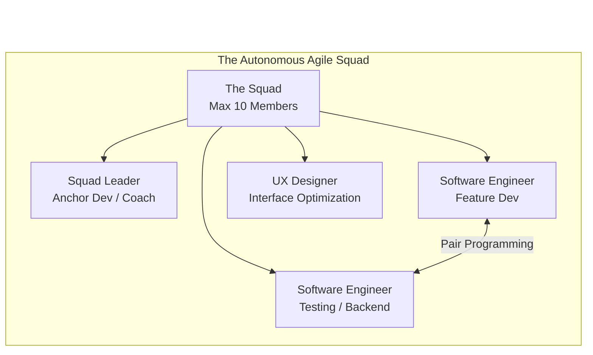

# 04 - Teamwork and Squads

<!-- IMAGE_PROMPT: A high-fidelity conceptual 3D isometric technical illustration of modern Software Engineering Teamwork. The image shows a glowing, futuristic circular command table where diverse geometric nodes (representing different engineering disciplines like UX, Back-End, and Front-End) connect together to form a cohesive, glowing central holographic core (representing the final software product). Data flows seamlessly between the nodes in synchronized harmony. Sleek dark background with neon cyan, amber, and purple accents. High aesthetic quality, crisp detail, no text. -->

## 1. Jargon Translation

- **Squad**:
  - _Official Definition_: In Agile development methodologies, a squad is a small, cross-functional, autonomous team (typically up to 10 members) with end-to-end responsibility for a specific product feature or domain.
  - _Under the Hood_: A specialized Navy SEAL team. Instead of having a massive army where everyone waits for orders from the top, you have a small, highly trained unit equipped with everything they need (a medic, a sniper, a communications expert) to complete a mission completely independently.
- **Retrospective**:
  - _Official Definition_: A formal meeting held at the end of a project or iteration (sprint) where the team reflects on what happened in the iteration and identifies actions for improvement going forward.
  - _Under the Hood_: The post-game locker room analysis. The team watches the game tape, celebrates the good plays, points out where they fumbled, and makes a concrete plan so they don't drop the ball in the next game.
- **Code Review**:
  - _Official Definition_: A systematic examination of computer source code intended to find mistakes overlooked in the initial development phase, improving the overall quality of software.
  - _Under the Hood_: Having an editor proofread your novel before it gets published. When you write a story, you become blind to your own typos; a fresh pair of eyes catches the spelling mistakes before the book hits the shelves.
- **Kick-off Meeting**:
  - _Official Definition_: The initial meeting with the project team and the client (or product owner) to establish common goals, define roles, and understand the scope of the project before development begins.
  - _Under the Hood_: The huddle before the first whistle blows. Everyone learns the playbook, understands exactly what position they are playing, and agrees on the strategy to win.
- **Walkthrough**:
  - _Official Definition_: A form of software peer review in which a designer or programmer leads members of the development team and other interested parties through a software product, and the participants ask questions and make comments about possible errors.
  - _Under the Hood_: A tour guide walking you through a museum they just built. They point out why they put the stairs where they did, and you can ask them why the emergency exit is blocked.

## 2. Topics Introduced in Lecture Transcript

1. The Definition and Broad Advantages of Teamwork
2. Cultivating Essential Team Dynamics (Trust, Roles, Goals)
3. Standard Software Engineering Meeting Cadences
4. The Tangible Code Benefits of Collaboration (Standards, Documentation, Bugs)
5. Mentorship and Internal Team Initiatives
6. The Agile "Squad" Structure and Its Composition

## 3. Exhaustive Deep Dive & Structured Notes

### The Psychology and Mechanics of Collaboration
In software engineering, the era of the isolated "lone wolf" programmer hacking away in a basement is obsolete. Modern software is far too complex for any single individual to master every layer (frontend, backend, database, DevOps, UI/UX). 
- **Skill Complementing**: By working in a team, members pool their varied experiences. A backend developer can focus purely on data architecture without worrying about button colors, knowing a UX designer is handling the interface.
- **Creative Friction**: Collaborating forces you to vocalize your logic. Discussing ideas and having a peer challenge your architectural decisions inherently leads to more robust, creative solutions that a single person would not have considered.

### Engineering Workflows and Meetings
Teams organize their collaboration through structured cadences to ensure everyone is aligned.
- **Kick-off Meetings**: The foundation phase. Without agreeing on goals and defining distinct roles here, teams risk "duplication of effort" (two developers accidentally writing the same feature).
- **Sub-team Meetings**: Focused check-ins to review granular progress on specific tickets.
- **Walkthroughs and Reviews**: Presenting sections of code to the team or stakeholders prevents knowledge silos (where only one person knows how a feature works).
- **Retrospectives**: The crucial loop for continuous improvement, focusing on team processes rather than technical code bugs.

| Meeting | Timing | Primary Purpose | Prevents |
| :--- | :--- | :--- | :--- |
| **Kick-off** | Start of project/sprint | Align goals & roles | Duplication of effort |
| **Sub-team Check-ins** | Ongoing, frequent | Track granular ticket progress | Silent blockers |
| **Walkthroughs / Reviews** | After a feature is built | Share knowledge, catch errors | Knowledge silos |
| **Retrospective** | End of sprint/project | Improve team process | Repeating the same mistakes |

### The Tangible Impact on Code Quality
Good teamwork doesn't just make people feel happier; it directly impacts the compiler and the repository.
- **Corporate Coding Standards**: When working alongside others, engineers are forced to format their code uniformly.
- **Accountability**: Knowing another peer will review your code forces you to write cleaner logic and actually write documentation. This naturally results in fewer bugs and a highly maintainable codebase.

### The Anatomy of an Agile Squad
Agile methodology explicitly defines team structures to maximize velocity. 
- A **Squad** is capped at around 10 people to prevent communication breakdown.
- **Squad Leader / Anchor Developer**: Acts as the technical coach and unblocker.
- **Software Engineers**: The core implementers of features and test cases.
- **UX Designers**: Ensure the human element of the software is optimized.
- **Pair Programming**: A common practice within squads where two developers share a single workstation to write code synchronously.

### Visualizing the Agile Squad Structure


## 4. Step-by-Step Breakdown: The Lifecycle of a Team Feature

1. **Alignment (Kick-off)**: The squad gathers. The Product Owner requests a new "Shopping Cart Checkout" feature. The team agrees on the overarching goal.
2. **Role Distribution**: The Squad Leader assigns the database schema creation to the back-end engineer, and the button UI to the UX designer and front-end engineer.
3. **Execution & Mentoring**: The developers write the code. A junior developer gets stuck on a payment API bug and turns to a senior developer for a brief pair-programming session to resolve the stress.
4. **Validation (Code Review)**: The developer submits the code. The rest of the squad conducts a code review, catching a syntax error that would have caused a bug in production.
5. **Reflection (Retrospective)**: The feature launches successfully. On Friday, the squad holds a retrospective meeting and agrees that next time, they need to communicate API changes faster.

## 5. Concrete Examples

- **Duplication of Effort**: If a team skips the Kick-off meeting and doesn't define roles, Developer A might spend 3 days writing a user authentication script, completely unaware that Developer B is also writing an authentication script. The team just wasted 3 days of expensive engineering time.
- **The Value of Retrospectives**: During a retrospective, an engineer mentions that deploying code at 5:00 PM on Fridays ruins their weekend because bugs inevitably occur when everyone has gone home. The team agrees on a new rule: "No deployments after Thursday." Team morale and stability instantly increase.

## 6. Code Blocks

```javascript
// TEAMWORK IN PRACTICE: Adhering to Corporate Standards
// When working in a silo, a lone developer might write this chaotic, unreadable code:
function calc(x,y){return x*y;}
const a=calc(5,10);
// No one else on the team knows what 'calc', 'x', 'y', or 'a' are.

// When working in a high-functioning Team/Squad, accountability forces this standard:
/**
 * Calculates the total price of items in the shopping cart including tax.
 * @param {number} basePrice - The raw price of the item.
 * @param {number} taxRate - The regional tax multiplier.
 * @returns {number} The final calculated price.
 */
function calculateTotalPrice(basePrice, taxRate) {
    const finalPrice = basePrice * taxRate;
    return finalPrice;
}

const checkoutTotal = calculateTotalPrice(5, 10);
```

**What happens if... your team doesn't enforce code reviews?**
If a team abandons the peer-review process to "move faster," a developer might accidentally push an infinite loop to the main codebase.
```javascript
// A developer accidentally writes an infinite loop because they copy-pasted wrong.
let userCount = 0;
// MISTAKE: The condition is 'userCount >= 0' which is ALWAYS true.
while (userCount >= 0) { 
    console.log("Fetching user...");
    userCount++;
}
// Without a team Code Review, this merges into production and crashes the company's servers instantly.
```

## 7. Related Concepts

1. **Version Control (Git)**: The ultimate teamwork tool. It allows dozens of developers to write code on the exact same project simultaneously without overwriting each other's files.
2. **Agile Methodology**: A project management philosophy that prioritizes flexibility, iterative rapid releases, and small, highly communicative teams (squads) over rigid, massive, long-term planning.
3. **DevOps Culture**: A collaborative approach that merges the software development team (Dev) and the IT operations team (Ops) to increase the speed and reliability of releasing software.
4. **Continuous Integration (CI)**: An automated process where every time a team member pushes new code, a server automatically builds and tests it, ensuring no one breaks the team's shared codebase.
5. **Pair Programming**: An Agile technique where two programmers share one computer. One types the code (the Driver) while the other reviews each line as it's typed (the Navigator/Observer).

## 8. Key Takeaways (Flashcard-Ready)

- **Q: What is the defining characteristic of an Agile "Squad"?**
  - A: It is a small, cross-functional, autonomous team of up to 10 people (including a leader, devs, and UX) that works on a specific feature end-to-end.
- **Q: How does teamwork directly improve the actual quality of the codebase?**
  - A: The accountability of peer collaboration forces engineers to adhere to coding standards, write documentation, and undergo code reviews, which drastically reduces bugs.
- **Q: What is the purpose of a retrospective meeting?**
  - A: To review a completed project or sprint, analyze what processes went well, and identify specific improvements the team can make for future workflows.
- **Q: Why is defining roles during a kick-off meeting essential?**
  - A: It provides absolute clarity on responsibilities, preventing costly duplication of effort and ensuring no vital tasks are accidentally missed.
- **Q: How does teamwork alleviate individual developer stress?**
  - A: It prevents developers from being bottlenecked by isolating problems; they always have colleagues to turn to for mentorship, pair programming, and architectural discussions.

## 9. The Trick Section

- **💡 The Secret Engineering Trick:** **The "Egoless" Code Review**. A massive pitfall for junior developers is attaching their personal ego to their code. When a teammate points out a flaw during a code review, the junior takes it as a personal attack, leading to toxic team dynamics. *The Trick*: Senior engineers practice "Egoless Programming." They understand that code is simply a tool, not a reflection of their intelligence. When submitting code for team review, they actively *hope* the team finds bugs, because catching a bug in a review is a team victory, whereas catching a bug in production is a disaster. Treat your code as a separate entity from yourself.

## 10. Interview Questions Section

### 1. What defines a highly effective software engineering team and why is it crucial for code quality?

- **Simple Definition**: An effective team is like a world-class symphony orchestra. You have a conductor, violinists, and percussionists. If the violinist tries to play the drums, or if the percussionist ignores the sheet music, the music sounds terrible. A highly effective software team works in total synchronization, where everyone trusts each other, follows the same sheet music (coding standards), and creates a beautiful application together.
- **Official Definition**: A highly effective software engineering team is a cohesive, cross-functional unit characterized by equitable contribution, psychological safety, transparent communication protocols, and clearly delineated roles. This structured collaboration directly dictates code quality by enforcing peer accountability, rigorous code review standards, and collective code ownership, which structurally prevents localized knowledge silos and catastrophic bugs.
- **Primary Responsibilities / Core Details**:
  - **Equitable Contribution**: Team effectiveness dies when one "hero" developer does 90% of the work. High-functioning teams distribute workloads based on strengths while actively mentoring to eliminate weak points.
  - **Psychological Safety**: Team members must feel entirely safe to say "I don't know how to do this" or "I made a mistake" without fear of punishment. This leads to faster bug resolution.
  - **Standardized Practices**: Effective teams don't debate styling rules every day; they establish a corporate coding standard (via linters or style guides) and stick to it universally.
  - **Collective Code Ownership**: No single file "belongs" to a specific developer. Any engineer should feel empowered to jump into any file to fix a bug, knowing the team's testing infrastructure will protect them.
  - **Accountability**: Knowing that your code will be publicly scrutinized by peers during a Pull Request forces developers to write cleaner, more maintainable code before submitting it.
- **Real-World Example**: At GitHub, engineering teams are famous for their asynchronous communication and strict adherence to peer reviews. If a developer builds a new feature, they don't just push it live. They open a Pull Request. Because the team culture demands accountability, the developer will automatically write comprehensive documentation and test cases, knowing that three other peers will review it. This collaborative gatekeeping is why GitHub rarely crashes despite thousands of daily deployments.
- **Best Coding/Development Practices**:
  - **Practice 1: Enforce Automated Linting**: Don't waste team meetings arguing about whether to use single quotes or double quotes. Use automated tools like ESLint or Prettier to instantly format code for everyone on the team.
    ```javascript
    // A team's .eslintrc.json configuration file dictates the rules universally
    {
      "rules": {
        "semi": ["error", "always"], // Forces every team member to use semicolons
        "quotes": ["error", "single"] // Forces every team member to use single quotes
      }
    }
    // If a teammate breaks these rules, the team's automated server rejects their code.
    ```
  - **Practice 2: Document "Why", Not "What"**: When working in a team, never write comments explaining *what* the code does (the code itself should be readable enough for that). Write comments explaining *why* a specific business decision was made, so future teammates have context.
  - **Practice 3: Adopt a "Blameless" Culture**: When production breaks, the team's first question should be "How did our automated testing systems fail to catch this?" instead of "Which developer wrote this bad code?"
- **Visual Aid (Mermaid Flowchart)**:
  ```mermaid
  flowchart TD
      margin_1((" "))
      style margin_1 fill:none,stroke:none
      margin_1 ~~~ Developer
      
      Developer[Solo Developer<br>Writes Code] --> PR[Opens Pull Request]
      
      subgraph "The Team Quality Gate"
          PR --> CI{Automated CI Server<br>Runs Tests}
          CI -->|Tests Pass| PeerReview{Team Peer Review}
          CI -->|Tests Fail| Reject1[Code Rejected<br>Developer Fixes]
          
          PeerReview -->|Code Approved| Merge[Merged to Production]
          PeerReview -->|Feedback Given| Reject1
      end
      
      Merge --> HighQuality[Result: High Quality Codebase]
  ```
- **Core Focus Areas**: Psychological Safety | Collective Ownership | Automated Accountability | Peer Review Systems

### 2. Detail the standard types of meetings a software engineering team conducts throughout a project lifecycle.

- **Simple Definition**: Think of building a house. You start with the blueprint meeting where the architect and builders agree on what to build (Kick-off). Every morning, the builders have a 5-minute coffee chat to say what walls they are painting today (Stand-ups). Occasionally, they walk the client through the framed house to get feedback (Walkthroughs). When the house is finished, the builders sit down to discuss how they can build the next house faster (Retrospective).
- **Official Definition**: Software engineering teams utilize a highly structured meeting cadence to ensure continuous alignment, risk mitigation, and continuous improvement. Standard meetings include the Project Kick-off (for goal and role definition), Daily Stand-ups (for unblocking immediate issues), Walkthroughs and Design Reviews (for technical oversight and stakeholder alignment), and Retrospectives (for analyzing team process inefficiencies post-delivery).
- **Primary Responsibilities / Core Details**:
  - **Kick-off Meetings**: The absolute genesis of a project. The product owner presents the requirements, and the engineering team negotiates the scope, sets the overarching goals, and assigns distinct roles to prevent duplicated effort.
  - **Daily Stand-ups / Sub-team syncs**: Usually limited to 15 minutes. Every team member answers three questions: What did I do yesterday? What am I doing today? What is blocking my progress?
  - **Design/Architecture Reviews**: Before a single line of code is written, senior engineers gather to debate the structural approach. Should we use a relational database? Should we use microservices?
  - **Code Walkthroughs**: A developer physically presents their screen to the team, explaining the logic block by block. This disseminates specialized knowledge so the entire team understands the module.
  - **Stakeholder Walkthroughs**: Presenting a simplified, non-jargon demo of the working software to non-technical business leaders to prove progress and gather early feedback.
  - **Retrospectives**: The final phase. The team asks: "What went well?", "What went wrong?", and "What concrete action items will we take to improve the next cycle?"
- **Real-World Example**: A team is tasked with building a new internal chat tool. During the **Kick-off**, they agree the front-end will use React and the back-end will use Node.js. During a **Daily Stand-up**, the front-end dev mentions they are blocked because the API isn't ready. The back-end dev agrees to mock the API data immediately. At the end of the month, during the **Retrospective**, they realize that mocking data took too long, and they decide to adopt a standardized tool like Postman for future projects.
- **Best Coding/Development Practices**:
  - **Practice 1: Timebox Meetings Strictly**: Engineers are paid to write code, not sit in meetings. Use a literal timer during Daily Stand-ups. If a technical debate starts, the team leader must say "Let's take this offline" to respect everyone's time.
    ```javascript
    // Conceptually, a Stand-up meeting should look like this minimal function:
    function dailyStandup(developer) {
        if (developer.hasBlocker) {
            schedulePairProgrammingSession(developer);
        }
        returnToCoding(); // Immediately return to productive work
    }
    ```
  - **Practice 2: Actionable Retrospectives**: Never end a retrospective with vague feelings like "We need to communicate better." End with concrete, measurable action items: "We will mandate a 2-hour SLA on Code Review approvals."
  - **Practice 3: Mandate Agendas**: Never accept a calendar invite for a Design Review if the organizer hasn't attached a clear agenda and pre-reading materials. Walkthroughs fail when participants arrive unprepared.
- **Visual Aid (Mermaid Flowchart)**:
  ```mermaid
  flowchart LR
      margin_1((" "))
      style margin_1 fill:none,stroke:none
      margin_1 ~~~ Kickoff
      
      Kickoff["Kick-off<br>(Goal Setting)"] --> Design
      Design["Design Review<br>(Architecture)"] --> Build
      
      subgraph "Iterative Build Phase"
          Build["Daily Stand-up"] --> Code["Write Code"]
          Code --> Walkthrough["Code Walkthrough"]
      end
      
      Walkthrough --> Retro["Retrospective<br>(Process Improvement)"]
  ```
- **Core Focus Areas**: Communication Cadence | Scope Alignment | Unblocking Workflows | Continuous Improvement

### 3. Explain the concept of a "Squad" within Agile development methodologies.

- **Simple Definition**: Instead of a massive factory line where a car frame is built in one building, shipped to another building for the engine, and shipped to a third for paint (Waterfall), a Squad is a small, specialized garage. Inside that one garage, you have exactly one engine mechanic, one painter, and one electrician. They work side-by-side, talk constantly, and build the entire car themselves from start to finish.
- **Official Definition**: A Squad is the fundamental unit of delivery in the Spotify Agile scaling model. It is a small (usually under 10 members), collocated, cross-functional, and highly autonomous team designed to operate almost like a mini-startup within a larger corporation. A squad possesses all the requisite skills (product management, design, software engineering, QA) needed to design, develop, test, and deploy a product feature end-to-end without relying on external departments.
- **Primary Responsibilities / Core Details**:
  - **Autonomy**: Squads are given a mission (e.g., "Improve the checkout conversion rate") rather than a strict checklist of tasks. They decide *how* to build the solution, what technology to use, and how to organize their work.
  - **Cross-Functional Makeup**: Squads aggressively eliminate "handoffs". Because the database expert, the UI designer, and the QA tester are all in the same squad, there is no waiting weeks for a different department to approve a request.
  - **The Squad Leader / Anchor**: Not a traditional "boss" who dictates tasks, but a servant-leader, technical coach, and facilitator whose primary job is removing organizational roadblocks for the developers.
  - **End-to-End Ownership**: The squad doesn't just write code; they deploy it, monitor it in production, and fix it if it breaks at 2 AM. "You build it, you run it."
  - **Long-Term Stability**: Unlike project teams that dissolve after a launch, squads stay together indefinitely, focusing on a specific product area (like "User Authentication"). This builds deep domain expertise and high team trust over time.
- **Real-World Example**: A major e-commerce company creates a "Search Experience Squad". This 8-person team contains a Product Owner who decides what search features users want, a UX Designer who draws the search bar, 4 Engineers who build the search algorithms and UI, and a QA engineer. This squad does not care about the "Shopping Cart" or the "User Profile" pages; they exist solely to make the search bar the best in the world, and they have the absolute authority to deploy updates to it whenever they want.
- **Best Coding/Development Practices**:
  - **Practice 1: Feature Flags for Autonomous Deployment**: Because Squads deploy constantly without waiting for other teams, they must use "Feature Flags". This allows them to push code to production servers, but keep the feature hidden from users until the exact marketing launch date.
    ```javascript
    // GOOD PRACTICE: Squad utilizing Feature Flags
    function renderSearchBar(user) {
        // The squad can safely push this code to production today.
        // It remains invisible until they flip 'new_search_algorithm' to true in a database.
        if (featureFlags.isEnabled('new_search_algorithm')) {
            return <NewAIPoweredSearch />;
        } else {
            return <LegacySearch />;
        }
    }
    ```
  - **Practice 2: Pair Programming**: Squads frequently utilize pair programming to disseminate knowledge quickly. If the front-end developer pairs with the back-end developer, they both gain a massive understanding of the full stack.
  - **Practice 3: Maintain a Dedicated Backlog**: The squad must fiercely guard their prioritization backlog. The Product Owner must prioritize technical debt reduction alongside shiny new features to ensure the squad's codebase remains healthy.
- **Visual Aid (Mermaid Flowchart)**:
  ```mermaid
  flowchart TD
      margin_1((" "))
      style margin_1 fill:none,stroke:none
      margin_1 ~~~ PO
      
      subgraph "The Autonomous Squad"
          PO["Product Owner<br>(Defines the 'What')"]
          Leader["Squad Leader / Coach<br>(Removes Blockers)"]
          
          Dev1["Front-End Eng"]
          Dev2["Back-End Eng"]
          UX["UX Designer"]
          QA["QA Engineer"]
          
          PO --> Dev1 & Dev2 & UX & QA
          Leader --> Dev1 & Dev2 & UX & QA
          Dev1 <--> Dev2 <--> UX <--> QA
      end
      
      Dev1 --> Deploy["Deploys Directly to Production"]
  ```
- **Core Focus Areas**: Cross-Functional Autonomy | End-to-End Ownership | Agile Methodologies | Reduced Handoffs

### 4. How do team dynamics and communication protocols directly impact the maintainability of a codebase?

- **Simple Definition**: If five writers try to write a single novel without talking to each other, you'll get a story where the main character's name changes in every chapter, and the plot makes no sense. The same is true for code. If developers don't communicate constantly, they will write wildly different styles of code, making the application impossible to read, fix, or maintain in the future.
- **Official Definition**: Team dynamics—encompassing the protocols for communication, conflict resolution, and collaborative planning—serve as the foundational matrix for software maintainability. A codebase's structural coherence (often described by Conway's Law) is a direct reflection of the communication structures of the team that built it. Poor communication results in high technical debt, code duplication, missing documentation, and brittle, unscalable architectures.
- **Primary Responsibilities / Core Details**:
  - **Conway’s Law**: A famous computing adage stating that organizations design systems that mirror their own communication structures. If an organization has three teams that refuse to talk to each other, they will inevitably build a software system with three deeply incompatible, siloed databases.
  - **Preventing Duplication**: Transparent communication ensures that if Developer A is building a specific date-formatting function, Developer B knows about it and reuses it, rather than writing a redundant, slightly different version.
  - **Code Readability**: Maintainability means a new employee can read old code and instantly understand it. Highly communicative teams enforce strict naming conventions and architectural patterns so the entire codebase looks like it was written by a single person.
  - **Reduced Stress and Attrition**: Healthy team dynamics provide a psychological safety net. When a developer is stuck on a critical bug, a supportive team swarms the problem together. Toxic teams leave the developer to suffer alone, leading to burnout and turnover, which destroys codebase continuity.
  - **Documentation as Communication**: In a team, code documentation is essentially an asynchronous conversation with developers in the future. Strong teams mandate documentation as a non-negotiable definition of "done."
- **Real-World Example**: A startup is rushing to build a product. The backend engineer builds an API that returns user ages as a `String` ("25"), but doesn't document it or communicate it. The frontend engineer builds the interface expecting a `Number` (25) and writes math logic based on that assumption. Because they didn't communicate, the app crashes in production when it tries to multiply a string. If they had a transparent API contract meeting, the bug would never have been written.
- **Best Coding/Development Practices**:
  - **Practice 1: Establish Strict API Contracts**: Before anyone writes code, the team must agree on the exact JSON structures that will be passed back and forth.
    ```javascript
    // GOOD PRACTICE: A documented team contract for an API response
    /**
     * API Contract for /users/profile
     * Team Agreement: All timestamps must be in ISO 8601 format.
     * All monetary values must be returned as integers (cents), NOT decimals.
     */
    const userProfileResponse = {
        userId: 10293,
        createdAt: "2023-10-01T12:00:00Z", // Agreed upon string format
        accountBalanceCents: 5000 // Agreed upon integer format
    };
    ```
  - **Practice 2: Centralize Shared Utility Functions**: Teams must maintain a shared `utils` folder and communicate when new tools are added to prevent developers from writing duplicate helper functions.
  - **Practice 3: Mandate PR Templates**: Create a Pull Request template in GitHub that forces developers to check a box stating "I have updated the relevant documentation" before the team is allowed to merge their code.
- **Visual Aid (Mermaid Flowchart)**:
  ```mermaid
  flowchart TD
      margin_1((" "))
      style margin_1 fill:none,stroke:none
      margin_1 ~~~ Comm
      
      Comm{"Team Communication Level"}
      
      Comm -->|High Transparency & Trust| Good[Standardized Patterns]
      Good --> Reusable[Reusable Components]
      Reusable --> Main[Highly Maintainable Codebase]
      
      Comm -->|Siloed & Toxic| Bad[Duplicated Logic]
      Bad --> Incompatible[Incompatible APIs]
      Incompatible --> TechDebt[Massive Technical Debt]
  ```
- **Core Focus Areas**: Conway's Law | Codebase Coherence | Technical Debt Reduction | Asynchronous Communication

### 5. Discuss the role of mentorship and internal standards development within an engineering team.

- **Simple Definition**: A software team is like a blacksmith's forge. You have master blacksmiths (senior engineers) and apprentices (juniors). The master doesn't just forge swords all day; their most important job is teaching the apprentice how to hold the hammer. Furthermore, the forge occasionally shuts down normal production just to build better tools, stronger anvils, and safer furnaces, making everyone's job easier in the long run.
- **Official Definition**: Mentorship in software engineering is the deliberate, structured transfer of domain knowledge, architectural wisdom, and professional conduct from experienced engineers to junior team members. Concurrently, internal standards development involves dedicating engineering resources not to customer-facing features, but to internal initiatives—such as defining architectural guidelines, updating legacy systems, and evaluating new tooling—to increase the overall velocity, safety, and capability of the entire engineering organization.
- **Primary Responsibilities / Core Details**:
  - **Knowledge Dissemination**: Mentorship prevents a "bus factor" of 1 (where if one senior developer gets hit by a bus, the entire project dies because no one else understands the database).
  - **Cultural Onboarding**: Mentors teach juniors not just *how* to code, but the *culture* of the team—how to conduct a polite code review, how to safely deploy to production, and how to write a bug report.
  - **Team Mentoring (Swarming)**: Mentorship isn't always 1-on-1. Teams often conduct "Lunch and Learns" where one developer presents a deep dive on a new technology (like Docker) to upskill the entire team simultaneously.
  - **Internal Tooling**: High-functioning teams dedicate specific sprints to internal projects, such as building a deployment script that reduces server setup time from 3 hours to 5 minutes.
  - **Standards Definition**: Creating and updating a living "Engineering Handbook" that dictates naming conventions, error-handling protocols, and preferred libraries, ensuring the codebase remains uniform regardless of staff turnover.
- **Real-World Example**: A junior developer joins a massive fintech company. On day one, instead of being thrown into critical banking code, they are assigned a Senior Mentor. They spend the first week Pair Programming. The senior lets the junior type, while explaining the historical reasons *why* the company uses a specific legacy database. When the junior makes a mistake, the senior catches it instantly, creating a safe, low-stress learning environment that drastically accelerates the junior's productivity.
- **Best Coding/Development Practices**:
  - **Practice 1: Junior-Led Code Reviews**: A highly effective mentoring technique is forcing junior developers to review senior developers' code. The junior must read complex architecture and is encouraged to ask the senior "Why did you do it this way?" in the comments.
  - **Practice 2: Build Internal CLIs**: Invest team time in building internal Command Line Interfaces to automate boring setup tasks, standardizing the workflow for every new hire.
    ```bash
    # An example of an internal tool built by the team to enforce standards
    # Instead of a new hire manually setting up 50 folders, they run:
    $ company-cli generate-microservice --name "BillingAPI"
    # Result: The internal tool instantly generates the boilerplate code exactly 
    # to the team's architectural standards, ensuring 100% uniformity.
    ```
  - **Practice 3: Regular Tech Debt Sprints**: Mentorship requires time. Teams must negotiate with Product Managers to dedicate 20% of every development cycle specifically to refactoring old code, updating documentation, and mentoring, rather than solely producing new features.
- **Visual Aid (Mermaid Flowchart)**:
  ```mermaid
  flowchart TD
      margin_1((" "))
      style margin_1 fill:none,stroke:none
      margin_1 ~~~ Senior
      
      subgraph "The Mentorship Ecosystem"
          Senior["Senior Engineer<br>(Domain Expert)"]
          Junior["Junior Engineer<br>(New Hire)"]
          
          Senior -->|Pair Programming & Coaching| Junior
          Junior -->|Fresh Perspectives & Questions| Senior
      end
      
      subgraph "Internal Initiatives"
          Standards["Define Coding Standards"]
          Tools["Build Internal Automation Tools"]
          Refactor["Refactor Legacy Code"]
      end
      
      Senior & Junior --> Standards & Tools & Refactor
      Standards & Tools & Refactor -->|Result| HighVelocity["Increased Team Velocity & Morale"]
  ```
- **Core Focus Areas**: Knowledge Transfer | Bus Factor Reduction | Technical Tooling | Continuous Upskilling
