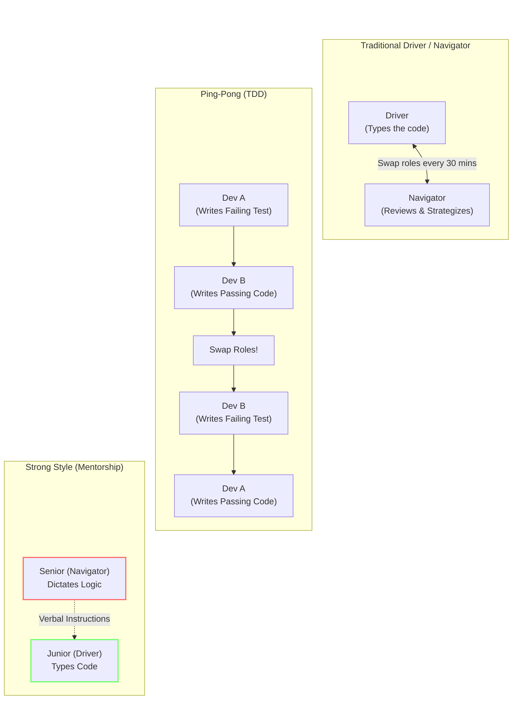

# 05 - Pair Programming

<!-- IMAGE_PROMPT: A high-fidelity conceptual 3D isometric technical illustration of Pair Programming. The image shows two glowing, stylized geometric avatars working in synchronized harmony in front of a massive, curved holographic code interface. One avatar (the Driver) is actively manipulating glowing code blocks on a terminal, while the second avatar (the Navigator) projects a wider strategic architectural blueprint overlaying the code. Flowing data links physically connect the two avatars, representing shared cognition. Sleek dark background with neon cyan, vibrant magenta, and amber accents. High aesthetic quality, crisp detail, no text. -->

## 1. Jargon Translation

- **Pair Programming**:
  - _Official Definition_: An Agile software development technique in which two programmers work together at one workstation. One writes the code while the other reviews each line of code as it is typed in.
  - _Under the Hood_: Driving a rally car. One person holds the steering wheel and pedals (typing the code), while the other holds the map and shouts out the upcoming sharp turns and hazards (reviewing and strategizing).
- **The Driver**:
  - _Official Definition_: The programmer who is actively typing at the keyboard and focusing on the immediate implementation details of the code being written.
  - _Under the Hood_: The person holding the paintbrush. They are entirely focused on making sure the stroke of paint goes exactly where it needs to go on the canvas.
- **The Navigator**:
  - _Official Definition_: The programmer who observes the work of the driver, looking for tactical defects (syntax errors) and strategic defects (architectural flaws), while considering the broader direction of the work.
  - _Under the Hood_: The architect standing behind the painter. While the painter focuses on the brush stroke, the architect is looking at the entire canvas to make sure the painting matches the original blueprint.
- **Ping-Pong Style**:
  - _Official Definition_: A pair programming workflow that heavily integrates Test-Driven Development (TDD). Developer A writes a failing test, Developer B writes code to pass the test, and then they swap.
  - _Under the Hood_: A tennis match. I serve the ball (a failing test). You hit it back (the code that passes the test). Now it's your turn to serve.
- **Strong Style Pairing**:
  - _Official Definition_: An experience-weighted pairing style governed by the rule: "For an idea to go from your head to the computer, it must go through someone else's hands." The senior developer navigates; the junior developer drives.
  - _Under the Hood_: A master chef teaching an apprentice. The chef (Navigator) is not allowed to touch the knife. They must verbally instruct the apprentice (Driver) exactly how to chop the onion, forcing the apprentice to learn the physical muscle memory and the logic simultaneously.

## 2. Topics Introduced in Lecture Transcript

1. The Definition and Mechanics of Pair Programming
2. The Driver/Navigator Paradigm
3. Ping-Pong Pairing and Test-Driven Development (TDD)
4. Strong Style Pairing for Mentorship and Onboarding
5. The Tangible Benefits of Collaborative Coding (Quality, On-the-fly review)
6. Common Pitfalls and Challenges of Pairing (Exhaustion, Personality clashes)

## 3. Exhaustive Deep Dive & Structured Notes

### The Evolution of Collaboration
Pair programming takes the core concepts of teamwork—communication, accountability, and code review—and condenses them into a real-time, synchronous process. Instead of writing code in a silo and asking a teammate to review it a week later, the review happens on a keystroke-by-keystroke basis.

### Dissecting the Styles
Teams do not use a "one size fits all" approach to pairing. The style chosen depends entirely on the goal of the session.
- **Driver / Navigator**: The most common and flexible style. It is crucial to swap these roles frequently (e.g., every 30 minutes) using a timer to prevent the Navigator from losing focus and the Driver from burning out.
- **Ping-Pong**: Excellent for teams transitioning to Test-Driven Development (TDD). Because the roles of "test writer" and "code writer" are constantly swapping, both developers become equally proficient at both disciplines.
- **Strong Style**: The ultimate onboarding tool. It prevents the senior developer from simply taking the keyboard and doing the work themselves. The junior is forced to write the complex logic, drastically accelerating their learning curve.

| Style | Role Swap Frequency | Best For | Key Risk |
| :--- | :--- | :--- | :--- |
| **Driver / Navigator** | Every ~30 minutes | General-purpose pairing | Navigator losing focus |
| **Ping-Pong (TDD)** | After each test/code cycle | Teams adopting TDD | Skipping the refactor step |
| **Strong Style** | Rarely — Navigator stays senior | Onboarding & mentorship | Navigator dictating too literally |

### The Cost/Benefit Analysis
A common management complaint is that pair programming halves productivity (two people doing the job of one). However, studies consistently show that while initial code generation takes slightly longer, pair programming virtually eliminates the massive time sinks of bug-hunting, complex QA cycles, and post-merge code reviews. The code is "clean" the moment it is finished.

### Visualizing Pair Programming Styles



## 4. Step-by-Step Breakdown: A Ping-Pong Pair Session

1. **The Setup**: Dev A and Dev B sit at the same machine (or join a VS Code Live Share session). They agree to build a `calculateDiscount()` function.
2. **The Serve (Failing Test)**: Dev A takes the keyboard and writes a test: `expect(calculateDiscount(100, 10)).toBe(90)`. They run the test. It fails (Red).
3. **The Return (Passing Code)**: Dev B takes the keyboard. Dev B writes the simplest code possible to pass the test: `function calculateDiscount(price, discount) { return price - discount; }`. The test passes (Green).
4. **The Refactor**: Both developers look at the code and agree it looks good. No refactoring needed yet.
5. **The Next Serve**: Dev B keeps the keyboard and writes the next test: `expect(calculateDiscount(100, 150)).toThrow("Discount cannot exceed price")`. It fails.
6. **The Next Return**: Dev A takes the keyboard to write the logic that passes the new test.

## 5. Concrete Examples

- **The "On-the-Fly" Code Review**: A developer (the Driver) is writing a database query. They accidentally type `SELECT * FROM users` without a `WHERE` clause. Before they even press save, the Navigator says, "Wait, that will pull a million records and crash the server. Add a limit." The bug is killed before it ever exists.
- **The Typist Anti-Pattern**: A senior developer is navigating but is overly controlling. They say, "Type `const`, space, `x`, equals, `5`, semicolon." The junior driver learns absolutely nothing about *why* the code is being written and becomes a mindless typist. This is a failure of Strong Style pairing.

## 6. Code Blocks

```javascript
// PING-PONG PAIR PROGRAMMING IN PRACTICE (TDD)

// STEP 1: Dev A (Driver) writes the test and passes the keyboard.
test('Should return user full name', () => {
    const user = { firstName: "John", lastName: "Doe" };
    expect(getFullName(user)).toBe("John Doe");
});

// STEP 2: Dev B (New Driver) writes the implementation to pass the test.
function getFullName(user) {
    return `${user.firstName} ${user.lastName}`;
}
// Dev B runs the tests. They pass!

// STEP 3: Dev B keeps the keyboard and writes the next failing test.
test('Should handle missing last name', () => {
    const user = { firstName: "John" };
    expect(getFullName(user)).toBe("John");
});

// STEP 4: Dev A (New Driver) takes the keyboard to update the implementation.
function getFullName(user) {
    if (!user.lastName) return user.firstName;
    return `${user.firstName} ${user.lastName}`;
}
```

## 7. Related Concepts

1. **Test-Driven Development (TDD)**: Writing the automated test for a feature *before* writing the feature itself. Intimately linked with Ping-Pong pairing.
2. **Mob Programming (Ensemble Programming)**: An evolution of pair programming where the *entire* team (3-6 people) works on the exact same code at the same time, usually projected on a large screen, with one Driver and multiple Navigators.
3. **Continuous Review**: The concept that peer review shouldn't happen at the very end of a sprint (via a Pull Request), but continuously throughout the day (via Pair Programming).
4. **Agile Software Development**: The overarching methodology that values "Individuals and interactions over processes and tools," which pair programming directly facilitates.
5. **Bus Factor**: The risk associated with information and capabilities not being shared among team members. Pairing reduces the bus factor by ensuring at least two people deeply understand every line of code.

## 8. Key Takeaways (Flashcard-Ready)

- **Q: What is the defining rule of Strong Style pair programming?**
  - A: For an idea to go from someone's head into the computer, it must pass through someone else's hands (The Navigator thinks and dictates, the Driver types).
- **Q: How does Ping-Pong pairing enforce Test-Driven Development?**
  - A: It forces developers to alternate roles for every step of TDD. One writes a failing test, the other writes the passing implementation, ensuring no code is written without a test existing first.
- **Q: What is the primary role of the "Navigator" in traditional pairing?**
  - A: To review the code in real-time for syntax and logic errors, while keeping the broader architectural "big picture" in mind so the Driver can focus solely on implementation.
- **Q: Why might pair programming be more efficient overall, despite using two developers for one task?**
  - A: It drastically reduces downstream costs by eliminating the need for separate, asynchronous code reviews, and prevents complex bugs from entering the testing pipeline.
- **Q: What is the biggest physical or psychological challenge of pair programming?**
  - A: The intense, sustained focus required. Pairing for 8 straight hours is deeply exhausting, and differing personalities can cause friction if roles aren't managed properly.

## 9. The Trick Section

- **💡 The Secret Engineering Trick:** **The Socratic Navigator**. When acting as the Navigator, it is very easy to become an annoying micromanager who just barks syntax corrections at the Driver ("You forgot a semicolon!"). *The Trick*: Senior engineers use the Socratic method when navigating. Instead of giving direct orders, they ask probing questions. Instead of saying "You didn't check for null values," they ask, "What happens to this function if the database returns an undefined user object?" This forces the Driver to realize the error themselves, internalize the architectural logic, and become a vastly better engineer.

## 10. Interview Questions Section

### 1. Explain the Driver/Navigator dynamic in pair programming and the psychological benefits it provides.

- **Simple Definition**: Imagine embarking on a highly complex cross-country road trip through completely unknown territory with unpredictable weather and treacherous terrain. One person is the Driver. Their hands are on the steering wheel, their foot is on the gas, and their eyes are glued to the immediate 100 feet of road in front of the car. They are hyper-focused on avoiding potholes, shifting gears smoothly, and reacting to immediate physical hazards. The other person is the Navigator sitting in the passenger seat. They are not looking at the potholes; they are looking at the GPS, the weather radar, and the map. They are warning the driver that there is a traffic jam two miles ahead, calculating the fuel efficiency required to reach the next gas station, and ensuring the car is actually driving toward the correct destination city. In programming, the Driver types the code (the steering wheel), while the Navigator plans the architecture and reviews the code in real-time (the map).
- **Official Definition**: The Driver/Navigator dynamic is the foundational operational framework of traditional pair programming, an Agile software development technique. It establishes a strict, dual-role system where two developers collaboratively work on a single workstation (or through a synchronized remote environment like VS Code Live Share) to achieve a single task. The Driver commands the input devices (keyboard and mouse) and is singularly focused on the tactical execution of writing clean, syntactically correct code that implements the immediate logic. The Navigator operates continuously as a real-time reviewer, strategic director, and architectural guide. By removing the cognitive load of typing and syntax formatting from the Navigator, they are freed to analyze broader architectural implications, identify edge cases, spot logical defects, and plan future refactoring needs synchronously as the code is generated.
- **Primary Responsibilities / Core Details**:
  - **Cognitive Load Distribution**: Software engineering requires holding a massive amount of abstract context in working memory. A solo developer must simultaneously remember the overall system architecture, the specific business requirement, the exact syntax of the programming language, and the minute details of the current function being written. This inevitably leads to cognitive overload and mistakes. By splitting the work, the Driver doesn't have to worry about the overarching architecture, and the Navigator doesn't have to worry about missing commas or mismatched brackets. This isolation of concerns allows both developers to operate at maximum efficiency within their specific domain.
  - **The Real-Time Code Review Mechanism**: In traditional asynchronous workflows, a developer writes code for a week, opens a Pull Request (PR), and then waits days for a peer to review it. By the time the review happens, the original developer has lost the context of why they wrote it that way. In the Driver/Navigator model, the review cycle is reduced from days to milliseconds. The code is peer-reviewed literally as it is being typed, eliminating the downstream bottleneck of the PR process.
  - **Psychological Safety and Anxiety Reduction**: When a solo developer encounters an incredibly complex bug or a blocker, they often experience imposter syndrome, stress, and anxiety. They might spend hours spinning their wheels in isolation. When a pair gets stuck, the psychological burden is shared. It transforms from "I am failing to solve this" to "We are facing a difficult problem." This shared responsibility vastly reduces individual anxiety and prevents burnout.
  - **Continuous Engagement and the Pomodoro Rhythm**: The Driver/Navigator dynamic is completely destroyed if the Navigator loses focus. Because the Navigator is not physically interacting with the machine, they are highly susceptible to "drift"—zoning out, checking their phone, or thinking about other things. To combat this, the roles must be swapped frequently using a strict cadence, such as the Pomodoro technique (e.g., 25 minutes of work followed by a 5-minute break and a role swap).
  - **Information Osmosis and Silo Destruction**: In many companies, specific developers become "silos" of knowledge (e.g., "Only Sarah knows how the payment gateway works"). The Driver/Navigator dynamic inherently destroys these silos because at least two people are deeply involved in the creation of every line of code. Information is transferred through osmosis, raising the baseline knowledge of the entire engineering department.
  - **Vocalization of Internal Logic**: To pair effectively, developers cannot remain silent. The Navigator must constantly vocalize their strategic intent ("Let's extract this logic into a helper function because we'll need it again in the next module"), and the Driver must vocalize their tactical execution ("I'm going to use a map function here instead of a forEach to return the new array"). This constant verbalization clarifies thought processes and exposes logical flaws before they are typed.
- **Real-World Example**: Consider a team building a Node.js/Express backend for an e-commerce platform. The current Jira ticket requires implementing a new checkout route that applies a complex discount logic based on the user's loyalty tier. 
  
  Developer A (the Driver) and Developer B (the Navigator) sit down to work. Developer A takes the keyboard and begins writing the Express route handler. Developer A is intensely focused on extracting the `userId` and `cartTotal` from the `req.body`, validating the input, and setting up the try/catch block for error handling. 
  
  Developer B, free from the burden of typing the boilerplate Express code, is looking at the broader picture. Developer B realizes that the `cartTotal` being sent from the frontend cannot be trusted, as malicious users could manipulate the client-side request to send a lower total. Developer B immediately stops Developer A. 
  
  "Wait," Developer B says. "We can't use the `cartTotal` from the request body. We need to query the database for the user's cart items and recalculate the total securely on the server side here before applying the discount." 
  
  Developer A agrees, deletes the vulnerable code, and writes the secure database query instead. If Developer A had been working solo, they likely would have implemented the vulnerable code, pushed it to GitHub, and the critical security flaw might have made it all the way to production. The Navigator saved the company from a massive vulnerability in real-time.
- **Best Coding/Development Practices**:
  - **Practice 1: Establish Strict, Unbreakable Timeboxes for Swapping Roles**: Do not rely on "we'll swap when it feels right." Developers will inevitably lose track of time, resulting in one person driving for three hours and the other person mentally checking out. Use a strict digital timer (like a Pomodoro app). When the 25-minute alarm goes off, the Driver must take their hands off the keyboard immediately, even if they are in the middle of typing a word. They swap physical seats (or remote control), and the new Driver finishes the sentence.
    ```javascript
    // Example: A timer goes off while Developer A is driving.
    function applyLoyaltyDiscount(user, cartTotal) {
        if (user.loyaltyTier === 'GOLD') {
            return cartTotal * 0.8; 
        }
        // TIMER RINGS! Developer A stops typing immediately.
        // Developer B takes the keyboard.
        
        // Developer B finishes the logic:
        if (user.loyaltyTier === 'SILVER') {
            return cartTotal * 0.9;
        }
        return cartTotal;
    }
    ```
  - **Practice 2: "Trust the Driver" (The Five-Second Rule)**: The Navigator must resist the urge to instantly correct every single typo. If the Driver types `cosnt` instead of `const`, the Navigator should wait at least five seconds before pointing it out. The Driver will almost always notice the red squiggly line from the IDE and fix it themselves. Interrupting the Driver's flow state for minor syntax errors causes immense frustration and ruins the psychological safety of the pair.
    ```javascript
    // BAD NAVIGATOR:
    // Driver types: fnuction calculateTotal() {
    // Navigator (instantly yelling): "YOU SPELLED FUNCTION WRONG!"
    // Driver: (Sighs, loses train of thought).

    // GOOD NAVIGATOR:
    // Driver types: fnuction calculateTotal() {
    // Navigator: (Stays silent for 5 seconds).
    // Driver: (Sees the error, backspaces, fixes it to 'function').
    // Navigator: "Great, now let's make sure we pass the tax rate as the second argument."
    ```
  - **Practice 3: Think Out Loud (Narrative Coding)**: Both developers must constantly narrate what they are doing and why. The Driver should narrate their micro-decisions ("I'm using a ternary operator here to keep it concise"), and the Navigator should narrate the macro-decisions ("Keep in mind we need to return a Promise from this function so the controller can await it").
- **Visual Aid (Mermaid Flowchart)**:

  ```mermaid
  flowchart TD
      margin_1((" "))
      style margin_1 fill:none,stroke:none
      margin_1 ~~~ Focus
      
      subgraph "Cognitive Load Distribution"
          margin_cog((" "))
          style margin_cog fill:none,stroke:none
          margin_cog ~~~ Focus
          
          Focus{"Pair Programming Session"}
          
          Focus -->|Tactical Execution| Driver
          Focus -->|Strategic Planning| Nav
          
          Driver["The Driver<br>Focus: Syntax, Logic Implementation, Typing"]
          Nav["The Navigator<br>Focus: Architecture, Edge Cases, Code Review"]
      end
      
      Driver -.->|Requires Mental Break| Swap{"Timer Rings<br>(Swap Roles)"}
      Nav -.->|Requires Engagement| Swap
      
      Swap -.->|Becomes| Driver
      Swap -.->|Becomes| Nav
  ```
- **Core Focus Areas**: Role Swapping | Real-time Review | Cognitive Load | Tactical vs Strategic Thinking | Imposter Syndrome Reduction

### 2. What is "Ping-Pong" pair programming, and how does it inherently enforce Test-Driven Development (TDD)?

- **Simple Definition**: It’s a game where you challenge your partner to solve a puzzle, but you build the puzzle one tiny piece at a time. I write a test that says "If I give you the numbers 5 and 5, you must write a program that gives me 10." The test fails because there is no code yet. I physically slide the keyboard over to you. You write the absolute simplest code possible that adds 5 and 5 to make the test pass. Then, while you still have the keyboard, you challenge me by writing a new, slightly harder test: "If I give you -5 and 5, you must return 0." You slide the keyboard back to me. We bounce the control back and forth like a ping-pong ball, slowly building up the entire application logic.
- **Official Definition**: Ping-Pong pair programming is a highly structured collaborative workflow that integrates the Red-Green-Refactor cycle of Test-Driven Development (TDD) with continuous, micro-level role-swapping. The process strictly dictates a sequence of operations: Developer A writes a failing automated test (the Red phase) and hands over control. Developer B writes the implementation logic required to satisfy the test (the Green phase). Both developers then pause and collaboratively analyze the code to improve its structure and efficiency (the Refactor phase). Finally, Developer B immediately writes the next failing test to initiate the next cycle, handing control back to Developer A.
- **Primary Responsibilities / Core Details**:
  - **Enforced TDD and Habit Building**: Many developers actively resist TDD because writing tests *before* writing the business logic feels unnatural and frustrating when working solo. Ping-Pong turns TDD into a social, gamified process. It makes it literally impossible to write implementation code without a test existing first, forcing the team to build a comprehensive test suite organically.
  - **Shared Context and Total Granular Understanding**: Because both developers are constantly writing both tests and business logic in alternating cycles, they both achieve a 100% granular understanding of the feature's requirements, edge cases, and architectural constraints. Neither developer is relegated to just "the test writer" or "the feature builder."
  - **Rapid Feedback Loops and Fatigue Prevention**: In traditional pairing, roles might swap every 30 minutes. In Ping-Pong, the roles swap every few minutes (as quickly as a single micro-test can be written and passed). This extremely rapid feedback loop ensures neither developer ever experiences fatigue, boredom, or the "drift" that occurs during long traditional pairing sessions.
  - **The Critical Refactoring Phase**: The most critical and often overlooked part of Ping-Pong is the Refactor phase. After the code goes "Green" (passes the test), both developers must actively stop typing. They step back, look at the code they just wrote to pass the test, and discuss how to make it cleaner, more efficient, and more compliant with DRY (Don't Repeat Yourself) principles *before* moving to the next test.
  - **Preventing Premature Optimization**: Ping-Pong forces developers to write the absolute bare minimum code required to pass the immediate test. It physically prevents a developer from going down a rabbit hole of building complex, overly engineered architectures for edge cases that don't even have a test written for them yet.
  - **Gamification of Edge Cases**: When Developer A writes a test for Developer B, Developer A is actively trying to think of the most difficult edge case to stump Developer B. This healthy competition forces the pair to cover a much wider range of edge cases than a solo developer would ever consider.
- **Real-World Example**: A financial software team is tasked with building a `calculateCompoundInterest` function for a new Node.js microservice. 
  
  Developer A (Driver) writes a Jest test expecting `calculateInterest(100, 0.05, 1)` to equal `105`. The test fails (Red). Developer A passes the keyboard. 
  
  Developer B (new Driver) takes the keyboard and writes the simplest possible code: `function calculateInterest(principal, rate, years) { return principal * (1 + rate); }`. The test passes (Green). They refactor slightly to add TypeScript types. 
  
  Developer B keeps the keyboard and writes a tricky test expecting `calculateInterest(-100, 0.05, 1)` to throw a "Negative Principal Error". The test fails (Red). Developer B passes the keyboard. 
  
  Developer A (new Driver) takes the keyboard and adds the error-handling logic: `if (principal < 0) throw new Error("Negative Principal Error");`. The test passes (Green). 
  
  Developer A writes the next test handling exponential compound growth for 10 years. Developer B takes the keyboard to implement the `Math.pow()` logic. They have successfully gamified complex financial math, ensuring 100% test coverage from the very first line of code.
- **Best Coding/Development Practices**:
  - **Practice 1: Do the Simplest Thing That Could Possibly Work (YAGNI)**: When it is your turn to make the test pass (the Green phase), do not over-engineer the solution. Write the absolute bare minimum code required to make the test pass, even if it feels "hacky." You can and will improve the structure during the Refactor phase.
    ```javascript
    // RED: Developer A writes a test
    test('returns true for even numbers', () => {
        expect(isEven(2)).toBe(true);
    });

    // GREEN (BAD): Developer B over-engineers the solution instantly
    function isEven(num) {
        if (typeof num !== 'number') throw new TypeError();
        if (num < 0) num = Math.abs(num);
        return num % 2 === 0;
    }

    // GREEN (GOOD): Developer B does the absolute minimum
    function isEven(num) {
        return num === 2; // Yes, this is technically correct for the single test provided!
    }
    // Developer B will then write a test for `isEven(4)` to force Developer A to write the actual modulo logic.
    ```
  - **Practice 2: Name Tests Behaviorally, Not Structurally**: When writing the failing test, the name of the test must describe the exact business requirement or behavior, not the internal function name. This ensures your partner knows exactly what business logic to implement without having to decipher your code.
    ```javascript
    // BAD TEST NAME
    test('calculateDiscount function test 1', () => {
        expect(calculateDiscount(100, 'GOLD')).toBe(80);
    });

    // GOOD TEST NAME
    test('should apply a 20% discount when the user has GOLD loyalty status', () => {
        expect(calculateDiscount(100, 'GOLD')).toBe(80);
    });
    ```
  - **Practice 3: Never Skip the Refactor Step**: It is incredibly tempting to just keep bouncing back and forth writing tests and passing them. You must pause after every Green phase. Look at the code. Are there duplicated strings? Can we extract a magic number into a constant? Do it now, while the tests prove you haven't broken anything.
- **Visual Aid (Mermaid Flowchart)**:

  ```mermaid
  flowchart TD
      margin_1((" "))
      style margin_1 fill:none,stroke:none
      margin_1 ~~~ Red
      
      subgraph "The Ping-Pong TDD Cycle"
          margin_tdd((" "))
          style margin_tdd fill:none,stroke:none
          margin_tdd ~~~ Red
          
          Red(("RED<br>(Dev A)"))
          Green(("GREEN<br>(Dev B)"))
          Refactor(("REFACTOR<br>(Together)"))
          
          Red -->|Writes Failing Test| Green
          Green -->|Writes Passing Code| Refactor
          Refactor -->|Dev B writes next test| Red
      end
      
      style Red fill:#ff9999,stroke:#333,stroke-width:2px
      style Green fill:#99ff99,stroke:#333,stroke-width:2px
      style Refactor fill:#9999ff,stroke:#333,stroke-width:2px
  ```
- **Core Focus Areas**: Red-Green-Refactor | Gamification | Test-Driven Development | Context Sharing

### 3. Detail the "Strong Style" of pair programming. Why is it highly effective for onboarding junior developers?

- **Simple Definition**: Imagine a master chef teaching an apprentice how to make a complex, five-star dish. If the chef just grabs the knife and chops the onions themselves, the apprentice learns nothing; they just watch. Instead, the brain and the hands are completely separated. The master chef (the brain) is strictly forbidden from touching the knife or the stove. The apprentice (the hands) must do 100% of the physical work. If the chef wants the onion diced, they must stand back and carefully explain out loud exactly how to hold the knife, how to angle the blade, and how to slice, until the apprentice understands it well enough to execute the physical action. In programming, the senior developer dictates the logic, and the junior developer types the code.
- **Official Definition**: Formulated by Agile coach Llewellyn Falco, "Strong Style" pair programming is an experience-weighted collaborative technique that operates on a singular, unbreakable mandate: "For an idea to go from your head to the computer, it must go through someone else's hands." In this paradigm, the Navigator (typically the senior developer or domain expert) acts as the sole source of architectural, strategic, and logical instruction. The Driver (typically the junior developer, new hire, or domain novice) acts as an intelligent conduit, interpreting those vocalized instructions into executable syntax. The Navigator is strictly forbidden from taking the keyboard to "just do it real quick."
- **Primary Responsibilities / Core Details**:
  - **Forced Communication and De-Obfuscation**: A senior developer has years of intuition and can often solve a complex architectural problem in 10 seconds silently in their head. Strong style actively prevents this silent execution. The senior is forced to vocalize their entire internal thought process, translating their abstract, subconscious intuition into concrete, linear, teachable steps.
  - **Active vs. Passive Learning**: A junior developer watching a senior type at warp speed learns almost nothing; it is an entirely passive, overwhelming experience. By forcing the junior to act as the Driver, they are engaged in active learning. They build physical muscle memory, learn IDE shortcuts organically, and must actively process the logic required to satisfy the senior's instructions.
  - **"Trust the Navigator" Mandate**: In Strong Style, the Driver agrees to a specific social contract: they temporarily suspend their own architectural disagreements or alternative ideas. They must implement the Navigator's idea fully and exactly as instructed before critiquing it. This ensures the flow of execution isn't constantly derailed by debates over minor implementation details.
  - **Role Reversal as Validation**: The ultimate goal of Strong Style is obsolescence. Once the junior understands the codebase or the specific technology, the roles must reverse. The junior becomes the Navigator (giving instructions based on their newly acquired understanding), and the senior becomes the Driver (typing exactly what the junior dictates). This acts as a definitive validation that the junior has actually learned and internalized the system.
  - **Navigating at the Highest Level of Abstraction**: The Navigator must strive to give instructions at the highest conceptual level the Driver can understand. They should say "Extract that validation logic into a helper function," not "Type `const`, space, `validate`, equals...". They only drop down to dictating exact keystrokes if the Driver is completely lost.
  - **Mitigating Imposter Syndrome for New Hires**: New hires often feel immense pressure to prove they are smart and fast. Strong Style removes this pressure. Because the senior developer is fully responsible for the logic and architecture, the new hire is only responsible for syntax and interpretation. It creates an incredibly safe, guided environment for onboarding.
- **Real-World Example**: A company hires a junior developer who is proficient in vanilla JavaScript but has never used React or Redux. The current Jira ticket requires connecting a React frontend component to a Redux store. If they pair traditionally, the Senior might just grab the keyboard and wire it up in 5 minutes, leaving the Junior confused. 
  
  In Strong Style, the Senior steps back. "Okay," the Senior says, "First, we need to map the global state to our component's props. Open `UserComponent.jsx`. At the bottom of the file, create a constant arrow function called `mapStateToProps`." 
  
  The Junior types this, physically experiencing the workflow. They ask, "Does this function take any arguments?" 
  
  "Yes," the Senior replies. "It takes `state` as an argument. Inside the function, return an object where the key is `userProfile` and the value is `state.user.profile`." 
  
  The Junior types the syntax. "Okay, what next?" 
  
  "Now we need to import the `connect` higher-order component from `react-redux` at the top of the file." 
  
  The Junior physically types the import statement, wires up the component export, and sees the data flow into the UI. By physically typing every line while understanding the "why" from the Navigator, the Junior has actively learned Redux wiring in a single session.
- **Best Coding/Development Practices**:
  - **Practice 1: Navigate at the Highest Level Possible (Progressive Disclosure)**: The Senior should constantly probe the Junior's understanding by giving high-level commands first. If the Junior fails to execute, drop down one level of abstraction. Never start by dictating syntax.
    ```javascript
    // SCENARIO: Filtering an array of active users.
    
    // NAVIGATOR (Level 1 - High Level): "Filter the users array to only include users where isActive is true."
    // If the Driver knows how to do this, they will type:
    const activeUsers = users.filter(user => user.isActive);
    
    // If the Driver pauses and looks confused, the Navigator drops to Level 2:
    // NAVIGATOR (Level 2 - Mid Level): "Create a new variable called activeUsers. Set it equal to users.filter()."
    // Driver types: const activeUsers = users.filter();
    
    // NAVIGATOR (Level 3 - Low Level - Only if absolutely necessary): "Inside the filter parentheses, add an arrow function that takes a 'user' parameter and returns 'user.isActive'."
    ```
  - **Practice 2: "Trust, then Verify" (The Driver's Rule)**: The Driver must type what the Navigator asks, even if they strongly believe a different approach (like a `reduce` instead of a `filter`) is better. Get the Navigator's complete idea onto the screen first.
    ```javascript
    // DRIVER: "I'm typing out this switch statement like you asked, but wouldn't an object literal mapping be cleaner here?"
    // NAVIGATOR: "Let's finish getting the switch statement working so we pass the tests. Once it's Green, we can absolutely refactor it into an object map together."
    ```
  - **Practice 3: The Hand-Off (Transferring Control)**: The moment the Senior realizes the Junior understands the pattern (e.g., they need to wire up three more Redux components exactly like the first one), the Senior should immediately declare, "You've got this. I'm stepping back to traditional Navigation." The training wheels come off, and the Junior takes ownership of the logic.
- **Visual Aid (Mermaid Flowchart)**:

  ```mermaid
  flowchart TD
      margin_1((" "))
      style margin_1 fill:none,stroke:none
      margin_1 ~~~ Brain
      
      subgraph "Strong Style Architecture"
          margin_arch((" "))
          style margin_arch fill:none,stroke:none
          margin_arch ~~~ Brain
          
          Brain["The Navigator (Senior)"]
          Voice{"Vocalizes Logic<br>'Extract this into a helper function'"}
          Hands["The Driver (Junior)"]
          Keyboard["Computer / IDE"]
          
          Brain -->|Generates Idea| Voice
          Voice -->|Transfers Knowledge| Hands
          Hands -->|Translates to Syntax| Keyboard
          Keyboard -->|Creates Code| Result["Working Software"]
      end
      
      style Brain fill:#fff3e0,stroke:#f57c00
      style Hands fill:#e8f5e9,stroke:#388e3c
  ```
- **Core Focus Areas**: Knowledge Transfer | Active Learning | Vocalizing Logic | Mentorship Frameworks

### 4. A manager argues that pair programming cuts productivity in half because two developers are doing the work of one. How do you respond?

- **Simple Definition**: On the surface, the manager's logic seems flawless: it looks like you are paying two highly salaried people to dig one single hole. If they dug separately, you would have two holes. But what the manager doesn't see is that if one person digs the hole alone, they will accidentally dig it in the wrong place, hit a municipal water pipe, and spend three weeks fixing the plumbing while the entire city is without water. The two people digging together guarantee the hole is dug in the perfect spot, to the exact required specifications, the very first time. You aren't paying for "more typing"; you are paying for an insurance policy against catastrophic downstream mistakes.
- **Official Definition**: The assertion that pair programming cuts productivity in half relies on a deeply flawed, highly localized, and outdated metric from the 1990s: "Lines of code written per hour." In modern software engineering, typing code is the cheapest, fastest, and arguably easiest part of the software development lifecycle (SDLC). The true, hidden cost of software development lies in debugging, prolonged Quality Assurance (QA) testing cycles, asynchronous pull request (PR) reviews, merge conflicts, and worst of all, fixing critical production outages. Pair programming drastically reduces all of these downstream costs by front-loading the quality assurance process, resulting in a significantly higher net velocity of *shippable, stable* software reaching the end user.
- **Primary Responsibilities / Core Details**:
  - **The Exponential Cost of Bugs**: The cost to fix a software bug increases exponentially the later it is found in the lifecycle. A bug caught while it is being typed costs almost zero dollars to fix. A bug caught in QA costs hours of communication and rework. A bug caught in production costs thousands of dollars in lost revenue and emergency engineering time. Pair programming (via continuous real-time review) acts as a microscopic filter, catching bugs at the cheapest possible stage: the keystroke.
  - **Eliminating "The Blocked Developer" Sinkhole**: Solo developers often get stuck on a complex logic puzzle or a cryptic error message. They might spend 4 to 6 hours silently scrolling through StackOverflow or wrestling with configuration, too proud or too isolated to ask for help. A paired team rarely gets blocked for long; they bounce ideas off each other, combine their disparate domain knowledge, and solve the exact same blocker in 20 minutes.
  - **Zero-Wait Asynchronous Code Reviews**: In a solo environment, a developer finishes a feature and opens a Pull Request on GitHub. They then move on to a different task. They wait 24-48 hours for a peer to have free time to review the PR. The peer requests a change, and the original developer has to context-switch *back* to the old code. In pair programming, the code is already peer-reviewed the moment the last line is typed, allowing the ticket to instantly transition from "In Progress" to "Done."
  - **The "Bus Factor" Mitigation**: The manager's ROI calculation completely ignores risk mitigation. The "Bus Factor" is the number of team members who can be hit by a bus before a project completely stalls. If a solo developer builds a critical system (a Bus Factor of 1) and then quits, the company halts while a new developer spends a month deciphering their undocumented, idiosyncratic code. Pairing ensures institutional knowledge is inherently backed up in multiple human brains, raising the Bus Factor automatically.
  - **Higher Systemic Design Quality**: Two minds collaborating on an architecture will almost universally design a more scalable, maintainable system than a single mind. They will identify edge cases, security flaws, and performance bottlenecks before any code is even written. This prevents the need for massive "refactoring sprints" a year down the line.
- **Real-World Example**: Consider an enterprise logistics company building a complex route-optimization algorithm. 
  
  **Scenario A (Solo):** The manager assigns Developer A to write the algorithm alone to "save money." Developer A writes 1,000 lines of code in 3 days. It looks incredibly fast. However, Developer A completely forgot to account for leap years in the delivery date logic. Developer A opens a PR, waits 2 days for a review. The reviewer rubber-stamps it because the code is too long to read thoroughly. QA tests it for 3 days and finds the leap year bug. Developer A spends 2 days fixing it. A month later, it crashes in production because of a race condition. The total "lead time" to stable software is over a month.
  
  **Scenario B (Paired):** The manager assigns Developer A and Developer B to the same algorithm. It takes them 5 days to write the code (noticeably slower initial development). However, because Developer B is Navigating, they immediately spot the leap year edge case on day 2. Because they are writing the code together, there is no PR review wait time. QA tests the code and finds zero bugs. It deploys to production and never crashes because the pair handled the race condition upfront. The total lead time to stable software is 5 days. The pair was objectively faster and significantly cheaper.
- **Best Coding/Development Practices**:
  - **Practice 1: Selective Pairing (Maximize ROI)**: You do not need to pair program 100% of the time. If a developer is just updating CSS hex colors, updating a Readme, or writing boilerplate HTML, let them work solo. Reserve pair programming for complex business logic, architectural changes, database schema design, and bug hunting where the ROI of a second set of eyes is mathematically highest.
  - **Practice 2: Track 'Lead Time', not 'Lines of Code'**: To mathematically prove the value of pairing to upper management, change the metrics in Jira. Track "Lead Time" (how long it takes a ticket to go from "In Progress" to "Deployed in Production") and "Defect Rate" (how many bugs are reported per feature). Pairing reduces total lead time and defect rates dramatically, proving its financial worth.
  - **Practice 3: Treat Pairing as Training Budget**: Managers often complain they don't have budget for training. Explain to the manager that Pair Programming is continuous, real-time, highly effective on-the-job training. Every hour a junior developer spends pairing with a senior developer replaces the need for expensive external training courses and drastically reduces the junior developer's time-to-competency.
- **Visual Aid (Mermaid Flowchart)**:

  ```mermaid
  flowchart TD
      margin_1((" "))
      style margin_1 fill:none,stroke:none
      margin_1 ~~~ Solo
      
      subgraph Solo_Dev ["Solo Developer (High Downstream Cost)"]
          margin_solo((" "))
          style margin_solo fill:none,stroke:none
          margin_solo ~~~ Solo
          
          Solo["Write Code<br>(Fast)"] --> PR["Wait for Code Review<br>(2 Days)"]
          PR --> QA["QA Finds Bug<br>(1 Day)"]
          QA --> Fix["Developer Fixes Bug<br>(1 Day)"]
          Fix --> Deploy1["Deployed"]
      end
      
      subgraph Paired_Dev ["Paired Developers (High Upstream Investment)"]
          margin_pair((" "))
          style margin_pair fill:none,stroke:none
          margin_pair ~~~ Pair
          
          Pair["Write & Review Code Simultaneously<br>(Slightly Slower)"] --> Deploy2["Deployed Instantly<br>(Zero Wait Time)"]
      end
      
      Deploy1 ~~~ Pair
      
      style Solo fill:#ffcccc,stroke:#cc0000
      style Pair fill:#ccffcc,stroke:#009900
  ```
- **Core Focus Areas**: Total Cost of Ownership | Downstream QA | Bus Factor | Asynchronous Wait Times

### 5. What are the most common anti-patterns or challenges in pair programming, and how do you mitigate them?

- **Simple Definition**: Pair programming is like a three-legged race. If you communicate, establish a rhythm, and work together, you will run incredibly fast. But it can easily turn into a disaster if one person is a control freak who just uses the other person as a human keyboard, dragging them along the dirt. Or, if both people run for 6 hours straight without stopping for water, they will collapse from exhaustion. To make it work, you must set extremely strict behavioral rules, check your ego at the door, and take frequent, structured breaks.
- **Official Definition**: While highly effective for codebase quality, pair programming introduces complex interpersonal dynamics, ergonomic constraints, and severe cognitive challenges. Common anti-patterns include "The Dictator/Typist" dynamic (where the navigator aggressively micromanages the driver's syntax), "Pairing Fatigue" (intense cognitive burnout resulting from sustained, synchronous human engagement without adequate breaks), and "Drift" (where the navigator disengages entirely to check emails or daydream). Mitigating these psychological and physiological anti-patterns requires strict adherence to role boundaries, structured rotation cadences (like Pomodoro), and a high degree of emotional intelligence from both participants.
- **Primary Responsibilities / Core Details**:
  - **The Dictator / Typist Anti-Pattern**: The Navigator stops guiding the high-level strategy and begins literally dictating keystrokes ("Type a parenthesis, now a quote, now spell 'function'"). This instantly turns the Driver's brain off, reducing them to a highly-paid stenographer. The psychological safety of the pair is destroyed. **Mitigation**: The Navigator must use the "Socratic Method"—asking probing questions ("How do you think we should handle the null case here?") instead of giving direct commands.
  - **Pairing Fatigue and Cognitive Burnout**: Solo programming allows for dozens of natural mental micro-breaks (checking Twitter, staring out the window, going to make coffee). Pairing requires 100% active, vocalized focus for hours on end, which is neuro-chemically exhausting. Many developers experience intense headaches after their first full day of pairing. **Mitigation**: Limit intensive pairing to a maximum of 4-6 hours a day. Utilize the Pomodoro technique strictly (25 minutes on, 5 minutes completely off, away from the screen).
  - **The "Watch the Master" (Passive Learning) Anti-Pattern**: A senior developer takes the keyboard (Driver) to solve a complex problem, and the junior developer sits in the Navigator seat. Because the junior doesn't understand the complex code being typed at warp speed, they stay silent, nod along, and learn absolutely nothing. **Mitigation**: Strictly enforce "Strong Style" pairing whenever there is a skill disparity. The person who understands the least must do 100% of the driving.
  - **The Silent Partner (Drift)**: The Navigator gets bored, assumes the Driver "has it handled," and pulls out their phone to answer Slack messages or scroll social media. The code is no longer being reviewed, completely defeating the mathematical purpose of pairing. **Mitigation**: Enforce physical (or remote control) role swapping every 20-30 minutes using an alarm. If the Navigator knows they have to drive in 10 minutes, they cannot afford to lose the context of the code.
  - **Ego and the "My Code" Fallacy**: A developer gets highly defensive when their partner points out a flaw in "their" logic. This stems from attaching personal ego to lines of code. **Mitigation**: Establish a culture of "Egoless Programming." The code does not belong to Developer A or Developer B; it belongs to the team. The goal is to defeat the bug, not to prove who is smarter.
- **Real-World Example**: Two developers, Alice (Senior, highly caffeinated, dominant personality) and Bob (Junior, introverted, anxious), are paired to build a complex API integration. Alice takes the keyboard immediately. She talks a mile a minute for two solid hours, flying through files and setting up complex GraphQL queries. Bob nods silently in the Navigator seat, entirely lost within the first ten minutes. Because Alice never stops to ask him questions, Bob eventually pulls out his phone to check emails, feeling useless. 
  
  The next day, Alice calls in sick. The API goes down in production. The manager asks Bob to fix it. Bob has to confess that despite sitting next to Alice for two hours, he has absolutely no idea how the API works. This was a catastrophic failure of the team to enforce role swapping, active engagement, and Strong Style pairing. It resulted in a massive waste of company time and severe imposter syndrome for Bob.
- **Best Coding/Development Practices**:
  - **Practice 1: Establish a Non-Offensive "Safe Word"**: Psychological safety is paramount. Teams should establish a normalized, non-offensive phrase that allows either developer to halt the pairing session instantly without feeling guilty or sounding lazy.
    ```text
    // Example Conversation
    Driver: "Okay, now let's write the recursive function for the binary tree..."
    Navigator: "Hey, I need to call a 'Brain Full' timeout. I'm saturated. Let's take 10 minutes to grab coffee so I can process what we just built."
    Driver: "No problem, stepping away."
    ```
  - **Practice 2: Ergonomic and Tooling Equality**: Ensure the physical or virtual workspace is actually conducive to equitable pairing. In an office, sitting awkwardly looking over someone's shoulder builds resentment. Use a large monitor, two separate keyboards, and two mice plugged into one computer. For remote pairing, do not rely on standard screen sharing (which causes "Drift"). Use high-quality collaborative IDE tools like VS Code Live Share or JetBrains Code With Me, so both developers can highlight code and explore the file tree independently.
  - **Practice 3: The 5-Second Rule for Syntax Errors**: If the Driver spells a variable wrong or misses a semicolon, the Navigator MUST wait at least 5 seconds before pointing it out. 99% of the time, the IDE will underline it in red, and the Driver will fix it natively. Barking "You misspelled variable!" mid-thought destroys the Driver's flow state and creates a hostile, micromanaged environment.
- **Visual Aid (Mermaid Flowchart)**:

  ```mermaid
  flowchart TD
      margin_1((" "))
      style margin_1 fill:none,stroke:none
      margin_1 ~~~ AntiPattern
      
      subgraph "Anti-Patterns vs Mitigations"
          margin_anti((" "))
          style margin_anti fill:none,stroke:none
          margin_anti ~~~ AntiPattern
          
          AntiPattern{"Detected Anti-Pattern"}
          
          AntiPattern -->|Navigator is micromanaging syntax| Typist["The 'Typist'"]
          Typist --> Mit1["Mitigation: Enforce 'Socratic' Questioning"]
          
          AntiPattern -->|Developers are exhausted| Fatigue["Pairing Fatigue"]
          Fatigue --> Mit2["Mitigation: Pomodoro Timer (25m on, 5m off)"]
          
          AntiPattern -->|Navigator is checking phone| Drift["The 'Silent Partner'"]
          Drift --> Mit3["Mitigation: Hard Swap Roles immediately"]
      end
  ```
- **Core Focus Areas**: Cognitive Fatigue | The Typist Anti-Pattern | Pomodoro Cadence | Socratic Navigation
