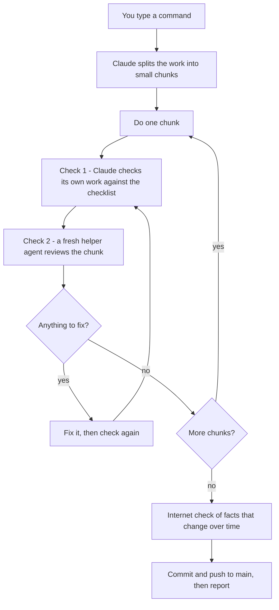

# Skill Guide — How to Use the Repo Skills

This repo has three **Claude Code skills**. They replace the long prompts in `note.txt`: you type one short command, and Claude follows a fixed, step-by-step workflow with checks after every chunk.

| Command | What it does | When to use it |
|---------|--------------|----------------|
| [`/new-lecture`](#1-new-lecture--a-new-transcript) | Transcript → notes + images → deep check → **SDLC update** → online verification → commit to `main` | Every new lecture |
| [`/sdlc-sync`](#2-sdlc-sync--update-the-sdlc-guide-from-a-note) | Note → LumenVenture SDLC guide (rules, diagrams, templates) → online verification → commit | Update the SDLC from a note that already exists (`/new-lecture` runs this for you) |
| [`/repo-audit`](#3-repo-audit--re-check-everything-later) | Re-checks notes, SDLC and guides against **current** best practice; fixes outdated facts | Every few months, or when a standard, law or tool changes |

The skill files live in `.claude/skills/<name>/SKILL.md`. Claude Code finds them automatically when you start it in this repo (on the Mac **and** on Windows, because they are committed to Git).

---

## How every skill works



- **Two checks per chunk.** First Claude checks its own work. Then a **separate helper agent**, which did not write the chunk, reviews it with fresh eyes. Problems are fixed before the next chunk starts.
- **The rules live in files, not in your prompt:**
  - `master-prompt.md` — how notes are written (sections, B1 English, Mermaid rules, the correction rule).
  - `.claude/skills/new-lecture/references/verification-checklists.md` — the checklists used for every check (A: note chunk, B: whole note, C: SDLC chunk, D: internet verification).
  - `.claude/skills/new-lecture/scripts/audit.py` — the automatic checker (links, anchors, Mermaid rules, SVG files, Windows-safe names, correction badges, wrong phrases).
- **Internet verification:** facts that change over time (standard editions, laws and dates, Node.js/npm/Express versions, tool behavior) are checked against **primary sources** (official sites, RFCs, docs). Anything that could not be verified is listed as "not re-checked" — never presented as verified.
- **Everything ends on `main`:** each skill commits and pushes its work, so your Mac and Windows copies stay in sync with `git pull`.

---

## 1. `/new-lecture` — a new transcript

**Type:**

```text
/new-lecture Software Testing
<paste the whole transcript here, in the same message>
```

**What happens (7 phases):**

| Phase | What Claude does | What you see |
|-------|------------------|--------------|
| 0. Set up | `git pull`; reads `master-prompt.md`; finds the course/module folder and the next note number; saves the transcript to `.transcripts/` (local only) | Asks for course/module names **only** if the lecture starts a new module or course |
| 1. Plan | Writes a **fact ledger** (every statement in the transcript, numbered), the list of lecture errors to correct, the modern practices to add, and the facts to check online | A one-line progress update |
| 2. Notes | Writes the note **section by section**; checks each section twice | Progress lines ("chunk 3 of 6") |
| 3. Images | Draws 2–4 SVG diagrams and embeds them | — |
| 4. Deep check | Runs `audit.py`; ticks every fact in the ledger; runs a modern-practice gap check (twice if needed); a helper agent reviews the whole note; commits and pushes the note | The **topic summary** and the list of corrections |
| 5. SDLC | Runs `/sdlc-sync` for this note (see below) | Gap summary, then the SDLC report |
| 6–7. Cross-check and report | Whole-repo audit; makes sure the SDLC does not still teach anything the note corrected | Final report and the next step |

**Good to know:**
- Paste the **full** transcript. Exercises can be left out.
- A big lecture takes a while — that is the deep checking at work.
- The lecture's exact words are kept only in **"Lecture wording (for the quiz)"** lines, so you can still answer course quizzes. Everywhere else the note teaches the **correct** version.

## 2. `/sdlc-sync` — update the SDLC guide from a note

**Type one of:**

```text
/sdlc-sync 08
/sdlc-sync 06 07
/sdlc-sync course-1-introduction-to-software-engineering/module-1-the-software-development-lifecycle/notes/08-software-testing.md
/sdlc-sync
```

(With no argument, Claude picks the newest note that has no SDLC CHANGELOG entry yet, and tells you.)

**What happens:**

1. **Gap analysis** — every practice in the note is searched for in `SDLC/`; Claude shows a short summary of what is new, what must be corrected, and what already exists.
2. **Correction sweep** — anything the note corrected is fixed in the SDLC guide first.
3. **Implementation, file by file** — explanations, **LumenVenture Standard** rules (must / should / may), gate items, **SVG diagrams**, Mermaid flows and **templates or filled examples**; each file is checked twice.
4. **Internet verification, twice** — Claude checks every time-sensitive fact online; then a second helper agent re-checks the riskiest facts independently.
5. **CHANGELOG entry**, README tables updated, audit with 0 problems, commit and push.

> **Why so strict?** The SDLC guide is the implementation guide LumenVenture uses on real client projects. Many people and real money depend on it, so an incorrect or outdated practice must never get in.

Claude asks you only when a decision is really yours — for example a new company-wide default (a notice period, a time limit).

## 3. `/repo-audit` — re-check everything later

Standards, laws and tools change. Run this every few months, or when you hear that something changed (for example a new OWASP Top 10 or a new Node.js LTS line).

**Type one of:**

```text
/repo-audit                 # everything (default)
/repo-audit sdlc            # only the SDLC guide
/repo-audit notes           # only the course notes
/repo-audit guides          # only the top-level *-Laws-*.md and 6-Phases guides
/repo-audit SDLC/04-Testing/Testing.md   # one file
```

**What happens:**

1. **Baseline** — `audit.py` runs on the scope; Claude shows the list of chunks (one file each), overdue SDLC files first.
2. **Per chunk:** fix mechanical problems → bring old notes up to today's master-prompt rules (for example the correction rule) → check every time-sensitive fact online → make the same fact consistent across notes, SDLC and guides → two checks → for SDLC files, update review dates and add a CHANGELOG review entry → commit and push.
3. **Report** — what changed (old → new, with sources), what could not be verified, and the next audit date.

**Known items for the first audit** (found when the checker was created):
- Notes 01–05 have correction badges without the "Lecture wording (for the quiz)" line (written before the rule existed).
- `7-Database-Laws-of-Senior-Backend-Developer.md` uses quotes inside Mermaid edge labels.
- `7-Coding-Laws-of-Senior-Developer.md` uses horizontal Mermaid layouts.

---

## Running the checker yourself

From the repo root:

```bash
python .claude/skills/new-lecture/scripts/audit.py                 # whole repo
python .claude/skills/new-lecture/scripts/audit.py SDLC            # one folder
python .claude/skills/new-lecture/scripts/audit.py <note.md> --leak "ensure error-free"   # find a corrected phrase outside quiz lines
```

It prints each problem and the total, and exits with code 1 if anything is wrong.

---

## Tips

- **Start Claude in the repo root** (`D:\personal\IBM-JavaScript-Backend-Developer` on Windows, the clone folder on the Mac), so the skills and `master-prompt.md` are found.
- **Changing how notes are written?** Edit `master-prompt.md`. **Changing the workflow?** Edit the `SKILL.md` files or the checklists. Commit both, so both computers get the change.
- **Transcripts** are saved in `.transcripts/`, which Git ignores (the course content stays on your machine). If you want them on both computers, copy the folder yourself, or remove `.transcripts/` from `.gitignore` — but only if the repository is private and the course terms allow it.
- **The pre-commit hook** (Windows-safe names) runs from the skills by hand. To run it on every commit you make yourself: `git config core.hooksPath .githooks` (once per clone).
- **Stopping halfway:** if a session ends during a skill, start a new one and say, for example, "continue /new-lecture for note 09 from Phase 5" — the notes and the CHANGELOG show what was already done.
